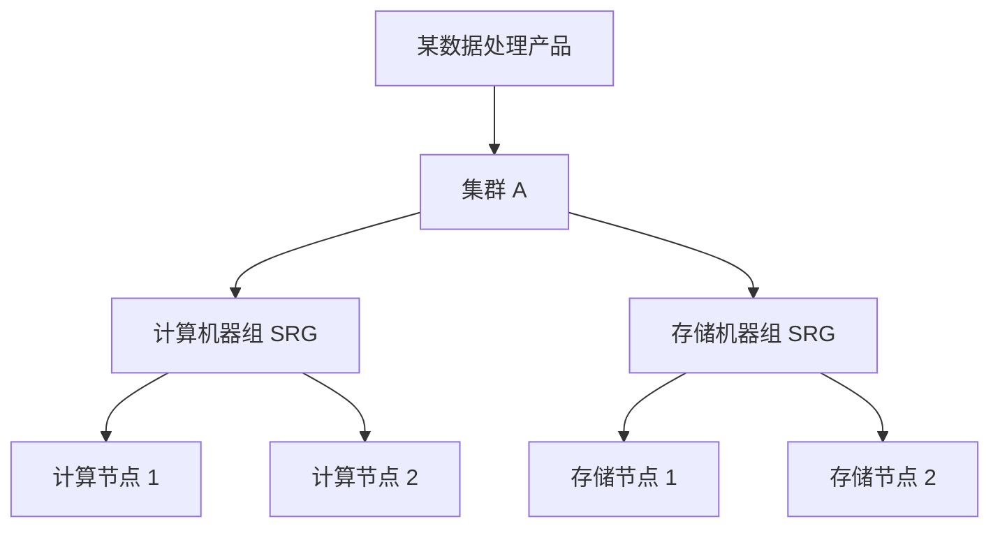
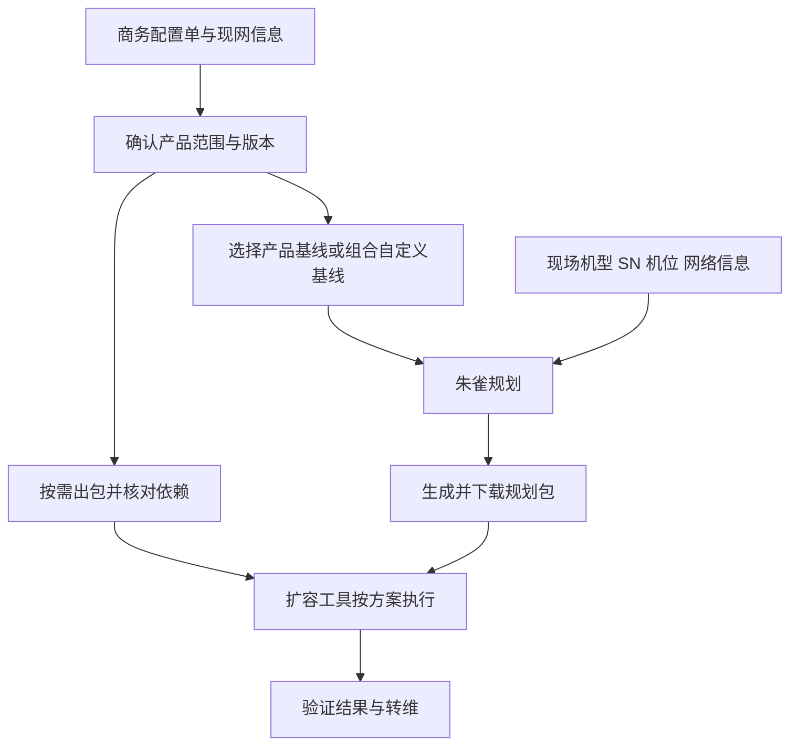

---
{"dg-publish":true,"permalink":"/03_course/2026.10.11 云平台/2026.10.12 扩容交付/","dg-note-properties":{}}
---

# 2026.10.12 扩容交付

## 初学者详解（补充知识）

> [!note] 阅读说明
> 本节围绕本笔记涉及的培训议题补充通用基础知识，帮助理解“是什么、为什么、怎么判断”。其中的示意图、数字和电力信息系统案例均为学习示例，不代表本次会议提出了相应项目、实施方案或决议。涉及阿里云专有平台的产品限制、地址池规则、配置项和操作步骤，仍需以对应版本的正式方案为准。

### 1. 先理解：扩容交付究竟要完成什么

云平台把机房里的服务器、存储和网络资源组织起来，向业务系统提供虚拟机、数据库、存储、网络等能力。电力企业的业务应用运行在这些资源上，信通人员既要关注设备是否正常，也要关注资源是否能够支撑业务。

**扩容**就是增加可供使用的资源或服务能力。例如，原来的计算资源只能承载一定数量的虚拟机，业务增长后需要增加计算节点；存储空间不足时，需要按产品支持的方式增加存储资源。培训还把新增功能、组件和集群纳入扩容交付的讨论范围，所以每次都应先明确具体要增加什么。

**交付**则是将这项需求落实到可使用、可验证、可维护的状态。服务器到货只是其中一环，后面还要完成网络接入、平台登记、软件部署、加入目标集群、结果验证和运维移交。这里的“平台登记”可理解为让平台识别并管理新资源，具体入口依平台而定。

扩容前先找瓶颈：业务“慢”可能由多种原因造成，不能仅凭使用感受就决定加机器。

| 需要判断的资源 | 初学者理解        | 假设的现象与判断方向                      |
| ------- | ------------ | ------------------------------- |
| CPU     | 执行计算任务的能力    | 计算任务排队、CPU 长时间高负载；还需判断是否存在低效程序。 |
| 内存      | 程序运行时暂存数据的空间 | 内存不足、频繁换页；需同时排查程序是否异常占用内存。      |
| 存储容量    | 数据能存放多少      | 空间接近容量规划阈值，增长趋势表明后续容量不足。        |
| 存储性能    | 数据读写的速度和并发能力 | 空间仍够，但读写等待较长；应分析吞吐、时延等指标。       |
| 网络能力    | 数据在节点间传输的能力  | 带宽不足、丢包或端口资源不足；需区分容量问题和网络故障。    |
| 产品功能    | 是否具备某项服务能力   | 缺少某个组件或服务角色，需要部署相应功能及其依赖。       |

容量足够、性能足够、功能齐全是不同的判断。增加资源能否解决问题，要结合实际指标、产品架构和业务增长趋势确认。

### 2. 物理机、虚拟机、容器和云产品有什么关系

| 概念 | 含义 | 与扩容的关系 |
| --- | --- | --- |
| 物理机 | 机柜里真实存在的服务器，具有 CPU、内存、硬盘、网卡等部件。 | 增加物理机，需要检查供电、机柜、布线、硬件兼容性等条件。 |
| 虚拟机（VM） | 通过虚拟化技术在物理资源上运行的独立计算环境，通常有自己的操作系统。 | 增加虚拟机要有底层资源，也要满足网络、镜像及平台部署要求。 |
| 容器 | 将应用及其运行依赖组织成可部署的运行单元；常见容器共享所在主机的操作系统内核。 | 增加容器实例仍会消耗底层资源，且依赖调度、网络、存储等条件。 |
| 云产品 | 平台向使用者提供的一类服务，例如计算、数据库、存储或网络服务。 | 产品可能由多个组件、机器组或集群共同提供，扩容对象需具体定位。 |
| 底座 | 支撑上层产品运行的基础平台能力，本次培训使用的概括性称谓。 | 上层产品可能依赖底座的管理、调度、网络或存储能力，需先核对依赖。 |

一台物理机可以承载多台虚拟机；容器可以运行在物理机或虚拟机上。具体产品也可能要求独占物理机，因此不能仅从“产品叫什么”判断它一定采用哪一种部署方式。

**ECS**通常指 Elastic Compute Service，即云服务器服务，用户使用的是云服务器实例；支撑这些实例的计算集群还包含底层服务器及管理组件。**RDS**通常指 Relational Database Service，即关系型数据库服务，用于提供数据库实例及相关管理能力。扩容平台侧 ECS 计算资源、扩容某一台云服务器的规格，以及扩容某个数据库实例，操作对象和方案都可能不同。

培训提到的“ECS 硬件一致性”“RDS 可支持混部”，应放在本次平台部署和集群扩容的语境中理解，具体条件需核对版本。IaaS 可先理解为提供计算、存储、网络等基础资源的服务层；PaaS 可先理解为在此基础上提供数据库、中间件等平台能力的服务层。

### 3. 产品、集群、SRG、服务角色：四个容易混淆的层次

**产品**回答“提供什么能力”，例如计算或数据库。**集群**回答“哪一组节点和组件协同提供这项服务”。同一个产品可能部署多个集群，具体是否支持要看产品架构。

**服务角色（Server Role）**表示节点承担什么工作，例如计算、存储或管理。**SRG（Server Role Group）**是本次培训使用的机器组概念，用于组织承担相应服务角色的节点。初学时可以把它理解为集群中的一个工作小组；具体组内角色及共同组件的组合，要看产品设计，不宜理解成所有 SRG 都只运行一个服务。

下面以某个假设的数据处理产品为例，展示逻辑关系，图中的名称不是正式产品角色名称：

如果计算任务排队，且确认原因是计算能力不足，就需要研究增加计算机器组的资源；仅向存储机器组加入节点，未必能够解决计算瓶颈。反过来，存储空间不足也不能仅靠增加计算节点解决。这就是讲师强调“规划到正确 SRG”的原因。

需求通常定位到产品和目标集群，实施还要继续明确目标 SRG、服务角色及节点。原文对“颗粒度”有不同层次的口述，实际工具中能够操作到哪一层，应以具体方案为准。

机器组分开部署，只表示它们有各自的节点和职责。计算组仍可能依赖存储组，管理组件也可能影响整个集群；判断故障影响时，应查看组件依赖，而不能仅看组名是否不同。

### 4. 同构、异构混部、新增 SRG、新增集群怎么区分

先分清两个维度：**硬件是否相同**，以及**业务功能是否相同**。新增机器组既可能是为了区分不同机型，也可能是为了增加新功能，不能单凭“新增 SRG”就确定原因。

| 情形 | 假设的变化 | 需要回答的问题 |
| --- | --- | --- |
| 同构扩容 | 某机器组已有 A 型服务器，再加入满足一致性要求的 A 型服务器。 | 型号、部件、软件等是否都符合该产品要求？ |
| 异构混部 | A 型服务器所在机器组加入 B 型服务器，承担同类工作。 | 产品是否允许组内混部？是否完成兼容性和稳定性验证？ |
| 按机型拆分或新增 SRG | A、B 型服务器分在不同组，可能承担相同功能。 | 产品是否支持这种分组？命名、资源配置和调度如何安排？ |
| 新增功能 SRG | 已有计算、存储组，再部署产品支持的其他功能组。 | 新角色依赖哪些组件？部署后如何与已有组协同？ |
| 新增集群 | 保留已有集群，另外部署一个集群。 | 是否支持多集群？资源如何接入、使用和管理？ |
| 新增产品 | 平台原先没有这类服务，部署一套产品。 | 底座、网络、依赖组件及版本是否满足要求？ |

**同构的一致性由产品方案定义。** 核对时可能涉及 CPU 架构及型号、内存、磁盘类型与数量、网卡、驱动、固件、操作系统等。即使整机名称相同，内部配置也可能有差异；哪些必须一致、哪些可以不同，应查兼容性要求。

异构需要验证，是因为新硬件可能带来驱动适配、资源识别、性能差异或运行稳定性问题。例如，同一任务分散到多个节点运行，较慢节点可能影响整体完成时间。这只是通用原因说明，不能据此判定某一机型不兼容。

判断扩容路径时，可以按顺序问：目标产品和集群是否存在？目标服务角色和 SRG 是否存在？新硬件是否满足一致性要求？若不满足，产品是否支持混部、按机型分组或多集群？依赖及版本是否满足？得到这些答案后，再选择对应方案。

新增集群还可能需要解决资源调度、访问入口或业务使用方式的问题；部署出一个集群，并不意味着原有业务会自动使用它。

### 5. 把交付流程拆开：每个阶段在解决什么问题

培训中的流程包含商务协调、现场准备、技术实施和运维移交。下面的工作与产出是帮助理解的通用示例，实际材料名称、分工和审批链以项目要求为准。

| 阶段 | 要解决的问题 | 常见工作与产出示例 |
| --- | --- | --- |
| 需求确认、售前 | 为什么扩容，增加多少，范围到哪里？ | 明确业务需求、现状、目标产品和容量规划。 |
| 开工会 | 哪些人参与，怎样协作？ | 确认范围、沟通接口、工作安排及前置事项。 |
| 工勘 | 现场条件是否满足？ | 核查机柜空间、供电、布线、交换机接口等，记录需整改事项。 |
| 项目交底 | 实施团队是否准确理解方案？ | 交接现网情况、产品范围、工期、约束及待解决问题。 |
| 采购、到货、上架 | 设备是否齐备并正确接入？ | 核对型号和数量，完成上架、供电、布线及标识。 |
| 环境摸底、规划 | 新资源具体放在哪里、叫什么、怎样管理？ | 明确目标集群、SRG、主机名、地址、网络连接和部署参数。 |
| 方案确认、变更审批 | 方案是否适用，何时可以实施？ | 核对版本和场景，评估业务影响，明确验证及异常处理安排。 |
| 扩容实施、验证 | 新资源是否真正可用？ | 按方案完成网络及产品扩容，检查资源、服务和业务状态。 |
| 转维 | 后续运维是否掌握变化？ | 移交实际配置、实施记录、验证结果及遗留事项。 |

**工勘**偏重现场条件调查，**摸底**偏重对现网资源和配置的确认，**规划**则是在这些信息基础上决定如何部署。三者可以互相补充。比如现场还有机柜空间，并不能说明地址池、交换机接口和平台版本都已满足条件。

**交底**是把已掌握的信息交给后续执行者。例如，售前确定了扩容目标，现场人员掌握布线条件，技术支持掌握产品限制，交付人员需要把这些条件一起纳入实施方案。项目经理侧重组织协调；原文中的 SA 参与售前方案交底，CIE 参与交付技术支持及研发对接，具体岗位全称和职责边界需结合项目确认。IDC 通常指互联网数据中心，在这里可理解为设备所在机房及其相关管理方。

### 6. 为什么要先扩网络，再扩平台产品

新增节点需要通过网络接受管理、与集群成员通信，并按产品要求提供服务。服务器通电后，如果缺少地址、接入网络或可达路径，平台软件仍可能无法正常部署或运行。因此，培训强调先满足网络前置条件。

| 网络概念 | 初学者理解 | 扩容时关注什么 |
| --- | --- | --- |
| 交换机、端口 | 将服务器及其他设备连接起来的网络设备和接口。 | 端口数量、速率、布线及配置是否满足接入要求。 |
| 网卡 | 服务器连接网络的硬件接口。 | 型号、驱动、接口数量及所连接网络是否符合方案。 |
| VLAN | 在二层网络中划分逻辑广播域的一种方式。 | 目标端口是否具备产品需要的 VLAN 等配置。 |
| IP 地址池 | 按平台规划保留、分配的一组地址。 | 是否有足够可用地址，范围、用途是否正确，是否存在冲突。 |
| 路由与宣告 | 路由决定数据往哪里转发；宣告用于让相关网络设备获知某些地址的可达信息。 | 新增网络和服务地址能否按架构被访问；具体宣告机制需查方案。 |
| 容器网络 | 为容器提供连接及通信能力的网络。 | 所需网络是否存在，新节点接入后是否具备相应配置。 |
| VPC | Virtual Private Cloud，虚拟专有网络，用于组织逻辑隔离的网络环境。 | 相应网络组件、地址资源及接入条件是否满足。 |
| DNS | 将名称解析为地址等信息的服务。 | 相关名称是否能够按设计解析和访问。 |
| SLB | Server Load Balancer，负载均衡服务，将访问流量按规则分配到后端。 | 相关接入、后端和健康检查条件是否满足产品方案。 |
| Open vSwitch | 常见的软件虚拟交换机，可参与主机上的虚拟网络转发。 | 对应产品是否依赖它，以及新节点和网络配置是否满足要求。 |

本次记录中的 ASW、DSW、LSW、BSW 是具体平台架构中的交换机称谓。初学者先理解它们在相应架构中的接入职责，再结合拓扑图识别设备；转录不足以准确补齐所有缩写全称及层级关系。

**VPC 反向地址池**是本次培训提到的具体平台配置。原文没有完整说明其访问原理，当前只能确认：部分产品的服务角色会依赖它，且地址数量、申请和宣告有相应要求。实际规划应查正式地址需求表，不能假定“一台服务器只需一个地址”。同一节点可能涉及管理、业务、存储、容器等不同网络，具体地址需求取决于架构。

举例：新增节点所需的接口、地址和网络配置已具备，可按方案直接进入产品扩容；如果目标交换机未承载所需网络，或地址资源不足，就要先完成相应网络配置或扩容，再部署产品。“先扩网络”应理解为先补齐实际缺少的条件。

### 7. TLOG 主机名、云盾开关和版本依赖为什么也要检查

**主机名**是识别节点的名称，有些部署工具或产品规则会使用它进行排序、校验或配置生成，因此命名可能影响部署。这里列举的是通用用途，转录没有说明 TLOG 限制的内部实现原因。

**字典序**可以先理解为按名称中的字符顺序进行比较。例如，`node-a` 在 `node-b` 之前。主机名的“看起来编号更大”与具体规则比较出的顺序未必一致，实际应使用规定的命名规则及检查方法。本次 TLOG 前后口述有矛盾，不能仅凭学习示例直接给生产节点命名。

**配置启用项**用于告诉平台哪些功能需要部署或启用。云盾包含多个产品，新增其中一项时，除了部署相应服务，还可能需要让平台配置识别这个变化。转录中的 `non`、`true` 没有给出完整字段路径和配置结构，应核对正式方案后再理解其具体含义。

**依赖**表示某个组件运行前需要另一项能力已经具备；**版本依赖**进一步要求该能力达到兼容版本。可以用假设的组件 A、B 理解：A 依赖 B，B 尚未部署时先部署 B；B 已部署但版本不满足时，需评估升级。升级本身也可能影响现网，应纳入相应方案和变更范围。原文中 DRDS/RDS 的举例识别不完整，不据此补成确定的依赖关系。

因此，扩容准备至少涉及硬件、网络、软件依赖、版本、命名和配置多个方面。设备到货解决的是硬件准备的一部分。

### 8. 为什么扩容需要方案、工单、审批和授权

扩容会改变现网状态，可能涉及集群成员、网络配置、资源调度或数据分布。生产业务持续运行时，即使目标是增加资源，也需要了解实施过程是否会影响现有服务。在电力信息通信业务中，还应关注承载的应用及其上下游关系，将实际影响范围纳入本单位变更管理要求。

| 管理手段 | 解决什么问题 | 初学者应分清的边界 |
| --- | --- | --- |
| 扩容方案 | 明确操作对象、前置条件、步骤、验证和异常处理方式。 | 要核对产品、版本、机型、网络及扩容类型，不能只看标题相似。 |
| 工单 | 留下需求或问题记录，并交给相应人员处理。 | 获取方案的工单、问题求助工单与变更审批各有用途，不能相互代替。 |
| 变更审批 | 确认实施范围、业务影响和实施安排得到相应审批。 | 操作步骤正确，还需满足客户侧审批和实施条件。 |
| 操作授权 | 允许执行者在规定范围内使用所需账号或权限。 | root 权限是高权限操作能力，具体任务仍需按获批范围执行。 |
| 实施记录 | 保存做了什么、结果怎样、遇到什么问题。 | 便于追溯、排障和转维，应据实记录。 |

**标准方案**适用于明确的产品版本和场景。如果机型、网络接入方式、部署形态或需求超出其支持范围，就需确认是否另有方案。培训提到由 CIE 对接研发处理非标准需求，并在审批中加签方案提供者，目的是让相应技术人员参与确认。

**变更窗口**是安排实施的时间范围。需考虑业务使用时段、可能影响及异常处理时间，具体时间由实际项目确认。**回退或回滚**是实施异常时恢复可接受状态的处理安排，但扩容不同阶段的恢复条件可能不同：新节点尚未承载业务，与已经发生数据迁移或写入时，处理方式可能差异很大。应在方案中明确可回退阶段、触发条件和处理步骤，不能假定任何时候都能简单删除新节点。

本次转录中的“重聚授权”和授权终端名称待核实，当前仅按其已表达的“申请授权、获取授权码、按范围提权”理解流程，不补写具体入口或命令。

### 9. 怎样确认扩容完成，以及怎样理解容灾

下面是通用的验证思路，帮助理解交付结果；具体检查项、观察时长和合格阈值应使用产品方案及项目要求。

| 验证层次 | 需要回答的问题 |
| --- | --- |
| 设备与网络 | 新设备、接口和链路状态是否正常？地址和网络可达性是否满足设计？ |
| 平台资源 | 节点是否被正确管理？是否加入了目标集群、SRG 和服务角色？ |
| 服务状态 | 必要组件是否正常，是否出现新增异常或持续告警？ |
| 容量与性能 | 新资源是否被识别并可用？是否改善了本次确认的资源瓶颈？ |
| 业务使用 | 业务是否按预期访问和使用新增能力？原有业务是否正常？ |
| 运维接管 | 台账、监视、告警及交接资料是否反映本次变化？遗留问题是否明确？ |

节点数量增加，并不意味着业务立刻获得同比例性能提升。平台可能需要完成资源登记、数据分布调整或调度配置；业务也可能受其他瓶颈限制，实际收益需验证。

**转维**是把交付后的系统状态和维护所需信息移交给运维人员。常见资料可以包括实际节点清单、地址及网络连接、集群和机器组归属、配置变更、验证结果、异常处理记录和遗留事项。这些是通用资料示例，本次转录没有完整列出必交材料清单。

**扩容**关注增加可用资源；**高可用**关注局部故障时如何继续提供服务；**容灾**关注较大故障影响下如何恢复业务。几者相关，但应分别检查。例如，其他机器组即使有空闲资源，也可能缺少所需服务角色、数据访问条件或接管机制，不能据此认定能够接替故障机器组。判断故障切换还需看剩余容量是否足够、数据是否可用、相关机制是否启用，以及产品是否支持。

转录中提到的 ECS 故障实例迁移，应结合相应产品能力和触发条件理解，不宜推成“所有机器组故障后，服务都会自动迁到其他组”。集群内接管与跨机房容灾也应分别确认。

### 10. 用一个电力信息系统的假设案例串起全流程

**案例前提（仅用于学习）**：某电力企业的信息资产管理应用使用云平台上的一项分布式存储服务。通过容量监测和增长分析，已确认当前存储容量不足，拟向目标存储机器组增加两个节点。假设已有六个节点，新设备与原设备满足该产品的同构要求，产品支持这种扩容方式。

1. **明确需求**：说明是存储容量不足，并确认扩容的是哪个产品、哪个集群、哪个存储机器组。两个节点只是本例的假设，实际数量需依据容量规划和产品要求测算。
2. **工勘与摸底**：检查机柜、供电、布线及接入接口；核对原节点的硬件、软件版本、机器组归属和网络配置。发现缺少条件时，先列出需补齐事项。
3. **选择扩容类型**：本例为已有 SRG 同构扩容。如果到货设备与要求不同，就需重新确认异构支持情况，不能直接沿用同构方案。
4. **完成资源规划**：按方案确定主机名、地址、网络连接、目标机器组及部署参数。如果产品有特定命名或地址池要求，逐项检查。
5. **补齐网络条件**：现有接口和地址等资源满足要求时进入后续步骤；不足时先实施相应网络扩容或配置变更，并验证新节点的必要网络可达性。
6. **确认方案和实施安排**：获取与版本及场景匹配的方案，评估对存储服务及业务应用的影响，完成客户侧变更审批、操作授权和异常处理准备。
7. **按方案加入节点**：完成规定的设备准备、平台登记和服务部署，将节点加入目标存储机器组；涉及数据调整时，按产品流程执行。
8. **分层验证**：确认节点状态、可用容量、数据及业务访问、读写情况和告警状态。机器组从六个节点变为八个节点，但可用容量增长还受单节点规格、副本或纠删码策略、预留空间等因素影响。
9. **转维交接**：更新实际资源和配置记录，移交实施与验证结果，说明遗留问题及后续监视事项。

本例中，新增节点要成为业务能够使用的存储能力，依次需要满足硬件适配、网络接入、平台管理、服务部署、结果验证和运维接管条件。阅读正式扩容方案时，可围绕这些条件逐项确认自己是否理解了操作目的。

### 11. 商务配置单：把业务需求转成可以规划的对象

新增转录先讲商务配置单，再讲出包和规划。它体现了一个顺序：先明确“为哪个环境、哪些产品、增加什么资源”，后面的工具才有正确输入。比如客户说“计算资源不够”，SA 需要进一步把需求落实到具体 ECS 集群、部署形态、机型及数量。

**商务配置单**可理解为需求与交付规划之间的结构化清单，**交付视图**是面向实施人员呈现相关信息的视图。培训强调配置单要已下发并完成交付所需的**打标**；此处打标可先理解为系统要求的一项标记处理，其字段和后台含义仍需核对。进入清单后要确认云实例 ID 对应当前环境，避免拿错另一个环境的单据。这里的云实例 ID 是该流程用来识别环境的标识，不应未经核对就当成某台 ECS 虚拟机的实例 ID。

| 要核对的信息 | 为什么要看 |
| --- | --- |
| 环境标识、交付视图和打标状态 | 确认单据属于本次环境，且具备交付规划的前置条件。 |
| 产品、集群、服务角色、SRG | 确认资源增加到正确的对象。 |
| 已有与新增、继承数量与本次数量 | 区分现网已有资源和这次要加入的资源。 |
| 部署形态、机型或套餐号 | 判断物理机、VM、容器等需求，以及是否存在异构。 |
| ECS 的共享或独享模式 | 与 SA 确认 `share` / `exclusive` 等配置的实际含义，避免填错模式。 |
| 网络扩容范围和现场设备 | 确认本次是否增加网络设备，以及实际厂家、型号是否与原规划一致。 |

“继承”表示从现网带入已有配置或数量，并不表示再采购同样数量。学习示例：原组已有六台，本次加入三台，在无其他变化时扩容后是九台；新组原先不存在，继承数量可以是零，但本次新增数量可以大于零。界面中的“预期数量”“实际数量”“计算数量”如何统计，仍要结合字段定义，不能把所有数量列都简单相加。

配置单、现场设备和批准范围有差异时，应与 SA 及相关人员确认并更新规划。设备以现场真实型号记录，同时还要核实其兼容性；现场多到货两台，也要确认是否纳入本次用途和实施范围，再决定填写数量。

**非标机型或异构适配**可能涉及研发确认、机型录入和装机模板参数。转录称“飞票／飞标”，正式流程名称待核实。关键是先取得适配结论和必要参数；模板缺项时向对应接口人确认，不能按相似机型自行补值。

### 12. 出包、基线、规划包：三个不同用途的东西

| 名称 | 初学者理解 | 回答的问题 |
| --- | --- | --- |
| 软件包、增量出包 | 按目标环境、产品版本和依赖组织出的部署或升级软件材料。 | 这次要安装、部署或升级哪些软件？ |
| 产品基线 | 在本次流程中，用于标识和引用相应产品版本及其软件材料的信息。 | 每个产品使用哪一版？ |
| 自定义基线 | 将本次涉及的多个产品版本组合成供规划引用的一份基线。 | 多产品交付如何统一引用已确认的版本组合？ |
| 规划包 | 朱雀规划完成后输出的数据包，供扩容工具读取。 | 哪些机器、以什么配置加入哪个集群和机器组？ |

可以把软件包理解为“要用的软件材料”，基线理解为“材料版本清单”，规划包理解为“部署对象和参数安排”。几者会相互关联，但作用不同：下载软件包不会自动完成现场规划；组合自定义基线也不会自动把现网产品升级。

转录中的基线信息涉及 `system ID`、`commit ID`、产品名称和产品包等。通用意义上，commit ID 标识某次代码或构建来源，版本标签用于标识一个发布版本，系统版本则可能组合多个产品版本；本平台字段关系需核对文档。判断版本一致性时应核验明确的标识，不能只看自定义名称相似。

图中是材料之间的关系示意。出包、基线组合和现场准备的具体先后及是否需要执行，依本次场景和方案确定。

### 13. 增量出包：为什么要上传现状、分析依赖和选择架构

本次转录中的 CI/CD 是内部出包平台。CI/CD 通常指持续集成与持续交付或部署；此处先关注它提供的版本选择、依赖分析、组包和下载流程，无需先学习软件开发流水线。

培训描述的增量出包过程是：填写环境和用途，上传现场状态材料，选择目标产品与版本，检查依赖，生成软件包，等待通知并按要求申请下载。上传现状是为了让系统知道当前已经部署哪些版本，从而分析本次目标与现状的差异及相关依赖。现场状态材料的正式名称、格式和获取入口待核实。

**强依赖**可理解为目标版本正常部署、运行必须具备的条件；若现状不满足，要把相应依赖部署或升级纳入方案。讲师强调强依赖不能遗漏，但这不意味着每次所有强依赖组件都必须重复升级：应先确认当前版本是否已经满足，以及出包系统为何列出该项。条件暂时无法满足时，应协调方案和变更安排。

**弱依赖**表示依赖分析中非强制的一类关系，是否升级需看功能需求、兼容性和方案。勾选“仅选择强依赖”可以帮助筛选必需项，但仍要人工确认产品范围和结果。

讲师将“集测版本”解释为经过集成测试的版本。它是选版的重要依据，但还要匹配当前环境和产品兼容要求；“最新”不能独立作为选版理由。

**CPU 架构**如 x86、ARM，会影响软件包是否能在目标服务器运行。学习时可以先理解为软件材料要与目标硬件类型匹配。转录中“W八六”等疑似架构误识别已保留并标注待核实，不能据此填写选项。同样，“三幺八六”等版本示例要核对现网，不能直接当成本环境默认版本。

### 14. 自定义基线：多产品扩容为什么需要组合版本

假设本次同时涉及三个产品，现网的产品甲是版本 A、产品乙是版本 B，新部署的产品丙应使用已确认的版本 C。自定义基线把这三个选择组合起来，供规划系统统一引用。A、B、C 只是学习用的版本代号，不是生产环境版本。

培训说明，单产品场景可直接使用对应产品基线；多产品且包含新增产品时，建议组合自定义基线。它的目的在于准确覆盖本次产品和版本，不能把所有产品统一替换成一个最新版本号。

| 场景 | 本次讲解中的版本判断方向 |
| --- | --- |
| 向已部署集群加入节点 | 核对现网版本，按相应扩容方案保持一致；升级应另行明确。 |
| 已部署产品新增另一个集群 | 先检查产品级版本约束。讲师后续以 ECS 等举例强调应与已部署产品保持一致，不能默认新集群就能选最新版本。 |
| 平台尚未部署的产品 | 根据依赖、兼容要求选择目标版本；培训提到最新集测版本或修复版本，具体选择需核实。 |
| 多产品组合 | 分别取得每个产品的版本或构建标识，组合后逐项核验。 |

新增转录在“新增集群是否考虑线上版本”处有前后不一致的口述，后续反复强调已部署产品的版本一致性。学习时应先分清“新增节点”“已部署产品新增集群”“新增产品”，再向产品接口人确认规则。

讲师演示了从运维平台进入目标集群详情、动态配置，查找对应产品版本标签的方法。应确认选中的是目标环境、目标产品和目标集群；`no rolling`、tag 等精确配置路径待核实，不能仅看列表中名称相近就选定。

自定义基线可通过朱雀或 CI/CD 相关流程制作、导入或同步。组合后要核对各产品及其版本标识，再确认规划引用的是正确基线。讲师还提示材料可能被定期清理；需要按项目要求留存版本标识和实际交付材料，具体清理范围与周期待核实。

### 15. 朱雀规划：把逻辑需求映射到真实设备

朱雀在本次培训中是交付规划系统，用于把产品范围、版本、数量、现场设备及网络信息组织成规划结果。以下按工作目的归纳，界面步骤编号、PaaS/IaaS 分支及字段名称应结合实际版本确认。

| 规划环节 | 输入和动作 | 为什么需要人工核对 |
| --- | --- | --- |
| 选择基线和组件 | 引用确认后的基线，按商务配置单选择本次产品、组件。 | 未选择的产品可能不会在后续步骤出现；错误选项会改变规划范围。 |
| 规划集群和 SRG | 核对继承的现网信息，填本次数量、机型，按方案拆分 SRG 或新增集群。 | 需要确认分组原因、产品归属和部署形态，不能机械点击“拆分”。 |
| 填写商务配置 | 对相应产品填写 CPU 型号、共享或独享模式等。 | 工具可以检查必填，但不能代替 SA 对需求的确认。 |
| 规划网络扩容 | 按实际范围设置开关，登记新增交换机组、厂家及型号。 | 数量单位可能是“组”；组内设备数量要按拓扑确认。 |
| 机房勘察 | 记录机柜、可用位置、接入交换机组等。 | 现场接线关系必须与表中记录一致。 |
| 网络和服务器上架表 | 填实际 SN、型号、机位、用途及相应连接信息。 | 防止把某产品的机器规划进另一个产品。 |
| VM 调度与地址分配 | 按流程调度虚拟资源，为所需网络分配地址。 | 自动结果仍需检查归属、数量、资源和地址可用性。 |
| 同步、生成及输出 | 保存、同步相关规划结果，完成预览并下载规划包。 | 确认各侧信息一致，导出的材料是本次完成的版本。 |

**共享与独享**在此是商务配置里的资源使用模式，不应仅按字面就认定是公网多租户或完全独占整台服务器；实际共享范围、调度限制和计费语义需向 SA 确认。

**拆分 SRG 与新增集群**作用层次不同。培训示例中，一些产品可因机型变化拆分机器组，ECS 的相应场景则添加集群；这些是具体产品规则。点击位置或界面自动校验只是工具机制，仍需先判断业务对象和方案是否正确。

### 16. SN、机位、产品用途和 IP：怎样保证“用对机器”

**SN（序列号）**用于识别具体设备，**机位**用于记录它在机柜中的物理位置，**主机名**用于系统内命名，**IP**用于相应网络上的通信。它们分别说明“是哪台、在哪里、叫什么、怎样访问”，需要在规划中正确关联。主机可能有多个网络地址，不能把 IP 与 SN 理解成天然一一对应且永不变化。

学习示例：原规划把机位甲的服务器用于 ECS，机位乙的服务器用于存储产品，但上架时两台设备的位置对调了。此时要先核对设备标签、SN、机型、接线和实际用途，再协调更新相关规划或纠正上架。仅交换表中的产品名字，可能使硬件、接线与用途仍然不匹配。讲师提到的表格调整方法需结合实际场景确认。

培训要求对导出的上架表补充 SN，并检查机型和产品用途后再导入；工勘人员可提供基础表，交付人员仍需核对现场差异。工具自动生成结果依赖输入准确性，输入中的用途错了，后续自动化就可能继续使用错误关联。

讲师口述“一个机柜只能接一组交换机、一组交换机可以接多个机柜”，应理解为当时拓扑和规划规则，具体表述待核实，不是所有数据中心通用的连接限制。

地址分配后，应按流程维护节点与地址的关联。后续改地址可能涉及网络配置、主机配置和服务注册等多处变更，需按方案处理。原文“IP 定死不能修改”是对当时流程的口述强调，不宜解释为技术上永远不可更改。

对地址校验提示，要先确认字段用途、必填条件及该项是否参与本次分配。确定不适用后才按工具支持的方式排除；必需项格式错误或地址缺失时，应查明并处理。新增转录中的“忽略提示”缺少具体字段上下文，不能作为统一操作方法。

### 17. PaaS 与 IaaS 两侧规划为什么要同步

培训里的“pass 侧”“二次侧”等口述多数指向 PaaS/IaaS 两侧，但部分平台形态和侧别对应仍需课件核实。IaaS 侧关注基础资源，PaaS 侧关注上层平台产品；某个 PaaS 服务的节点可能由 IaaS 侧资源承载，因此要正确关联。

在讲师演示的流程中，两侧先分别选择相应基线、产品和数量，再通过后续步骤带入或同步 SN、IP 等信息。同步的目的，是让上层服务规划与实际基础资源指向同一对象，而非在两侧分别随意填一套设备和地址。

学习示例：PaaS 侧规划数据库服务运行在某节点，IaaS 侧记录了该节点对应的实际设备、虚拟资源和网络地址；若同步前用途或 SN 填错，上层规划也可能得到错误关联。因此应在关键输入确认后检查同步结果，再生成输出材料。

规划包是后续扩容工具的重要输入，应按实际场景取得所需材料。新增转录还提到 PaaS 侧“精灵文件”，文件正式名称、是否必需及适用方式待核实，不将它当作所有扩容场景共用的文件。

### 18. ASI 与 ASO：工具做什么，使用前确认什么

讲师把扩容工具的工作归纳为扩容准备、装机、产品扩容和检查。**装机**主要是安装、配置相应系统环境，**产品扩容**则是将新节点及其服务纳入目标产品的流程。系统装好与产品已经可用是不同的状态。

自动化工具可以读取规划数据，按适配流程组织批量操作和校验，减少手工重复工作。但错误的环境、基线、SN、数量或用途也可能被批量传递，因此输入核对和执行后的验证同样重要。

| 使用前确认项 | 本次讲解及补充理解 |
| --- | --- |
| 环境版本和工具支持范围 | 培训介绍旧 ASI 和新 ASO；具体替换边界口述反复更正，应查对应版本方案。 |
| 产品支持名单 | ASO 存在支持范围或扩容白名单，确认本次产品及场景是否被支持。 |
| 软件包、规划包和依赖 | 确认材料对应本环境及本次规划；ASO 演示涉及出包和依赖检测。 |
| 部署位置及访问入口 | 按方案确认运维节点、启动状态和实际访问地址，不套用示例地址。 |
| 账号和页面会话 | 讲师提醒切换账号可能造成页面权限问题；需确认工具会话机制及获批账号使用方式。 |
| 扩容功能入口 | 按讲师要求进入扩容流程，确认未进入与本次任务无关的交互功能。 |

旧 ASI 示例提到端口 `8848`，端口可理解为主机上服务的网络访问入口编号。服务访问异常时，进程、端口监听和日志可从不同角度帮助确认状态；只看到进程存在，还不能证明服务已正常监听或可用。转录中的命令口述不完整，本笔记不补成直接执行的部署命令。

ASO 示例描述安装结束输出一个访问域名，实际地址及安装方式应从对应环境和方案取得。“使用最新工具”也需同时满足环境和产品兼容要求。

多人访问时，讲师建议保持同一账号以避免页面权限问题；该说法保留在转录中并标注适用方式待核实。补充理解是确认谁执行、谁观察、工具是否支持多用户并发，以及如何保留操作记录，再按本单位账号授权要求安排，不从演示推导出生产环境必须共享个人账号。

至此，阅读本节新增流程时，可以依次检查：配置单是否正确并打标、版本与依赖是否确认、实际设备和数量是否核对、规划是否完整并同步、工具是否支持、执行和验证安排是否明确。

## 会议纪要

### 会议基本信息

- **会议主题**：云平台扩容交付流程与实施规范培训。
- **会议时间**：2026.10.12
- **参会情况**：讲师及培训学员；姓名、正式名单与地点未明确。
- **培训安排**：首日以理论讲解为主，后续安排扩容工具及产品扩容实操，最后一天讲解网络部分；受内部实验环境和学员人数限制，可能仅部分学员能够上手操作。
- **整理说明**：本纪要依据下方两部分转录提炼，属于培训内容记录。产品约束按讲师口述归纳，具体实施仍需核对对应产品、版本及扩容方案；原文未明确分派个人任务或完成期限。

### 一、扩容交付总体流程

1. **前期准备**：从售前、开工会、工勘及硬件信息收集开始，协调采购、设备厂家与 IDC，确认实施条件。
2. **项目交底**：项目经理组织售前 SA、CIE 等人员，交底工期、部署范围和涉及产品。
3. **设备准备与入场**：完成服务器上架、布线及 IDC 检查后，交付团队开展环境摸底、规划和扩容实施。
4. **实施顺序**：涉及网络扩容时，先完成网络扩容，再扩容平台侧产品；无网络扩容需求时，直接进入产品扩容。
5. **交付收尾**：实施完成后进行转维，召开转维会议并提交相应材料。

### 二、扩容对象与类型

- 扩容涉及底座、计算、数据库、存储、网络、大数据及安全等产品，各产品的部署方式和依赖不同，可能部署在物理机、虚拟机或容器中。
- **集群与机器组**：讲解将新增产品、集群扩容定位到具体集群；集群内可包含一个或多个 SRG（Server Role Group，机器组）。不同 SRG 可承担计算、存储等不同功能，规划时必须选对目标机器组。
- **网络扩容**：包括 IP 地址池、ASW、DSW 等交换机扩容；板卡扩容处出现 DSW、BSW 两种称谓，具体设备待核实。
- **产品扩容**：区分已有集群扩容、新增功能或组件，以及新增集群。已有集群扩容还需区分同构、异构混部和新增 SRG 等情况。

| 扩容情形 | 讲解要点 |
| --- | --- |
| 已有 SRG 同构扩容 | 向现有机器组加入同类服务器，满足相应硬件一致性要求。 |
| 已有 SRG 异构混部 | 向同一机器组加入不同机型，须确认产品支持并完成内部适配、测试。 |
| 异构拆分或新增 SRG | 通过拆分、命名或新增机器组区分不同机型；承担的功能可以相同，具体方式依产品方案确定。 |
| 新增功能 SRG | 为集群增加原先没有的功能，与单纯因机型不同而拆分机器组有所区别。 |
| 新增集群或未部署产品 | 核对产品的多集群支持能力、依赖组件及版本；缺少依赖时先部署，依赖版本不足时先升级。 |

### 三、产品约束与实施注意事项

- **硬件适配**：同一机器组通常要求硬件一致。异构扩容不能直接套用同构方案，应完成评估及适配测试，以保证集群稳定性。
- **网络接入**：普通产品通常接入 ASW；DNS、SLB、VPC 等特殊网络产品还涉及 LSW 接入及额外布线。需核对目标交换机下的容器网络、VLAN 等条件，不满足时先扩容相关网络。
- **地址池依赖**：部分产品的服务角色依赖 VPC 反向地址池，应核实所需地址数量、申请及宣告要求；转录未给出可直接使用的数量表。
- **TLOG 主机名**：讲师后续反复强调，新增主机名需按字典序排在线上主机名之后，否则可能部署失败；前段例子与此存在矛盾，正式规则应结合课件或方案核实。
- **云盾配置**：云盾包含多个产品，新增其中的产品时，需要按方案修改集群配置中的相应启用项；原文配置字段和值识别不清，不能直接用于操作。
- **ECS 与 RDS**：按本次讲解，ECS 强调硬件一致性，不能直接通过新增 SRG 处理异构，需考虑集群拆分；RDS 可支持混部。具体支持范围需结合实际版本与方案确认。
- **机器组依赖与容灾**：不同机器组可能存在组件依赖，新增机器组不等于其他机器组能够承接其故障业务。问答未形成完整的集群内容灾说明，需要针对实际产品进一步确认。

### 四、扩容方案获取与变更管理

- 扩容属于可能影响客户业务的变更，应依据标准方案和审批流程实施。
- 讲师说明，原 KB 库方案正在迁移至 EOCC，后续可在 EOCC 搜索；客户侧也可通过项目对应群内的工单服务获取方案。转录未提供可核验的平台链接。
- 对没有标准方案的特殊需求，由 CIE 对接研发评估实施方式；非标准方案在变更审批时需加签提供方案的研发人员。
- 新旧交换机下的扩容方案可能不同，需选择与实际场景匹配的方案，不能混用。
- 变更提前申请时间与执行流程，应依据客户侧实际要求落实；原文未记录明确的提前天数。
- 受控环境中需按版本、root 权限需求等申请授权，使用授权码进行相应范围内的提权；授权机制及终端名称待核实。

### 五、项目管理与实施前检查事项

以下为培训中提出的实施要求，并非本次会议分派的具体任务；负责人、完成期限均未明确。

- **项目记录**：在飞天服务平台创建项目，录入 Cloud ID、授权分配等信息并走审批；记录工勘、整改、入场变更、交付问题和转维情况。
- **日报填写**：据实选择当天参与人员、项目阶段并填写工作内容。
- **问题工单**：遇到无法处理的问题，通过对应群内工单服务或项目交付平台提交，准确描述产品、标题和问题，避免因产品名称填错影响处理。
- **清单检查**：使用“清单革命”核对入场前准备、实施必查项及常见技术问题，确认实施条件。
- **借盘流程**：涉及借盘时按适用流程申请；阿里内部流程与客户侧内部流程应分别按实际要求执行。
- **转维资料**：交付完成后组织转维并提交对应材料。

### 商务配置单与规划前置条件（新增转录）

- 交付规划依赖已下发、完成相应打标的商务配置单；核对云实例 ID，切换到交付视图。未打标时联系 SA 完成处理。
- 核对本次产品、组件、集群、SRG、部署形态、机型及数量，区分现网继承信息与新增信息。数量、用途或设备与配置单不一致时，与相关人员确认后按实际范围规划。
- ECS 共享、独享等商务配置需与 SA 确认；现场网络设备的厂商、型号按实际情况核对登记。
- 异构或非标机型需先取得研发适配结论和装机模板参数；转录所称“飞票／飞标”正式名称待核实。参数缺失时找对应接口人补充确认。

### 增量出包、自定义基线与版本选择（新增转录）

- CI/CD 出包流程包括填写环境及用途、上传现场状态材料、选择产品和版本、分析依赖、组包及申请下载。材料名称、版本号和架构选项应结合现网核对。
- 讲师强调强依赖必须满足，涉及缺失或版本不足时需部署或升级；弱依赖是否升级按需求及方案评估。集测版本、仅选择强依赖等选项用于辅助筛选。
- 单产品可引用对应基线，多产品及新增产品混合场景建议组合自定义基线；逐项核对产品版本与相关构建标识，并在朱雀导入或同步。
- 已部署集群扩容以对应线上版本为依据。对已部署产品新增集群，讲师后续以 ECS、base 等示例强调产品版本一致性；新部署产品的目标版本还需满足依赖及兼容要求。前段“新增集群可不考虑线上版本”的口述与后文有矛盾，正式规则待核实。
- 讲师演示从目标集群详情及动态配置查找产品版本标签；精确字段路径和新版界面需按课件确认。基线材料可能被清理，具体清理政策待核实。

### 朱雀规划、现场映射与输出材料（新增转录）

1. 选择小版本基线及商务配置涉及的组件，核对继承的线上集群、SRG、机型和数量。
2. 按实际扩容类型填写机型和本次数量，进行对应 SRG 拆分或集群新增；完成相关集群商务配置。
3. 根据网络扩容范围设置开关，填写实际新增交换机组、厂家、型号。
4. 核对机房勘察、网络及服务器上架信息，确保机位、SN、机型、产品用途与实际一致。工勘表可提供基础信息，现场差异仍需核对处理。
5. 按流程完成 VM 调度、地址分配、保存、同步、预览及规划输出。PaaS/IaaS 两侧存在关联信息同步，需确认 SN、IP 等正确映射。
6. 下载相应规划包供工具使用；PaaS 侧另提到“精灵文件”，正式名称及适用条件待核实。以上按工作环节归纳，界面具体步骤编号以实际版本为准。

### 扩容工具介绍与后续检查事项（新增转录）

- 培训介绍 ASI、ASO，功能涉及扩容准备、装机、产品扩容和检查；后续演示主要使用 ASO。工具适用版本边界口述多次更正，不能直接确定。
- ASI 示例提到运维节点、`8848` 端口及启动、日志检查；ASO 示例涉及 CI/CD 出包、依赖检测、安装后输出访问域名。部署节点、依赖名称及操作命令须以方案核实。
- ASO 使用前确认扩容支持名单、环境兼容性及相应材料。讲师提醒多人登录或切换账号可能影响页面权限；具体账号和会话使用方式待核实。
- **实施前检查补充**：确认配置单及打标、现场机型与用途、产品版本与基线、依赖及架构、地址校验、两侧同步、规划包和工具支持范围。这些是培训提出的实施要求，原文未分派具体负责人或完成期限。

### 六、仍需核实与转录校订说明

- **培训日期**：原文先后出现“十二号到十七号”“十到十六号”“十二到十六号为平台侧”等表述，需核对正式课表；不将目录日期作为培训起止日期。
- **产品和术语**：保留原文中识别不清的“S U E”“天机”“云加S”“Base”“Blind”“EDP凝聚”“HBM”“Dramma”“Terminal、Computer”“重聚授权”“腾讯那里”等，并标注待核实；产品全称、服务角色及授权入口应以课件或实际平台为准。
- **关键规则**：核实 TLOG 主机名排序的矛盾表述、云盾配置字段和值、网络板卡扩容对应设备，以及 ECS/RDS 的具体扩容支持条件。
- **重要纠错**：依据交付上下文，将“IDC公单”改为“IDC工单”，项目收尾处“转为／转会”改为“转维”，项目入场记录中的“公开”改为“工勘”；扩容类型中的“混播／混布／同步”“统计性扩容”按上下文分别纠正为“混部”“同构扩容”。保留其余口述语气、疑问和未确认内容。

- **新增转录待核实**：平台形态“M32 Stack Arc／M32 Stack”、侧别“旱测／二测”、流程“飞票／飞标”、产品“CBS／CDS／MyCircle／TSPS／Lindem”等、套餐号和示例数量均以课件或实际配置为准；不补猜正式名称。
- **新增转录规则边界**：核实已部署产品新增集群的版本规则、基线与状态文件字段、ASI/ASO 切换版本、工具账号机制及 PaaS 侧输出文件名称。机柜与交换机连接限制属于演示架构口述；“忽略地址提示”“IP 不能修改”不能直接泛化。
- **新增转录局部校订**：依据后文明确用词，将规划系统“猪圈／猪血”改为“朱雀”，“机线／极限（选基线语境）”改为“基线”，现场调查中的“公开”改为“工勘”，“上下表”改为“上架表”，出包语境“出盘”改为“出包”，并统一明确的 CI/CD、PaaS 误识别。其余不明确内容保留，并在关键位置标注待核实。

## 转录文本

> 整理来源：原有培训转录及本次补充转录。新增部分来自用户提供的 [Pasted text.txt](</Users/ananas/.codex/attachments/c4d94c81-77cd-4348-9a41-941ce9c24f44/Pasted text.txt>)，按提供顺序续接；不明确的术语、数字及操作边界保留口述并标注待核实。

### 第一部分：交付流程与扩容类型

要不大家把自己那音箱那个音量关掉吧，不然有回音。 都关掉是吧？就直接把自己电脑那个音量直接静音就好。但是电电脑的静音，不然会有回音的。开班，开班的电脑声音没有看到。开班呢，主要就是简单介绍一下我们整个那个流程里面这几天课程大概接讲的是什么，以及我们做一个简单的上课约定。

 培训呢，咱们主要是会让大家通过这次培训呢，学到我们整个一个企业版的一个基础流程，以及一个我们内部的规划系统的使用，还有咱们扩容工具一个整个的流程，以及还能了解到我们扩容。 对应的具体步骤以及实操的部分，哪些产品的实实际东西，主要培训的时间呢（以下口述日期待核实）？就是说是十二号开始到十七号，但是我们这属于平台前的话，就是十六号。哦，不对，哦，一共就是十到十六号，对的，是。哦，到十七号之前，这的十二到十六就是我们平台侧的，然后最后一天是网络部分，会有一个专门的老师他在对大家进行一个讲解。

 然后培训的话，其实就是咱们现场以这种形式进行一个培训嘛。然后课表的安排的话，就在下面这里。嗯，大家能简单看清吗？呃，比如说第一天、第二天到十七号这一件，一到五天呢，就是我们整个我负责的一个部分。就比如说我们今天就大概会简单介绍一下交付流程这些大纲的话，就简单过目一下吧。有需要的可以截图。然后等会儿的话，我会根据这个大纲进行一个PPT讲解，大家。 如果有疑问，因为咱们人比较多，可能因为讲完一节，我会留适当的时间给大家休息一会儿。如果有问题，那就大家请举手示意，或者是上台来咨询就好了，可以吧？好，主要呢，第一天主要就是理论部分，后面的几天的话都是分为一个实操的一个部分。比如说，我们会涉及四个产品的一个扩容实操。然后，因为我们的呃，咱们是。

 我用的我们阿里内部的一个家里环境的话，所以说可能会涉及到，比如说咱们学员有点多，可能到时候只能进行，比如说学员实操的时候，只能我。那我们多优惠。然后，可能只有部分同学他会自己上手进行一个实操。嗯，直接讲干货，直接讲内容，时间比较紧。好的，好的。好的，那老师从现在开始吧。好。 那济南，大家过一下就好了。呃，这里呢，主要就是带大家去了解一下一个整个的交付流程，还有我们一些类型的去怎么获取。

 这是对应的五个目录，第一个就是我们整个的S U E流程（名称待核实），比如说整个扩容的流程，它就会从这里，你从这一张图就可以完整的看出来。我们会从一个售前到我们一个I D C工单，就是我们硬件的一个收集，然后最后进行一个采纳交底，然后最后会进行服务器上架，这一部分就是。 现场我们到时候交付同学会去做的一些I D C检查啊，比如说这些是可能会是客户协调进行上架布线，最后就会到整个的交付工程师，比如说我们会进行摸底规划扩容这些。如果有网络，我们会涉及网络，然后有产品的话就会扩容产。呃，我们如果有网络产品和那个网络网络和平台侧的产品的话，我们会优先扩容网络产品，再扩容那个平台侧产品。如果没有网络了，我们直接跳过网络扩容产品就好了。

 后面的就是一些整个的转维流程，这些就是一个简单的示意，从开工会到工勘，整个流程，他这里会简单跟您说一下，比如说这里对应的负责人是谁，然后需要具备哪些东西，提供给客户，然后才能正好完成了更好的具备实施条件。好，这里前面过完之后，就到下面这里，这里就是客户去采购，或者是我们这边的C S M进行一个安排。 设备厂家或者IDC，他这里写的很详细。到时候呢，我看一下这个PPT是会进行一个价改发出来吗？这个交底会就是说，我们大我们内部会拉着一个项目经理，会拉着我们对应的售前SA老师和CIE老师来进行一个简单的交底，以及工期和我们对应部署的一个范围的产品，对应的这内容就是这些，可以简单参考一下。

 然后就到这里，就是我们前面已经完成了，剩下的就是交付团队入场进行一个实施阶段了。啊，实施完成之后就是一个转维，这就是一个整个的扩容的简单的SOP流程介绍。啊，这只是一个提供，就是说你如果最后要参考一下，这可以从这里下载。啊，下面就是介绍一个常规的扩容产品。呃，我们常见的扩容产品呢，一共一共分为几个部分，可以简单了解一下。比如说底座。 就是说飞天云平台的底座产品，比如说天机、云加S、茅台、Buffer（以上产品名称待核实），然后五大件的话就是说计算类，这个是数据库类，就是存储类，就是网络类，这两个都是网络类嘛。ECS呢就是，嗯，不知道大家有没有了解过，反正就是你可以理理解为一个阿里内部的虚拟机嘛，ECS。然后呢，下面的大数据Base（名称待核实），它可能就包括Base、ODPS、Blind（名称待核实）和DataHub、Hive，还有Hologres这些。存储的话，它就分为这些，可以。

 了解就简单几个图吧，反正只需要了解，就是说我们如果扩容的话，会涉及到哪些产品，就是如图所示的这些产品。然后安全的话，涉及的是少少见，因为密码机基本上环境里面部署的多，扩容的比较少。啊，它这里会简单的列举了一下，比如说咱们一些特殊要求的产品，比如说有特别接入LSW综合接入交换机的，要学习EDP凝聚（术语待核实）的，还有依赖VPC反向地址池的。 这里它都会列举出来，简单说明一下，亲，呃，有要求的，比如说这个对主机名有要求，我们内部的话是有一个 TLOG，TLOG 它完它就会对这个主机名有一个严格要求，可以简单做给大家一个了解。比如说它这里是说的，我们 TLOG 就是会按照字母表，比如说你开头二零八，大家都是二零八，那就是如果你是 A，就可以先部署。

 如果你是B想要第二次部署的话就不行，你必须在它前面，就是这个要求（此处与后文主机名排序说明不一致，待核实）。所以说这个比较考验，就是说大家的一个基础力，呃，经验能力，以及以对产品的熟悉度，然后一些特定要求的，比如说这些，它会说一个集合安全底座，云盾的话差不多就可以理解为是一个集合嘛。好，这里是一个特殊的一些网络架构，比如说我们对应的一些。 网络产品需要接入的，一般的产品的话，普通产品它只会接入ASW，就是交换机，普通交换机。然后像特殊的网络产品，DNS、SLB、VPC这些，它会特别接入LSLSW。所以这些大家需要简单了解一下。如果到时候可能，如果大家真的上手进行整个扩容的话，需要了解就是LSB和VPC这些网络的，它要额外接的一些线，但是也有说明。

 啊，它这里也简单列举了一下依赖这个 VPC 反向地址池的数量的一个产品，比如说 Red RDS 里面的 HBM、茅台（服务名称待核实），这些是它的服务名称。前面是产品，后面呢就是说它对应的，产品里面的服务角色哪些到底需要，以及需要多少个这个样子。它简单的访问原理呢，就是可以简单了解一下。 因为这里就不多赘述，这个确实还是呃不浪费时间了。有感兴趣的私下了解吧。啊，这里，它这里是简单告诉一下你，它是什么，在哪里做宣告，以及哪些地址不需要宣告，要申请的是哪些。这里呢，就是一些对应的一些原理。好，然后我们主要就了解到了，就是我们所面临的扩容对象是哪些，比如说一些是线上集群。

 呃，一些这里，比如说，就是我们扩容集群的颗粒度，叫Server Role Group S R G，在我们天翼（平台名称待核实）上呢，叫机器组Machine Groups。它这里就简单跟你说了一下，我们新增及产品以及集群扩容的颗粒度，就是说最细的就是说到集群，针对一个集群。然后呢，它又给你简单说了一下集群下面它有多组S R G，或一组S R G。就比如说刚刚提到的Server Role Group，它分一第一个、第二个，或者可能有。 集群它多的话，它可能有第三个。然后它呢也告诉了你，它有些会在部署需要真实依赖物理机，以及需要一些在VM部署、容器化部署的，它这里已经列举出来了，就可以了解。比如说这些，它列图片上的示例，就是说从都是从基于服务器安装系统，然后对应的一些服务安装好了之后，它就统称为一个三部入组。

 因为这个它为什么要这样分呢？因为有些在集群里面，它这个group里面的东西可能作用不同。比如说它作用计算，它作用存存储，比如说ODPS这样的，你可以简单理解嘛，因为它有MapReduce这样的功能嘛，就简单这样理解就好了。总总而言之，就是每一个SR group它可能有对应的作用。如果它们两个在不在不同，你扩容的时候，比如说你要扩容A。 那你如果规划到了B，那就是错误的，因为你实际是需要的A的作用，你不需要B的作用。然后这里它也是简单跟你说明一下，嗯，刚刚说的是集群，这里就是扩容物理机。这里刚刚就提到了，你看它里有每一组有独立的功能，计算资源、存储资源。我们这里还有强硬要求，你必须要一致。比如说，一般来说大家都是标标准准的，你是A，你是A同学，那你就要加入A同学进去，但是。

 一般情况下，比如说现在机器确实硬件不太好找，可能就会存在，嗯，时代A同学不够了，那我们只能往里面加B同学，这个就属属于是异构一个种类。异构的话需要我们评估，比如说原来都是A需要参加，这个就属于异构。异构的话是我们需要走内部的。 内部的一个流程适配吧，测试化，比如说测试通过后才能使用，因为要确保整个集群的一个稳定性。因为这个云平台的话，它的持久性很讲很久的，现据我了解，可能最久的有一二年部署的，或者是一几年部署的（部署年份待核实），它现在还能平稳运行。我们内部化的测试就是为了测试这个集集群的稳定性，不能说B同学加入，他过几个月或者过一两天他就坏了，那对咱们的客户业务会造成一个受损。

 受影响的范围。它这里又简单列举一下，比如说一些对应产品里面的机器组，它需要的一些容器网络，比如说 OpenVSwitch、Dramma（名称待核实） 这些，你就简单了解一下。如果大家到时候涉及了这些产品，就要去看对应的交换机下面有没有这些网络，没有的话，那必须先把这些网络给扩容掉，才能进行这个机器组的扩容。于是我们刚刚说了，有网络就扩网络，没有网络就跳到产品这个样子。 这个也简单给你介绍一下，这个OMSVM，它的一个优点和限制，以及对应的服务器组它要接入的。好，这个也是RAM，简单了解一下吧。好，这里也是DSW，看这里连接了一下，加了又加了一个VLAN。这里刚刚就是刚刚提到的TLOG，TLOG的话就是它特别比较挑剔一点，它就必须要。

 看吧，刚刚就提到了，一定要排在线上T T log线上的主机名之后，否则会那个部署失败。这里就是，比如说你到时候打印的话，你必须要在它线上，如果这里是C，那你不能部署A B C前面了，你只能往E往后面走。这个就是它的一个挑剔度，它就因为它这也说了，如果你不按照它的那个字典排序的话，那它就会部署失败。 然后这里，他也简单说明一下，又说明一下这里，看没？往这里排，B B B，最后这里都是都是B，那其实没有啥问题，啊。然后这里，他也有介绍了一下云盾的一个系列的一个要改对应的东西，因为云盾的话，刚刚说的它是一个集合，你集合里面云盾它包含很多产品，如果你加入一个产品，比如说你加入了这一个。

 是，嗯，这一个，那你需要把这个 non 改为 true（配置字段及原值待核实），这里它说了一下，因为你新增了，我们就需要去修改它的一个集群配置文件，看这里也是标注了一下。好，那接下来我们介绍下扩容会涉及到的一些类型嘛，比如说刚刚就说到了，呃，网络扩容，它会涉及到地址池 ASW 和 DSW 扩容，DSW 话就是版 卡不知道大家有没有见过，BSW（此处与前述 DSW 称谓不一致，设备及板卡配置待核实）它原来初始有两张板卡，然后你如果线上环境交换机确实过于多，那你就会加往里面加两张板卡，然后或者是扩容 IP 地址池、扩容交换机，然后这里就这里也是有说明一个情呃集群扩容，产品扩容的话有两种，一个是业务集群扩容，一个是新增功能或者是就相当于新增组件，然后或者是新增集群扩容这个样子，比如说这里刚刚说到的一个情况。

 已有S R G，就刚刚说的第一个S R G不入股。然后这里同构扩容，就是说A同学加入A同学。这种混部的话，它就是说明是这个，就是刚刚提到的A同学加入B同学进去。然后这里还有一个就是新增异构。 比如说你要新增一个SRG，比如说原来是ASRG，你现在要新增BSRG，这个样子。这个第二个、第三个是不是一样的？嗯，不太一样，因为这两个的话，它是新增SRG，比如说，看一下新增一个。

 因为它是这样的，比如说第一个是A，你刚刚说的是这个嘛？A到B，它相当于是B同学里面全是B同学。最下面这一个，它可能它是新增一个这个，新增一个S R G，它是直接从A S R G，然后新增一个B S R G。它原上面这一个A到B，它是说同在一一个S R G里面，比如说都在A S R G里面这个样子。 所以说这两个类型是不一样的，一个是往 S R G 里面加同学，加不同的同学；另一个是新增一个班级嘛，你就相当于 A 就是一个班级。然后第三种情况就是加入一个新的班级一样。然后后面这个就是刚刚提到的，嗯，一个新增功能，一个新增集群、云盾扩容这些。这里他又提到一下，又简单要求一致，他又提再向赘述了一下，就相当于再向大家详细的解释一下。

 什么叫做这个同构扩容？什么叫异构？比如说，你看这里拆分、新增，就简单了解一下。就是刚刚说的，这个就是A班级要加入B班级，然后这个呢就是A班级里面A同学，然后加入B同学，这个就A加A。然后在这里再追溯一下，它比如说再给你说明一下，要满足哪些条件，以及它扩容是怎么扩？ 比如说这是加，这是原来的，他就往里面加，但是最后大家合都是一样的，合起来都为它一个效力，就是这样子。啊，他就往里面加服务器就可以了。好，这个呢，它就是这个样子，看，看没，原来就是S R G S R G，它新增了一个，然后Split，然后什么什么，就是它的一个名称嘛，更有辨辨识性，它就是这样加。好，这个呢，它就是直接新增一个S R G，相当于刚刚说的一样，这里它就简单的给你。

 形形象列举一下它是怎么这个是怎么增加出来的？然后这个新增S G跟那个第二个有区别吗？网上发现这个吗？嗯，嗯，发现这个是新增，看没？刚刚是这个就说了嘛？这你这个是这是A班机型，我知道这是不同机型和原有的机型不一致，对吧？对对对。 是的，那你有疑问？然后有第三个呢，这个是为什么必须要新增 S R G？刚才是因为机型不一致，这个是？最上面嘛，比如说你有些产品，比如说，嗯，O O D P S 里面它有很多个 S R G，比如说 Terminal、 Computer（服务角色名称待核实），还有一个，哎，还有个小S R G，反正它有三个，但是咱们云平台里面只有两个，那你现在需要第三种功能，那你是不是就要加一个？

 哦，对，因为刚刚不是说了吗？一个SRG负责的是一种功能。你比如说，你这个集群里面原来只有两种功能，你现在，呃，咱们需要的话要加一一种新的功能。啊，现在翻到上一页，我看一下。这里吗？啊。对，点一下。你。 这里是吧？点一下，对。这不应该是 server 服务？呃，一二。对啊，你新增一个，就加一个。哦，行。没有了。知道了。有，还有问题吗？啊，没有。然后这三这几个机器组之间是互相分开、不不互相混搭的，对吧？互相混搭，您就是它上面的服务不会互相。

 有依赖或者什么？呃，这个要看它集群内部的一个构造。比如说，它有些的话会大家部署相同的东西，它不单独的部分会单独布在这才这个，比如说这个 S2 入服里面。但是不排除它说，比如说，比如说这一个你部署第三个，它需要依赖前面两个才能部署，因为它要依赖上面组件。就是我的意思，是它部署在，比如说。 S G Groove S G Groove三，它部署在四台机器上，你新增四台机器，那它部署服务就在这四台机器上跑，不会往其他的机器顶上去挪，对吧？不会不会，你你的意思就是说，原来比如说你的，我明白你的意思。比如说原来你这上面布满了服务，对吧？然后你新增的这些服务上面，你你的疑问是，这里面的这原来的你原来的S R G会不会新新增？

 服务对吧？一般来说，只会只有升级它，还可能会新增服务。一般它独立部署的话，比如说你新增这个，就是新增服务，就是你布了这些 server role 这些这些这些服务之后，就是你们这三个机器组是互相独立的，对不对？就是如果宕机了，比如说第三个机器组，四台机器，比如说你新布四台机器全宕机了，那剩下的机器，呃，能不能支撑它去做上面业务的容灾迁移？ 容灾迁移那可能不行啊，因为你容灾迁移是整个集群网，比如说你 A 机房往 B 机房迁，他们是只属于整个集群内的容灾。对，集群内的容灾。啊，比如就是简单一点的，就 E C S 嘛，对吧？ E C S 你扩计算机资源扩容，比如说现在有两个公服，一个公服十台，一个公服。 E C S 不适用， E C S 只有一个集群组。啊，只有一个集群组。你 E C S 当机了，它就会把那台机器上的实例往正常机器上迁移。哦哦。

 你你理解的这个东西的话，它其实有点。好，那后面再学吧。行，有问题再私下聊吧。这个东西继续往下了。它它这个就是同一个，它不同S R机是必须要分的，然后可以用同一个机型的系统。可以的，比如说，你第一个S R机和第二个S R机可以同一种机型，只要我们通过我们内部适配了，就如果你提供的机型就是这样，那就是可以这样用的。这个东西只有在。 有不同机型混部的时候才需要分两条线。对啊，你不，比如说这里时代，你看这两个，你跟线上都不一样了，那就拆了一下。虽然作用是一样的，但是为了区分你机型不同，它就这样拆分了一下，还有问题吗？就它这个相当于是它它这个 sleep 一下，但是它们的它和第一个的功能是一样。对对对，它是简单拆，就例改了一下名嘛，相当于区分一下哪些是原班生，哪些是插班生。

 哦，没有。还有问题吗？这里没有问题，那继续哦。继续。好。好，你看这里，他跟你说了，你无论ECS，因为ECS比较挑剔，它属于计算机计算类型的话，它只能部署一种。比如说，你必须强要求硬件一致，你如果不一致的话，它你如果要拆分，一般是只能通过集群拆分，你不能就是说像刚刚那样。 往里面加SRG，这样是行不通的。然后RDS它简单说了一下，它可以支持混部。呃，这里也是简单介绍一下，它会涉及哪些新支持多集群部署的一些产品，以及它的future。我这里就刚刚提到了，它又在给你列举一下大纲，就是总做一个总结。我们产品部署就分为两部分。

 一个是第一个就是已部署，就是线上已经存在的，然后还有一个属于未部署的。这一存在的，他写了一个是已部署，比如说嗯集群存在，就刚刚提到的OBS线上已经有了。那如果S R G有，还会增加机型，就刚刚说的那些去走机型相同，那就是A同学或A同学；机型不同，那就是混部。 它如果不支持混部的话，那你就只能新增集群往往下面走了，因为它很挑剔，需要按照严格的要求去走。嗯，多集群混部，那你就只能新增集群去走。然后这里你支持混部啊，那你就像刚刚一样，加个SRG，然后写个名字。

 这个样子，它简单列列个名字，好。然后，如果是下面是云平台没有的话，那就是需要去判断依赖满满足。比如说，有些产品它必须要满足对应产品版本才能去部署。比如说，PaaS侧的DRDS哦，那个RDS，你需要满足线上平PaaS侧版平台有DRDS。 和RDS才能进行部署。如果不满足的话，那你就要去把它的依赖给部署掉。如果你这里还有一种情况，就是你依赖满足，但是你的版本不满足，就要去升级依赖。这个东西就要去大家介入，呃，接触到云平台之后，你才能对这个进行一个深刻的了解。这里口头赘述的话，可能是理解的是有点不太能接受吸收的嘛。好，下面就是简单介绍一下我们整个那个扩容方案是怎么获取的。

 因为我们做扩容就属于是变更，相当于会影响部分客户业务，那我们就需要按照一个标准流程，不能说根据自己的每个心情随心所欲的进行一个操作。所以说，我们会获获取一些方案，特定方案，比如说这里都是在KB库，然后现在的话，这个我们都是更新了一下，都会往一个KB库腾挪到了E O C C里面，所以最后大家都是在E O C C搜索。 好，然后这里还这里特别提问一下，比如说，有些产品它特定，比如说没有标准方案的，因为有些客户他的需求确实过于旺盛，比如说大客户，呃，他就会比如说想要扩容一些特定产品，比如说D N C S，一般只会云平台新增组件，新增一个V M，用容器化去部署，但是。

 确实依赖那个需求太过旺盛，他需要想要从容器化转为独占服务器部署，那就需要去找对应的 C I E 同学，然后 C I E 老师去找对应的研发同学，看是否通过什么样的方式进行一个实施。这里他还说明一下，我们这是内部流程，非标准的，我们变更审批的时候需要呢我们加签一下提供这个方案的研发老师，这样呢才能有一个流程保护好大家。好。 这里简单介绍一下，这是怎么接入的，比如说这里怎么搜索ASI，扩容、流产这些，就简单告诉你进入这个平台，你点哪里可以搜索，然后这里也是简单就列举一下怎么下载方案。因为如果大家后面涉及扩容的话，因为我们现在需，嗯，大家的AI知知知道比较那个需求比较高嘛，大家嗯都在逐步试AI，我们也有一个独立的一个一方群。

 大家可以理解为，你会干要干这个项目，它会自动拉取一个群，你在群里面进行被机器人提单。我们有个工单服务，大家提工单的方案呢，可能客户侧的方案就是你直接提一个一方有一个一方群，群里面有一个工单服务，然后你就在群里面找这个工单服务，然后你就提单。 就这个样子，大家客户侧的流程就比较简单。你在群里面对应的群，找到对应的服务，然后你再提单就可以了，都不需要自己在内部找，会有机器人自动帮你找好，给你发出来。然后这里也是一样的，这里就不多赘述了，过一下就好。这里就是混部，比如说这个 Kubewalker，它要什么旧 SW 和新增 SW 下的不同方案，只做个区分。

 现在新增的和旧的，因为它们两种方案是不一样的，所以说必须要单独使用对应的方案。啊，这个也是一样。这里也是，你、你旧扩容都是一样。大概现在就介绍前面就是说方案的一个获取，然后我们已经说了，我们客户侧会有一个非常简便的流程。那前面大家就主要做个了解。然后这里就是一个项目规范，我们项目管理呢有一个飞天服务平台，还有一个清单革命。 清单革命呢，就是说为了做这个向扩容产品前，我们会有一个清单革命去讲解，比如说你有些必必须要查的事项，它会在里面列举出来，以防大家不清楚啊，有一个存储，比如说你新增要借盘这些硬盘的流程，这个简单了解第三个就好了。它简单就说明一下，这个服务平台呢是我们的一个数字化服务平台，包含数字台这些东西，网址就在这里。

 大家，我们到我们我们一般也会用到这个，然后进行一个专业运营服务在这里。好，他会告诉你，嗯，我们简单，比如说这个项目是初期，老师会创建一个项目，然后对应录入，简单了解一下，看一下就好了。他录入之后，就会输入咱们项目的一些，比如说进进入的一些Cloud ID，一些授权分配这些，然后到HRD审批，这里驳回，通过之后就会有一些维护，我们比如说工勘同学的入场。 还会记录他哪天是工勘的，有有没有要整改的地方。如果整改通过，然后我们就会入场进行一些变更。如果大家交付中遇到问题，就进行一个提交。日报呢，只是做作为一个每日的工作量统计。完成之后就会到返回，就到这里。整个一个流程就这样。日报呢，他就简单告诉你我们是怎么填写日报，或者说选择哪些是哪些。比如说今天有哪些人，今天只来了三个人，那就多选三个人。

 到哪个阶段就选对应的阶段，这里就对应写啊，就写一下就好了。然后这里如果遇到无法处理的问题，我们就提交工工交付工单。这个工单也是跟刚刚一样，我们有个群，群里面那个工单服务就是，你就可以在这里面提，然后就提交问题。啊，就这样，只需要在群里面对应提交就好了，跟我们在这个。 项目交付管管理这个飞天云平台里面是一样的，好，它这里会说明要描描述一下你对应产品，比如说你涉及ECS，但是你提单的时候你不小心输输成了RDS，那你会干扰一下这个工单处理人的一个思路，他会他他会原来从标题进行判断，但是你由于给他提供错误的，所以说他会收到的消息不明确。

 好，这里就是我们整个一个变更规范的一个流程。比如说我们要提变更，它有说明要提前几天，这些大家简单作为了解。如果大家实施的话，肯定是根据咱们各自客户的一个实施，就不是说按照我们内部的流程去走了。好，还有这个重聚授权，因为有些确实环境管控的很比较严格，现在都比较严格，那就会申请一个重聚授权（术语待核实）。 就会根据以前对应的版本，以及是否使用使用root权限进行一个填写。填写完成之后，你点击授权，你就可以在腾讯那里（终端名称待核实）输入授权码，进行一个root的账户的一个实施范围提权，是可以使用root账户的权限进行一个变更实施。好，转维前面都完成了，比如说你创建项目，哎，工勘完了，交付完了，那你最后取消开个转维会，把所有对应的材料全部转维时提交上去，提交。

 填写就可以了。清单层面呢，简单介绍一下，就是说，嗯，它主要是做什么呢？这里，它简单介绍一下，它会把我们贯穿的整个，比如说遇见的一些问实施过程的问题、技术常见问题，它给你列举出来，因为我们要保证客户稳定性嘛。 大家就如果入场入场前不拆清楚一些地方，他会给你说明，然后你去按照那个去做，那也说你前面的准备工作就基本上做的是嗯没有啥问题的。他比如说会告诉你这里新单革命地址以及对应的地方。呃，这个就是借盘，因为咱们一般是阿里内部的借盘，就是介入，比如说新新店的时候考包这些。但是咱们是客户的客户侧的话，可能就是会根据自己的内部流程进行申请借盘这些。

 这个简单作为了解就好，单位就是从业务员审批这些对应的一个任务流。好，现在呃，大概这个这个PPT呢就简单讲这个总结吧。比如说一些容器化，的注意事项，但是这些，咱们只是作为一个简单了解，主要了解的就是说新增的这下面这一个新扩容的类型，不同类型。第一个呢就是已有。 第二个呢就是新增，已有呢又分为刚刚说的那三个同学，这个样子，然后呢这个就是。

 这个样子，就这个样子。简单的就了解了。扩容的话，它就属于两个类型，第一个大群。 部分就是已有，第二个就是新增，然后已有呢又分下面这两个，新增呢又分一个功能和一个集群，这个就比较简单，就不用再我就不再打字说明了。好，这个就是整个第一个PPT的讲解，大家看有什么疑问吗？要不先休息两三分钟，再开始下一个，喝喝口水，上。

### 第二部分：商务配置、出包、基线、规划与扩容工具（新增）

现有的这个就是呃属于规划一部分里面的一个内容，到时候再解释吧。然后增量的话，就是说刚刚提到的新增集群或者是新增功能的一个流程。那第一个呢，就简单介绍一下对应的一个目，它目录有一个里面有这些东西。然后第一部分就是分析咱们这个商务配置单。第一个呢，它就是说。 这是一个朱雀，我们的朱雀系统的一个简单的示意图。配置单呢，就是说我们P D S A方案解决架构师（岗位称谓待核实）会根据咱们的客户业务，比如说出一份扩容交付清单。比如，简单来说，就是说客户向我们这边P D A S A老师（岗位称谓待核实）提出E C S的计算资源不足，那S A老师就可能考虑往那个E C S集群里面加机器。简单理解就是，用我们的配置单的作用就是提出需求，往我们这边过来。

 好，他这里简单介绍，就是说他提到的这些什么蓝色的字眼是要额外注意的。要我们依赖的是是商务配置单，比如说你要做这个交付的时候，哎，商务配置单没有下来，以及没有打标的话，那你是做不了交付规划的。所以你不明前面的信息没有了解，没有认真查看商务配置单的话，那你是无法正常开展一个顺利的交付规划。 这里呢，就是说一个简单的链接，还是简单提高一下。我们 HRD 里面会有一个清单权限，到时候大家点击到这个权限里面，就会跳转到对应的一个链接。这就是所属的对应实例 I。你进入的时候，你可以看一下这个实例 ID 是不是跟咱们的原来实例 ID 是一致的。如果是一致，那就是咱们的单子就进行用。这里他会说，你进来之后，可能他会跳转到像刚刚那个页面。

 进来可能直接就是像这个页面，是你就可以直接用。如果你进来是这个页面，那你要点击一下切换交付视图。切换交付视图的时候，你你可以简单看一下，从这里也能看。这里，工勘用就是说是这个是给工勘同学用的，交付用就是给交付同学交付实施用的。如果你交付实施的时候，这里显示的是未打标，他们这里没有像这个样子，那就说明你还要通知SA老师帮你打标，你才能进行一个交付，不然的话。 你就算有这个单，相互规划单子，你有了，你找到这个链接，它没达标，你也进行不了一个交付规划。在这里呢，就是一个简单的介绍，简介绍两种形态嘛，一个就是，嗯，M32 Stack Arc（平台形态名称待核实），然后M32 Stack，然后就一零分。简单来说，这个就是旱测，这个是二测（两侧名称待核实），然后呢，它就是相当于受扩容底座K8S的，这上面呢就是独占的物理机。

 比如说，像这样，还是刚刚提到的，就是我们刚刚提到的，就是已有集群扩容范围的这几种都在这里面。他会解释一下，比如说你要扩容浮游券或者是什么，这里是对应的解释。到时候大家拿到可以对应去看一下，就对应的这些什么字段，它是对是对应的是什么作用，这里能看得见。然后这里呢，飞票流程（流程名称待核实；下文亦称“飞标”）就是说，飞票就是说刚刚说到的这个异构，比如说。 比如说咱们这边的A同学不够了，要加B同学。B同学的话就要提出，我们的老师会帮忙提。向内部流研发同学提出一个验签，去把对应的机型录入，然后给研发同学发过去。研发同学确认这个东西已经适配才能用。如果这里他这里说了没有完成的话，那你可能你不能做，因为你没有确认这个可行性，以及我们装机模板是否需要修改这些。所以说需要提一个飞标。

 然后这里新增产品刚刚提到，就是说依赖满不满足，依赖不满足，那你要部署这个产品。那你说这个有了这个产品，但是你版本不满足，那你升级这个产品，就是简单这个样子。然后 E C S 它也说明一下，就你部署的时候，你要确认一下，因为 E C S 它有两种形态，一个是独享形态，一个是共享。这个呢就要根据 A C 老师的沟确认，然后咱们确认一下到底是以 share 还是 exclusive 独占。然后这个新增网络扩容，它这里说了。 你上架的时候，就是相当于有网络就要设计它，没有就不用管。这里也说了，你交换机要与现场的实际进行核对。呃，商务呢只是作为参考，因为有可能，呃，S A老师推荐的是华为的交换机，但是你最后客户采购的只能采购到锐捷了，所以这个最后就以锐捷为准嘛，因为现场实际用的都是锐捷。好，这里他也说了，就是判断主站的节点，它分为哪些？

 比如说你新增集群，它这里就会有提示新增。然后呢，这里就是机型，就是部署形式，这里就是VM，就是呃纯软形式布，呃那个容器化部署。然后这里预期数量，就比如说计算数量，就是说的是这个计算数量，就是说本次新增实际数量，实际数量这里我们没看见。这里继承的，就比如说继承就是线上的，你就可以点一位这个。 本次新增这个样子，你看实际数量，它这里就是跟这里保持一致的。实际数量就是说，你这计算是一，它这里代出来过来就是一，最后它会统计一个总数，预期数量。

 然后这里，比如说你看这里，这里就是继承，这还是 PaaS 侧的。第一个就是原有的，这个是新增的。它这里只是说差的，它是服务节点用于哪个的。然后这里机型就是说这是阿里对应的一个机套餐号而已。嗯，这里就这里就是咱们新增的，就本次要搞多少台。 这里就是以物理机独占的形式，然后这里就是带出来一样的，继承就是说，线上这里原有的继承，线上原来就有六台，你要往里面加三台，这个新增你就是本来就没有，你要往里面加，所以这里就是零，因为它原来就不在这个环境里面，所以这个也是新增。你看这里都是零，啊，再看一看这一个一个server群里面，对吧？它有两个chart，相当于。

 它有两个作用，比如说这一个就是相当于是个S R G，这个也是个S R G。你在里面看的时候，它就会这个里面有二十台，这里面现在就为空这个样子，你就能理解吧？就这样对应过去，这个S R G里面会新增三十台两台，加二十（数量待核实），但是这个里面A C L是没有规划，所以它本次是零，就这样子。如果你后面要用到这个，那就像我们刚刚说的，你是往这这里面加就可以了。 好，然后二次它也是一样的，你你前面这个第二步都是一样的，比如说你异构的话，就要拆分一下，听到没？它原来是用的是 P F 六二 M 二点二二（机型套餐号待核实），但你最后客户采纳的机型，它是套餐号是 P F 五二 M 二（机型套餐号待核实），那你就只能异构一下，进行一个规划扩容。他也说了一下，嗯，你新增它分为物理机独占和 V M 虚软嘛，嗯，大部分情况下一般。

 只有那种加功能组件的，可能会涉及微生物群落（部署形态误识别，待核实），一般都是目的基主站（术语待核实）新增集群。好，这里他也简单跟你说说明一下，新增就刚刚说的已有集群同集群扩容，那就是相当还是提到一下，大家都是一样的，A加A，这是原来的A同学五十五十五个，要加三十三个三十个（数量待核实）同学，然后这个呢就是新增的。 嗯，你看，它原来有一个集群，对吗？但是客户呢，他觉得这个集群不满足他使用，或者是说他想要做一个区分，比如说做LBC，这个只给一个区用，这个给另一个区用，那他就新增一个集群，他就搞了一个新，搞一个新集群，然后往里面加机器就好了。下面这个也是一样，新增列举的，他往里面加了一个机器。啊，这里呢，主要注意就是，他会你在做的时候，他会提示你。

 如果你这个是非标题型（术语待核实），他会让你看一下这里，你要需要特别注意这个模板 template，然后 default 里面是否有参数，没有的话，那你要去看有没有飞标。就刚刚说提到的飞标，飞标里面会包含这些。这里它提示你是飞标，那你要看这里有没有东西，没有东西，那你会要根据飞标里面提供的信息去填写。那如果这个飞标里面它没有给你，啊，就相当于飞标。 第七，那你需要去找对应接口人，比如说飞标里面的，有可能他是忘忘提供在飞标里面，你去找他索要就好了。好，下面那个也是一样，一样就是刚刚说的产品这些，你满足版本依赖，你要部署。

 如果你不买，你产品有了，但是你版本不了，你要升级还是一样的。嗯，我这里，嗯，这里的话就涉及刚刚提到这个，然后商务配置化，只一般来说只有ECS、CBS（产品名称待核实），嗯，涉及，比如说它这里就刚刚提到的，你要填一些这个CPU的model，使用型号，呃，使用哪种服务，比如说独享。 下面有个共享，独享、共享呢，就它区别很大，所以说到时候区分的时候，你要劝跟SA老师劝好，到底是以什么形式部署，不然会导致到时候使用的时候会有歧义。好，下面就介绍呢新增产品这个CI/CD的一个出包，嗯，它这里简单说明一下什么情况要出包，以及具体怎么出包，嗯，出包简流程呢就简单这样，比如说你是他简单介绍一下。

 嗯，你是新增体积出包，那你要上传现场状态，它自动平台帮你分析你的 future 这些，你要升级版本，它出包的时候就会打包，你差一部分一起打包，然后自动帮你处理依赖。以前的话是要人工进行处理嘛，就大大减少这个人力成本，然后还可以后面进行复盘。比如说你确实觉得有些东西不没必要升级，那就自行进行一个判断。但但是这里最重要的就是。 弱依赖可以。弱依赖是否考虑自自行升级？强依赖必须升级。哎呀，必须升级！所以说，你如果到时候看见“强依赖”这三个字，那你一定要升级，无论有什么艰难条件。

 那你必须要升级，不然的话，你后面这个包或者是你新增这个产品，它就无法正常使用。啊，填写的时候就是这样，你随便填写。这个比如说你到时候如果你是对应据点，你就写咱们这是湖北电力，你就写湖北电力增量出包。比如说哪个环境，你也可以写生产环境还是测试环境还是外网与环境。然后出包用途就根据对应来写，一般就是扩容的话，那就写你这个增量服务事儿，增量扩容就好了。然后你。 从铜铜雀白亭下载的这个动态文件（入口及文件名称待核实）之后，你下上传，它会自动识别到这个云实例ID，你就填写对应产品版本。因为现在一般大部分环境都是三幺八六，你就填三幺八六，然后起价的OBC都是W，你就W八六（架构及字段误识别，待核实）。如果你环境有ARM的话，你选择，因为你可能用ARM的服务器，你最好可能选择W八六点逗号ARM（选项名称待核实）就好了。然后产品选择就是说，你你要搞哪些产品，就往这个加号里面加。

 加好之后就往下一步。这里它告诉你们这些必填项，就刚刚提到的这些用途啊、中泰版本，它这旁边也有星号注注释的。啊，这里它简单就列举一下，比如说你点了这个加号，它就写出来你要选哪个产品，然后要要不要勾选最新集测版本，勾选了之后你把对应产品选上，选它的对应版本就可以了，就点确定。 好，你选好之后，它就会跳转到第二步来了。第二步你就会，你可以给你简单一判断，看这里不就有吗？仅选择，仅选择强依赖。你把这两个勾选之后，集测版本就是说通过呃规集中化测试的是最稳定的版本，呃目当前比较稳定的版本，你就可以勾选它。

 然后呢，仅选择强依赖，你就减少自己判断强依赖、弱依赖的一个时间。你勾选强依赖，就说明强只会出现你必须要升级的一些产品。然后你确认完之后，就到这里规划出包。你前面就是说一些压缩格式、加密这些，就不用修改它，直接点仅出包就好了。啊，出包的时候，出包完成，它会有发起一个通知，在你的钉钉、阿里钉上面会有一个通知。 通知完成之后，你就可以进行下载。你要是你要下载链接嘛，那就填下载理由。你是什么场景申请，那你就如实填写就好了。对应会有老师进行审批，审批完成，好，那你这一部分就做完了。然后自定义基线是为什么？自定义基线呢，就是因为咱们扩容的话，可能不会涉及，比如说很少有产场景是单一产品，比如说你这一次就只扩ECS，咱们这次呢就扩容四个产品，那就会涉及ECS、CDS、MyCircle和天机（CDS、MyCircle 及“天机”的正式名称待核实）。

 那说明为为要，所以就要自定义基线。啊，自定义基线，它简单告诉你什么是基线，这是一些理论层面的东西，大家简单做个了解。对，基线，什么是基线？它告诉你是个系统，然后包含什么？system ID、commit ID、产品名称、产品包。这里又告诉你这五个东西对应的是什么？ 你看这个呢，就是说是一个朱雀的一个对应版本，你先这个简单作为了解。最主要呢，就是说你需要去了解。我看一下这个，这里CI你去查它的版本标签，因为每个环境的版本是不一致的。比如说咱们这边有ECS，它可能是SP零零六，然后天机。

 SP零零五，CDS，SP零零五，MyCircle零零六。到时候你需要去环境里面去查，然后你把这些查出来之后，然后做错，拖成一个新的，就相当于汇总的，比如说零幺幺幺幺二，不会，你这个样子，你就去到时候直接去在归朱雀规划的时候，第一步你就直接用这个。 包含这所有产品的基线，去用它就可以了。啊，这里他简单告诉你，你看，你扩容一个产品，你就不需要新增基线，你就直接用对应的那个产品版本就可以了。但是你扩容产品确实多，然后你覆盖很多种类型又有新增产品，所以说建议你为了省事儿，一一次性解决，那你就规划一个自定义基线，把所有。

 涉及到的产品基线全部放进来，就可以用一个基线制制制制定了。所以刚刚也说过，就是那样制作，找到对应的产品版本，然后给它制作出来。然后这里也说了一下，你这个制定基线它有个要求，你有集群扩容，比如说你有ECS，你ECS，嗯，ECS又E，ECS比较特殊，ECS，比如你ECS是SP零零六，你是新增。 那你就问了，你说，哎，老师，你不是说新增刚刚有前面说要提到的是用的最新版本或者 fix 吗？但是咱们线上确，但是是有 ECS 线上。

 集群，比如说咱们线上已经有个ECS集群了，你如果用新的，比如说现最新的版本，你要用ST零零七，那肯定不行，因为咱们线上已经存在过这个集群了，你你就以线上存在的这个产品集群组版本，或者说你新增一个新集群，那你就不考虑线上的这个产品的实际（与后文版本一致性要求存在矛盾，待核实）。 那个版本呢？如果你看它这里也提示了，就是你新增及你已经部署了这个产品，比如说E你部署了ECS这个产品，你只需要部署ECS CPU这个集群，那你必须要和现状保持一致。然后新增的话，就是你要用最新的这个版本，它已经说的很明确了。如果有问题，大家在私下聊吧。我觉得这里说的已经很明确了，就是说你右集群扩容，比如像。

 嗯，买circle这种集群，你往里面加，那你就用对应版本。然后ECS这种特殊的，它只能以，比如说你机型不同，只能以新增集集群为主，那你也只能也要参考以线上，版成本保持一致这种形式，不然的话会有问题。啊，看这里就简单列举一下，嗯，比如说你看这个base里面，它有很多种集群。 但是它最后统一使用的版本都是SP零幺幺，不可能说你，比如说你要搞幺五四一这个版本，你新增的是这个集群，它就属于你部署的线上这个产品。但是你要新增这个集群的话，那你必须要用这个base SP零幺幺。你如果用它最新的，比如说零零二，你现在是不符合要求的。

 那这里是怎怎么呃告诉你怎么获取线上基线版本？呃，因为这个是旧版天机，新版天机的话，需要我现在演示一下吗？我去环境上演示给大家看一下，新版天机上是怎么找。如果有环境的话，同学可以看自行，嗯，你也可以自行跟着我们一起来吗？看。好。 比如说，像你已经申请好白名单那些，你直接开个代理，登到无影桌面。

 不对。 因为有些东西它可能不会进就满天机，那你就只能在登录ASO之后，你在这个飞天基础运维平台里面，你随便点一个资源管理也可以。好，你点到这里，它就会弹出新版的一个天机界面。网有点慢，稍等一下。

 啊，你就随便搜吧，我们就搜现在本次要用的产品天机，那你就能找到。别找错了，它这里是有对应天机的，你不能看到上面有个天机你就点进去，容易点错。啊，你点这个集群详情。 一点这个动态配置，这里动态配置就跟这个旧版这里是显示的是一样的。这里它告诉你，你可以看一下，它这里显示的是集群配置，然后这里 no rolling（配置路径待核实），然后你找对应产品名字加 tag，就从这里就找到了。

 No rolling，你看到这个PPT里面是一组，点一下No rolling，在这点一下天机，这是天机的集训名嘛？然后你再点开它，啊，点到这个泰勒，啊，这里显示，显示，它个那个图片里面有，我这也标注出来，你到时候直接用这个就可以了。 这个就是它对应的产品版本，好，你就已经会找了，你就已经会找对应的产品基线了。找到完成之后，那你就跟着PPT继续往下，你看PPT告诉你你已经找到了，那你就去用它，然后你去获取基线版本，它告诉你这里是什么扩容版本号，这是中泰文件里面的（文件名称待核实）。因为现在监测文件的话（文件名称待核实），以前你可以通过监测文件去找，但是监测文件现在逐渐被废弃掉的话，所以。

 嗯，这个方式就是大家作为一个简单了解吧。啊，你看，告诉你怎么去获取，然后这里他告诉你怎么自定义基线，嗯，两种方式，第一个通过朱雀进行下载，但是不推荐，因为容易被朱雀山定期清理。第二种呢，就是CI/CD版本，嗯，也会被正常清理。他本次只介绍这两种，他他本次只介绍二次这两种。 CI/CD，啊，比如说你就会进到朱雀的这个产品基线里面导进去，或者是在这个 CI/CD 里面系统版本去进行一个出包，啊，这里简单就它就告诉你怎么去做，点这里，点产品基线，点入基线，你把对应的刚刚收收到的产品的那个版本号基线给它写进去，你可以录制，录完之后它就会生成一个下载，下载完成这一些，就当你可以引用了，啊。

 这个呢，自定义一键就是说CI/CD上面版本计划系统版本，你就对应输入勾选克隆就好了。克隆完，你看你这里，如果你觉得不够，你就再再点这个增加往里面加，或者是你觉得这些有些有有些确实有用，你就把它留着，就像这样用就好了。啊，这里就告诉你，比如说这个，它列举了就五四个产品：天际、贝斯、ECS、TSPS（产品名称待核实）。 那就把这个四个勾上，然后你就点出，上面有个出包就好了。这里只是确认你这里查，你可以先选产品，然后去查卡密（版本标识名称待核实）的到底是否对应一致，要严格一致才能用。好，这里就是你这个出包完，你看没？可以用快捷F在浏览器对应去搜索你刚刚实际的卡密（版本标识名称待核实）的，然后对应这个目标的卡密（版本标识名称待核实）给进行一个确认，然后确认无误，你点出包，出包完成之后，它就会在这里系统版本出现一个新的。

 比如说你什么时间、什么时候、你的名字，然后还有对应的你取的名字，比如说这个是三幺六二。好，它这里有个名字，比如说我们这里湖北，我们可能说是H D这样子，你就取一个比较区分的名字，到时候就善于查找。然后这里就导入进来就好了，因为你刚刚在CI/CD导，没有在朱雀同步，你在这里也同步进来就可以了。然后同步完成，它这里显示当这说明已经导入，这里也提示。 死基线已导入朱雀，你就使用这一个，在朱雀第一步进行导入就好了。刚刚说了那么多，它其实就是朱雀规划你做交付扩容的第一步。接下来正式开始介绍这个扩容朱雀规划。它这里就是说的是一个规划流程，要简单怎么用。主要的就是说，第一步你要设计小版本基线，这个小版本基线就是你在前面找的对应线上产品版本，然后你搓好的自定义基线。

 然后给它放进去，你就完成了第一步。然后第一步你就去找，而且你要找组件包。这个组件包呢，你因为你确实第一次接触，你不知道怎么找。一般就是要根据一个商务规划，到时候实操会给大家也是看一下。你就根据商务规划去找，他勾选什么你就勾选什么，这样肯定是没有错的。如果有错呢，就是说可能是S A老师和客户前期没有沟通到位，到时候再跟S A私下沟哦，再跟S A老师确认一下就好了。 它这里只简单提醒你，呃，比如说你选择这些主 hard 的恐怖，就是说你要选择 ark hard 这个包，它有些非主站的产品就会恐怖在这些服务器。大家感兴趣可以私下了解。这个呢，因为我们本次不涉及，这次就略过一下。好，这里就是刚刚那样的，你在前面选了，这还是第一步。比如说，看这里就勾选了你要涉及的产品。咱们如果只涉及，比如说我们这次。

 假设只勾A D B，我们就只勾选A D B这一些。如果S A L是没有勾选，那就不用勾选。只勾选它存在，比如说他也勾选了这个扩容差二点零，那你就勾选，那你就说明我们本次要扩容的就是这两个产品，那你就正常勾选就好了。好，勾选完成，你确认好你的跟他的第一步完全没有问题之后，你就往下进行下一步。它这里也只告诉你，因为它这个会自动获取你前面这里勾选的对应的东西，它就会自动。 生成出来，比如说你哪个云产品里面线上有几个集群，然后售卖的规格线上有多少台，这个样子就会显示出来，就像这个样子。你看，这个就是线上的，它直接显示云有线上云有集群吗？你勾选了这一个，你勾选了这个东西，它才会出来。如果你没勾选，它在第二步不会勾选出来，然后它就会列举线上这些，SRG，然后它的机型以及线上机群数量。

 比如说，这个没有，那就说明它现在原来就没有部署；这个也没有，但是你往里面加，就是说明本次你是往里面异构。这个就是线上的，你看线上的，线上只有三台，但是你线上用的机型不同，所以说你能拆分，就这个样子。你就根据这个也可以，比如说你这里你也不清楚咱们到底有多少台，你就先按S A老师的去选。 最就最好呢，就是说你去现场，你能了解现场他上架了多少台机器。如果这次，线上去，呃，老师规划三台，但实际线上有五台，问一下五台是不是都作用？如果都作用就全部加进去。如果它是对应只用三台，那你就写三台进去就好。这里就完了。嗯，第一步、第二步就完了。第三步，呃，这个是PaaS的第三步，你就勘察。勘察的话，你就。

 因为PaaS侧和二次测它两个有一点区别。如果你是又有pass又有二次的话，你在PaaS侧搞完这两步之后，你要回到二次去搞。就比如说这，你就回到了二次的第一步，又开始选基线，你就选这里就不用管，因为你刚刚已经选过。嗯，只不过说你要重新选一下二次和pass两个，他们俩分开的嘛。你要有对应不同版本，你可以出一样的基线，你就方便一点。如果 你想区分一下，你就帕色出一个，暗色出一个，这个样子。好，充完之后，看到没？它这里告诉你，比如说，帕色帕色，你原来的机型是这个，但是由于你机型，它这显示机型，理论上不同机型会生成新的SG，但是 Cooper Walker 因为它是每个产品以产品为为主的，比如说这个产品，它告诉你，这个帕色是主要用于 Lindem的（产品名称待核实）。

 这里是用于那个，你你它两个是不一样的，所以说它这里做了一个拆分，也你在查询的时候你也区分能在这里看见它到底是给哪一个拆分。这里也写了自动继承，最主要的它是要区分一下这个到这个 S R G 到底是给哪一个产品的哪一个集群用的，它的二次拉 S R G 用的，就这个样子。 特殊的规划点就是说，刚刚也提过，就是说异构什么呢？比如说这个 base gw group，它拆一下，为什么？因为它的机型不一样，所以说你就只点击这个齿轮有一个拆分，这个齿轮齿轮有个拆分，你点一下拆分，它就会出现上面这种效果。你就进行一个选对应机型真实机型，然后选数量点就好了。

 然后这里ECS刚刚也提过了，就是说上面有个商务配置，我看一下它这个。好，ECS也这样，因为你ECS如果说你比如说你这个CPU用的集群用的是这个PF六二P三ME（机型套餐号待核实），但是你这次只是PF六二P三的话（机型套餐号待核实），那你要点一下齿轮，点添加集群。你看它这里很明显，刚刚我们是在后面点的，这个。 这个是拆分 S R G，这个是拆分集群。当然你别点删除，删除虽然它会拦住你，但是最好别误点。然后你如果确实不知道怎么点，比如说你新增点一个添加之后，它出来一个新集群，你可以点一下这个齿轮，然后你它会去触发出现一个这个集群商务配置，你在这里点一下就可以了。如果你实在觉得你就要一起的话，你就最后点完，它右上角会有一个集群商务配置的，而且你检查了它也会提示你。

 你看，这里集群商务配置，你就点对应新增集群。比如说，你看它这里新增了两个ECS集群，然后这里就对应填写模式就好了。这里也是第二步里面的，就是刚刚点保存上面有一步，所以这个不无需担心，就算你忘记了，你点下一步的时候，它自动会有一个逻辑检测，逻辑检测的。如果它检测到你没有填写，它会提示你的，你没检测它不会放行，就这个样子。 好，这里网络开关就是第三步，我们之前提过的。你如果涉及网络，你就把这个开关打开；不涉及网络，嗯，就把它关掉。这个很很好理解。然后不涉及关掉之后，它这里不是有下旁边有上一步嘛？那你不涉及之后，你就直接点旁边。

 放一步旁边的下一步，直接点下一步就可以了。如果你设计，那就是按照对应的逻辑。比如说，你是这里，这里是实实你，比如说环境是实际的，你要加实际交换机，那你就把这数量加。比如说，咱们扣一组，一组就是两一组，呃，加一组SW。这里是以组为单位，所以说你加个一，它就会自动往下面带出来一组新的。 比如说，它会这样带出来一组，然后这个是这样，好，带出新的。然后这里型号就是说明了之前说的，咱们S A老师规划的是华为的，但是最后可能采纳的是宇杰的，那你就要把这个厂商进行一个选择，选择真实的机型，这个方便后续的维护和管理记录。就这个样子。好，这里完成之后，因为你这里选完，你正常也点下一步，你涉及就往这里走就好了，不涉及就继续下一步。

 啊，这里就到前面第三、一二三已经完成了，现在就到了第四步。第四步的作用呢，也是比较重要的吧，因为它是体现咱们现场机柜的情况。比如说，咱们机柜服务器有上架的位置，那你需要告诉这个表的作用，就是说你指定了哪个，你把机器放在哪个位置。比如说，这里写的是B零六。 B列、C列机柜，然后它对应的接入的是哪些交换机，要写清楚。然后呢，比如说这里最大能上架二十台，它对应能接的接口就是这些，这个能方便后续的是维护记录。然后最重要的其实就是咱们这边其实有个，呃，这里好像没说，我看写一下会写一个。

 其实你这里也能看得出来，它没有说B零四，它它接ASW十G一的杠一，它又接是ASW十G一杠二，它就这里进行要求，一个一组一个机会只能接一组交换机（机柜连接规则及表述待核实）。 但是你看这里，它有两，它一组交换机可以接不同机柜，是一就是这个样子。因为你交换机有四十八个口，你机柜的话，你机柜能装，也没有说一一下能把四十八台，比如说交换机的机柜全给装上去。比如说你四十八台服务器都在一个机柜上面，那，那你确实能就是一个机一个交换机对应一组，一组机柜。

 就这个样子，大家做的时候就是一般来说，这个是会由工勘同学提供，这里不需要咱们来操心。就是说，只不过说你要去核对的时候，你要看一下这个位置跟工勘同学，比如说他这个位置原来计划给ECS用的，但是你最后实际查看的时候发现它是给买Circle用的，那你需要在对应的这个C那个服务器上架表这里面去改一下它对应的位置，不然的话会有冲突。 到时候就会直接，比如说这个给E C S的，他就会把对应给买Circle的产品的机器直接扩到E C S里面。到时候就会有问题。好，这里这里也是一样的，嗯，网络上架表就是你涉及你就填，你不涉及你直接点下一步就好了。你如果涉及的话，你就按他这样写的就行了。比如说你扩的是A S W第四组交换机，那你就对应写它的厂真实型号以及厂商这样。好，S N你就如实填写嘛，它。

 交换机上面写的是什么，你就正常填写。好，填写完成之后，你就正常下一步。下一步就到服务器上架表，服务器上架表这里一般它会有一个，呃，这里默认规则查。如果你不清楚，你就可以点这个查看。但是还是那第四步机房勘察表说的，因为这个东西会有工勘同学，他会进行一个出版的工勘，他会做一版工勘规划。第四步你能直接用它的。 第五、六步，你只需要确认一下啊。这个第五步的服务结算代表，你只需要确认一下，他规划的这个位置有没有给对应的产品用。如果上架的时候，厂厂商或者是那个设备厂商或者是客户的自行上架的人，他是那个给的规划用途，比如说就跟刚刚说的给A产品的，结果上到上的是B产品，那你需要改一下对应的里面的详细信息，保证。

 给哪个产品的机器，就是给哪，在表里面就是给哪些是哪个产品呢？就这个样子，我找个比较好看，这里还行。上架位置，你对应的产品不能出错，你错了，那你就很严重了，你就相当于已经有问题了。这里他已经说很很明确，比如说你看这里，比如说这个是给天机的产品，然后机型是这个。 但是原来一般来说上架位置对的话，那你肯定就是它这个机型就是给这个产品用的。但是有是厂商他上架的时候他给上错了，他把这一台机器上到了这一个位置，那你就会有问题。所以说到时候你需要把这两个位置，比如说后面这一排的，前面的信息除了 S N 机位的什么东西，你把前面的交换一下就好了。这个东西到时候再说吧。

 如果大家遇到了不懂的，到时候再来咨询就好了。你这里，嗯，可以不用什么什么，因为这些东西它会自动生成、工勘生成的规划，它和我们是那个交付规划的时候会不一样，所以说到时候有些，比如说这里面的有些东西，它会生成出来不一样，你就需要用真实生成出来的去替换就好了。啊，对你点上架表，你可以导导出一下，因为你点。 上面的这个导出自动上列表，你填完，填完后面有个S N，它这里是或主机点，你看S N是空的，我们要填的就是填主机S N，以及检查它对应的机型，还有它对应的给的产品是不是有问没有问题，没有问题就正常填S N就好了。填完你就导入，导入之后这里就完成了，它会自动检测这个虚拟机调度，你就正常点，剩下的填后面都很简单，你需要点点点。

 我们的规划系统，它会自动完成。你点了上调度，它就自动会调度，然后你点下一步，调度完成，你可以看一下它怎么分散。比如说你涉及一些新增产品，它会从给你新的一些VM或者是调度一些组件什么的，这里分配的某些数量。好，最后这里网络功能就是说我们对于每个机器或无论是物理机、虚拟机对于IP地址，这一步就是给它分配新的IP地址。 你机器加入进来都是空的，你需要通过这个系统去自行分配。然后呢，分配的时候，你看这里，原来你只能看见这些机器，但是它后面给它分成这些IP，这些IP就是它的身份证对应定死了，不能你不不能修改（此处为流程口述要求，适用范围待核实）。然后它也是定好的，就是这样一一对应。你直接修改完成这里，到时候会大家大家看一下的。这里有一些。

 可以注意的勾选事项，要有些勾选掉就可以了。然后你这里完成，你就点分配。分配之后，你可以在这里查看分配的对应的IP是什么。啊，比如说你看这里，告诉你有些请输入正确IP格式段，到时候你就可以把这些忽略掉（字段是否必需及排除条件待核实）。这些有些那必须填的，它这里你到时候点分配的时候，它会提醒你，你就根据报错进行处理就好了。一般来说就是这种请输入正确IP格式段的，以及显然不需要，你就正正常勾选。 它就不会参与分配。好，这里完成之后，第六步你点完成，你的点同步一下。它虽然会自动同步，但是你可以确保安全，你再点一下同步，相当于再次触发一下你。然后点完，你继续下一步。下一步之后就点自动生成，你点个保存，再点完成规划就可以了。完成之后你再点预览，它就会自动跳转，跳转到PaaS侧，因为它这个是pass和us（两侧名称待核实）一起做的，就会像这样，你就会第三步同步。

 因为它是映射关系的话，你看它这里还会把对应的IP SN从R侧带到P侧，然后你就是想也点下一步下一步就可以。你看这里下一步你就不用管，它自动配好了。然后这里也点完成规划就可以了。最后就是这里，呃，新以前三幺八六版本之前不对，三幺八三版本之前都是可以用这个ASI扩容工具的。但是由于现在版本也出，我们在不断的更新迭代。 现在从ASI工具变成了ASO工具，嗯，以前你就不用下载了。如果你是低版本，比如说三幺六版、三幺六二版的，或者三幺八三之前的版本，都可以下载这个工具（工具适用版本边界待核实）进行一个扩容。好，这里就是你的规划包。但是无论你用哪种形式，这个东西你一定要下载，你是要需要上传的。它是根据这个数据包，去进行一个扩容工扩容工作开展的。好。

 你下载完成，这个是Pass的Pass的精灵文件（文件正式名称待核实）。如果你有Pass扩容，你就用它；不用的话，你就不用管它，忽略就好了。好，整个的朱雀的流程的话，就给它介绍完了。但是的话，因为那个东西确实，呃，你只有实际参与过之后，你才会知道它到底具体要点哪里，以及哪些需要修改的。这个到时候会带大家实操一遍看一下的。然后这里就是介绍咱们本次的一个扩容工具。扩容工具的话，它这里只先介绍一个ASR白屏工具（与下文 ASI 称谓关系待核实）。 白云工具呢，就会简单列举一下几个功能，就是扩容准备、装机、装机的话就是装系统，产品扩容就是指把它纳入到产品扩容问题，它就是检查有没有问题。这里呢，他给你简单介绍了一下，呃，什么是ASI，他就是说通过扩容的复杂流程，他把做成了一个标准的机流流程化工具，呃，通具备一个通用的扩容方案能力。他也告诉你，我们不是把操作白云化，而是解决了大部分产品几百台机器的一个。

 低风险流程，好，这里就是一个简单的告诉你你在哪下载，这里有个链接，就去下载就好了。下载了之后，你就对应填写版本，就正常下载。好，部署呢，他也告诉你，就是你随便找，要找到它的ops一进行下载，这就是对应的一个其他步骤。但是我们本次不涉及，就简单了解一下就好了。嗯，最重要的就是，如果你真后面遇到了啊，那你就需要知道。 ASI使用的是八八四八端口，那你到时候需要PS-ef去查看一下这个八八四八是否被ASI占用，然后呢，以及然后PS-ef-那个grep一下ASI，看一下ASI有没有正式启动起来，然后你也可以通过查看日志的方式去查看是否正常部署。好，部署完成之后，你就会输入ops的，对。

 这里启动进来就是 obs1 的地址，然后加 8848，就这个样子，你就能进入到这个工具内内部。进入之后，你就点，比如说这个主备的话，我们都其他场你都不用管，因为你是扩容，它也告诉你禁止在扩容场景进行进入交互界面，所以你能点来就是这个，我要扩容。 然后你点这个，然后天机就好了。好，这这里呢，主要就带大家介绍一下这个CI/CD到底是怎么出包，以及我们资金基线到底是适用于哪一个场景，以及怎么用。然后呢，以及朱雀规划的一个使用和ASI的一个介绍。然后呢，我们主要用的就是ASO，我下载了一个，大家看一下吧。

 好，他这里告诉你，你这如果用这个方案去部署的话，你要去要注意一下事项，就是它有一个扩容白名单，有些产品支持，有些产品不支持，还有就是你使用的时候要下载最新的，这些就是一些简单的了解事项，大家使用的时候就去对应参考。然后还有的就是你用这个 A S O 工具的时候，你访登录的时候，你要不要切换 A S O 平台账号？比如说我到时候会用 Office 的名，那大家。 如果有，虽然这个是测试环境，但是如果在生产环境，可能大家比如说有你自己有一个个人账号，如果大家想要同时去访问这个扩容平台工具的话，就不要登录不同的账号去访问。比如说你用的，一个第一个同学的账号，那你们就同时保持用第一个同学的账号（账号及会话使用方式待核实），不然呢会导致这个工具的页面权限会有问题。啊，这个部署完就是一些简单的使用，就是大家做可以了解，这里不用。

 我已经启动好了，只需要了解它这个启动是怎么样的。因为它的启动呢，是需要在CI/CD出包，它这里会检帮你检测一下这些依赖服务。你比如说要检要检查一下这个是否依赖以及N I O这个服务（依赖名称待核实）。好，然后你就正常下载，它下载也跟你说了要怎么下载，到时候根据方案来就好了。主要呢就是说，你就跟着这个方案严格启动就好了。不像我们S三，它就很简单，你去。 那个网址下载出来，然后你就把它解压，有很简单几个条命令。但这个呢就比较流程化复杂一点，就是你要去下载一个包，然后下载完成之后你要拷在OPC上面，然后你去解压安装。解压完成之后，它会最后一行打印一个域名，你到时候用这个域名直接访问就好了。然后或者如果你忘记了，因为确实你到时候忘记了，他会告诉你方法。使用这些注册规划，以及到这个扩容工具的访问。

 到这个 Big Bang 的使用，就对应的这些地址就是这样。那这一节的话，我们就给大家了解的就是这些内容。嗯，那接下来大家再休息一会儿吧，然后我们再开展下一个 PPT 的讲解。如果大家有啥问题的话，现在就对这一节有问题的话，可以。
