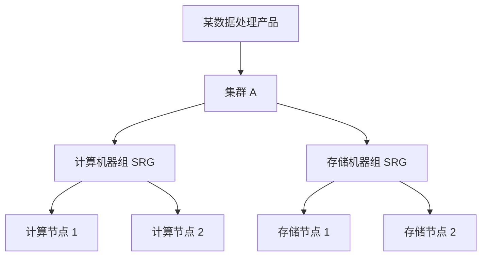

---
{"dg-publish":true,"permalink":"/培训/2026.10.11 云平台/2026.10.12 扩容交付/","dg-note-properties":{}}
---

2026.10.12 扩容交付

### 会议基本信息

- **会议主题**：云平台扩容交付流程与实施规范培训。
- **会议时间**：2026.10.12
- **参会情况**：讲师及培训学员；姓名、正式名单与地点未明确。
- **培训安排**：首日以理论讲解为主，后续安排扩容工具及产品扩容实操，最后一天讲解网络部分；受内部实验环境和学员人数限制，可能仅部分学员能够上手操作。
- **整理说明**：本纪要依据下方转录提炼，属于培训内容记录。产品约束按讲师口述归纳，具体实施仍需核对对应产品、版本及扩容方案；原文未明确分派个人任务或完成期限。

### 一、扩容交付总体流程

1. **前期准备**：从售前、开工会、工勘及硬件信息收集开始，协调采购、设备厂家与 IDC，确认实施条件。
2. **项目交底**：项目经理组织售前 SA、CIE 等人员，交底工期、部署范围和涉及产品。
3. **设备准备与入场**：完成服务器上架、布线及 IDC 检查后，交付团队开展环境摸底、规划和扩容实施。
4. **实施顺序**：涉及网络扩容时，先完成网络扩容，再扩容平台侧产品；无网络扩容需求时，直接进入产品扩容。
5. **交付收尾**：实施完成后进行转维，召开转维会议并提交相应材料。

### 二、扩容对象与类型

- 扩容涉及底座、计算、数据库、存储、网络、大数据及安全等产品，各产品的部署方式和依赖不同，可能部署在物理机、虚拟机或容器中。
- **集群与机器组**：讲解将新增产品、集群扩容定位到具体集群；集群内可包含一个或多个 SRG（Server Role Group，机器组）。不同 SRG 可承担计算、存储等不同功能，规划时必须选对目标机器组。
- **网络扩容**：包括 IP 地址池、ASW、DSW 等交换机扩容；板卡扩容处出现 DSW、BSW 两种称谓，具体设备待核实。
- **产品扩容**：区分已有集群扩容、新增功能或组件，以及新增集群。已有集群扩容还需区分同构、异构混部和新增 SRG 等情况。

| 扩容情形 | 讲解要点 |
| --- | --- |
| 已有 SRG 同构扩容 | 向现有机器组加入同类服务器，满足相应硬件一致性要求。 |
| 已有 SRG 异构混部 | 向同一机器组加入不同机型，须确认产品支持并完成内部适配、测试。 |
| 异构拆分或新增 SRG | 通过拆分、命名或新增机器组区分不同机型；承担的功能可以相同，具体方式依产品方案确定。 |
| 新增功能 SRG | 为集群增加原先没有的功能，与单纯因机型不同而拆分机器组有所区别。 |
| 新增集群或未部署产品 | 核对产品的多集群支持能力、依赖组件及版本；缺少依赖时先部署，依赖版本不足时先升级。 |

### 三、产品约束与实施注意事项

- **硬件适配**：同一机器组通常要求硬件一致。异构扩容不能直接套用同构方案，应完成评估及适配测试，以保证集群稳定性。
- **网络接入**：普通产品通常接入 ASW；DNS、SLB、VPC 等特殊网络产品还涉及 LSW 接入及额外布线。需核对目标交换机下的容器网络、VLAN 等条件，不满足时先扩容相关网络。
- **地址池依赖**：部分产品的服务角色依赖 VPC 反向地址池，应核实所需地址数量、申请及宣告要求；转录未给出可直接使用的数量表。
- **TLOG 主机名**：讲师后续反复强调，新增主机名需按字典序排在线上主机名之后，否则可能部署失败；前段例子与此存在矛盾，正式规则应结合课件或方案核实。
- **云盾配置**：云盾包含多个产品，新增其中的产品时，需要按方案修改集群配置中的相应启用项；原文配置字段和值识别不清，不能直接用于操作。
- **ECS 与 RDS**：按本次讲解，ECS 强调硬件一致性，不能直接通过新增 SRG 处理异构，需考虑集群拆分；RDS 可支持混部。具体支持范围需结合实际版本与方案确认。
- **机器组依赖与容灾**：不同机器组可能存在组件依赖，新增机器组不等于其他机器组能够承接其故障业务。问答未形成完整的集群内容灾说明，需要针对实际产品进一步确认。

### 四、扩容方案获取与变更管理

- 扩容属于可能影响客户业务的变更，应依据标准方案和审批流程实施。
- 讲师说明，原 KB 库方案正在迁移至 EOCC，后续可在 EOCC 搜索；客户侧也可通过项目对应群内的工单服务获取方案。转录未提供可核验的平台链接。
- 对没有标准方案的特殊需求，由 CIE 对接研发评估实施方式；非标准方案在变更审批时需加签提供方案的研发人员。
- 新旧交换机下的扩容方案可能不同，需选择与实际场景匹配的方案，不能混用。
- 变更提前申请时间与执行流程，应依据客户侧实际要求落实；原文未记录明确的提前天数。
- 受控环境中需按版本、root 权限需求等申请授权，使用授权码进行相应范围内的提权；授权机制及终端名称待核实。

### 五、项目管理与实施前检查事项

以下为培训中提出的实施要求，并非本次会议分派的具体任务；负责人、完成期限均未明确。

- **项目记录**：在飞天服务平台创建项目，录入 Cloud ID、授权分配等信息并走审批；记录工勘、整改、入场变更、交付问题和转维情况。
- **日报填写**：据实选择当天参与人员、项目阶段并填写工作内容。
- **问题工单**：遇到无法处理的问题，通过对应群内工单服务或项目交付平台提交，准确描述产品、标题和问题，避免因产品名称填错影响处理。
- **清单检查**：使用“清单革命”核对入场前准备、实施必查项及常见技术问题，确认实施条件。
- **借盘流程**：涉及借盘时按适用流程申请；阿里内部流程与客户侧内部流程应分别按实际要求执行。
- **转维资料**：交付完成后组织转维并提交对应材料。

### 六、仍需核实与转录校订说明

- **培训日期**：原文先后出现“十二号到十七号”“十到十六号”“十二到十六号为平台侧”等表述，需核对正式课表；不将目录日期作为培训起止日期。
- **产品和术语**：保留原文中识别不清的“S U E”“天机”“云加S”“Base”“Blind”“EDP凝聚”“HBM”“Dramma”“Terminal、Computer”“重聚授权”“腾讯那里”等，并标注待核实；产品全称、服务角色及授权入口应以课件或实际平台为准。
- **关键规则**：核实 TLOG 主机名排序的矛盾表述、云盾配置字段和值、网络板卡扩容对应设备，以及 ECS/RDS 的具体扩容支持条件。
- **重要纠错**：依据交付上下文，将“IDC公单”改为“IDC工单”，项目收尾处“转为／转会”改为“转维”，项目入场记录中的“公开”改为“工勘”；扩容类型中的“混播／混布／同步”“统计性扩容”按上下文分别纠正为“混部”“同构扩容”。保留其余口述语气、疑问和未确认内容。

### 七、初学者详解（补充知识）

> [!note] 阅读说明
> 本节围绕前述培训议题补充通用基础知识，帮助理解“是什么、为什么、怎么判断”。其中的示意图、数字和电力信息系统案例均为学习示例，不代表本次会议提出了相应项目、实施方案或决议。涉及阿里云专有平台的产品限制、地址池规则、配置项和操作步骤，仍需以对应版本的正式方案为准。

#### 1. 先理解：扩容交付究竟要完成什么

云平台把机房里的服务器、存储和网络资源组织起来，向业务系统提供虚拟机、数据库、存储、网络等能力。电力企业的业务应用运行在这些资源上，信通人员既要关注设备是否正常，也要关注资源是否能够支撑业务。

**扩容**就是增加可供使用的资源或服务能力。例如，原来的计算资源只能承载一定数量的虚拟机，业务增长后需要增加计算节点；存储空间不足时，需要按产品支持的方式增加存储资源。培训还把新增功能、组件和集群纳入扩容交付的讨论范围，所以每次都应先明确具体要增加什么。

**交付**则是将这项需求落实到可使用、可验证、可维护的状态。服务器到货只是其中一环，后面还要完成网络接入、平台登记、软件部署、加入目标集群、结果验证和运维移交。这里的“平台登记”可理解为让平台识别并管理新资源，具体入口依平台而定。

扩容前先找瓶颈：业务“慢”可能由多种原因造成，不能仅凭使用感受就决定加机器。

| 需要判断的资源 | 初学者理解 | 假设的现象与判断方向 |
| --- | --- | --- |
| CPU | 执行计算任务的能力 | 计算任务排队、CPU 长时间高负载；还需判断是否存在低效程序。 |
| 内存 | 程序运行时暂存数据的空间 | 内存不足、频繁换页；需同时排查程序是否异常占用内存。 |
| 存储容量 | 数据能存放多少 | 空间接近容量规划阈值，增长趋势表明后续容量不足。 |
| 存储性能 | 数据读写的速度和并发能力 | 空间仍够，但读写等待较长；应分析吞吐、时延等指标。 |
| 网络能力 | 数据在节点间传输的能力 | 带宽不足、丢包或端口资源不足；需区分容量问题和网络故障。 |
| 产品功能 | 是否具备某项服务能力 | 缺少某个组件或服务角色，需要部署相应功能及其依赖。 |

容量足够、性能足够、功能齐全是不同的判断。增加资源能否解决问题，要结合实际指标、产品架构和业务增长趋势确认。

#### 2. 物理机、虚拟机、容器和云产品有什么关系

| 概念 | 含义 | 与扩容的关系 |
| --- | --- | --- |
| 物理机 | 机柜里真实存在的服务器，具有 CPU、内存、硬盘、网卡等部件。 | 增加物理机，需要检查供电、机柜、布线、硬件兼容性等条件。 |
| 虚拟机（VM） | 通过虚拟化技术在物理资源上运行的独立计算环境，通常有自己的操作系统。 | 增加虚拟机要有底层资源，也要满足网络、镜像及平台部署要求。 |
| 容器 | 将应用及其运行依赖组织成可部署的运行单元；常见容器共享所在主机的操作系统内核。 | 增加容器实例仍会消耗底层资源，且依赖调度、网络、存储等条件。 |
| 云产品 | 平台向使用者提供的一类服务，例如计算、数据库、存储或网络服务。 | 产品可能由多个组件、机器组或集群共同提供，扩容对象需具体定位。 |
| 底座 | 支撑上层产品运行的基础平台能力，本次培训使用的概括性称谓。 | 上层产品可能依赖底座的管理、调度、网络或存储能力，需先核对依赖。 |

一台物理机可以承载多台虚拟机；容器可以运行在物理机或虚拟机上。具体产品也可能要求独占物理机，因此不能仅从“产品叫什么”判断它一定采用哪一种部署方式。

**ECS**通常指 Elastic Compute Service，即云服务器服务，用户使用的是云服务器实例；支撑这些实例的计算集群还包含底层服务器及管理组件。**RDS**通常指 Relational Database Service，即关系型数据库服务，用于提供数据库实例及相关管理能力。扩容平台侧 ECS 计算资源、扩容某一台云服务器的规格，以及扩容某个数据库实例，操作对象和方案都可能不同。

培训提到的“ECS 硬件一致性”“RDS 可支持混部”，应放在本次平台部署和集群扩容的语境中理解，具体条件需核对版本。IaaS 可先理解为提供计算、存储、网络等基础资源的服务层；PaaS 可先理解为在此基础上提供数据库、中间件等平台能力的服务层。

#### 3. 产品、集群、SRG、服务角色：四个容易混淆的层次

**产品**回答“提供什么能力”，例如计算或数据库。**集群**回答“哪一组节点和组件协同提供这项服务”。同一个产品可能部署多个集群，具体是否支持要看产品架构。

**服务角色（Server Role）**表示节点承担什么工作，例如计算、存储或管理。**SRG（Server Role Group）**是本次培训使用的机器组概念，用于组织承担相应服务角色的节点。初学时可以把它理解为集群中的一个工作小组；具体组内角色及共同组件的组合，要看产品设计，不宜理解成所有 SRG 都只运行一个服务。

下面以某个假设的数据处理产品为例，展示逻辑关系，图中的名称不是正式产品角色名称：

如果计算任务排队，且确认原因是计算能力不足，就需要研究增加计算机器组的资源；仅向存储机器组加入节点，未必能够解决计算瓶颈。反过来，存储空间不足也不能仅靠增加计算节点解决。这就是讲师强调“规划到正确 SRG”的原因。

需求通常定位到产品和目标集群，实施还要继续明确目标 SRG、服务角色及节点。原文对“颗粒度”有不同层次的口述，实际工具中能够操作到哪一层，应以具体方案为准。

机器组分开部署，只表示它们有各自的节点和职责。计算组仍可能依赖存储组，管理组件也可能影响整个集群；判断故障影响时，应查看组件依赖，而不能仅看组名是否不同。

#### 4. 同构、异构混部、新增 SRG、新增集群怎么区分

先分清两个维度：**硬件是否相同**，以及**业务功能是否相同**。新增机器组既可能是为了区分不同机型，也可能是为了增加新功能，不能单凭“新增 SRG”就确定原因。

| 情形 | 假设的变化 | 需要回答的问题 |
| --- | --- | --- |
| 同构扩容 | 某机器组已有 A 型服务器，再加入满足一致性要求的 A 型服务器。 | 型号、部件、软件等是否都符合该产品要求？ |
| 异构混部 | A 型服务器所在机器组加入 B 型服务器，承担同类工作。 | 产品是否允许组内混部？是否完成兼容性和稳定性验证？ |
| 按机型拆分或新增 SRG | A、B 型服务器分在不同组，可能承担相同功能。 | 产品是否支持这种分组？命名、资源配置和调度如何安排？ |
| 新增功能 SRG | 已有计算、存储组，再部署产品支持的其他功能组。 | 新角色依赖哪些组件？部署后如何与已有组协同？ |
| 新增集群 | 保留已有集群，另外部署一个集群。 | 是否支持多集群？资源如何接入、使用和管理？ |
| 新增产品 | 平台原先没有这类服务，部署一套产品。 | 底座、网络、依赖组件及版本是否满足要求？ |

**同构的一致性由产品方案定义。** 核对时可能涉及 CPU 架构及型号、内存、磁盘类型与数量、网卡、驱动、固件、操作系统等。即使整机名称相同，内部配置也可能有差异；哪些必须一致、哪些可以不同，应查兼容性要求。

异构需要验证，是因为新硬件可能带来驱动适配、资源识别、性能差异或运行稳定性问题。例如，同一任务分散到多个节点运行，较慢节点可能影响整体完成时间。这只是通用原因说明，不能据此判定某一机型不兼容。

判断扩容路径时，可以按顺序问：目标产品和集群是否存在？目标服务角色和 SRG 是否存在？新硬件是否满足一致性要求？若不满足，产品是否支持混部、按机型分组或多集群？依赖及版本是否满足？得到这些答案后，再选择对应方案。

新增集群还可能需要解决资源调度、访问入口或业务使用方式的问题；部署出一个集群，并不意味着原有业务会自动使用它。

#### 5. 把交付流程拆开：每个阶段在解决什么问题

培训中的流程包含商务协调、现场准备、技术实施和运维移交。下面的工作与产出是帮助理解的通用示例，实际材料名称、分工和审批链以项目要求为准。

| 阶段 | 要解决的问题 | 常见工作与产出示例 |
| --- | --- | --- |
| 需求确认、售前 | 为什么扩容，增加多少，范围到哪里？ | 明确业务需求、现状、目标产品和容量规划。 |
| 开工会 | 哪些人参与，怎样协作？ | 确认范围、沟通接口、工作安排及前置事项。 |
| 工勘 | 现场条件是否满足？ | 核查机柜空间、供电、布线、交换机接口等，记录需整改事项。 |
| 项目交底 | 实施团队是否准确理解方案？ | 交接现网情况、产品范围、工期、约束及待解决问题。 |
| 采购、到货、上架 | 设备是否齐备并正确接入？ | 核对型号和数量，完成上架、供电、布线及标识。 |
| 环境摸底、规划 | 新资源具体放在哪里、叫什么、怎样管理？ | 明确目标集群、SRG、主机名、地址、网络连接和部署参数。 |
| 方案确认、变更审批 | 方案是否适用，何时可以实施？ | 核对版本和场景，评估业务影响，明确验证及异常处理安排。 |
| 扩容实施、验证 | 新资源是否真正可用？ | 按方案完成网络及产品扩容，检查资源、服务和业务状态。 |
| 转维 | 后续运维是否掌握变化？ | 移交实际配置、实施记录、验证结果及遗留事项。 |

**工勘**偏重现场条件调查，**摸底**偏重对现网资源和配置的确认，**规划**则是在这些信息基础上决定如何部署。三者可以互相补充。比如现场还有机柜空间，并不能说明地址池、交换机接口和平台版本都已满足条件。

**交底**是把已掌握的信息交给后续执行者。例如，售前确定了扩容目标，现场人员掌握布线条件，技术支持掌握产品限制，交付人员需要把这些条件一起纳入实施方案。项目经理侧重组织协调；原文中的 SA 参与售前方案交底，CIE 参与交付技术支持及研发对接，具体岗位全称和职责边界需结合项目确认。IDC 通常指互联网数据中心，在这里可理解为设备所在机房及其相关管理方。

#### 6. 为什么要先扩网络，再扩平台产品

新增节点需要通过网络接受管理、与集群成员通信，并按产品要求提供服务。服务器通电后，如果缺少地址、接入网络或可达路径，平台软件仍可能无法正常部署或运行。因此，培训强调先满足网络前置条件。

| 网络概念 | 初学者理解 | 扩容时关注什么 |
| --- | --- | --- |
| 交换机、端口 | 将服务器及其他设备连接起来的网络设备和接口。 | 端口数量、速率、布线及配置是否满足接入要求。 |
| 网卡 | 服务器连接网络的硬件接口。 | 型号、驱动、接口数量及所连接网络是否符合方案。 |
| VLAN | 在二层网络中划分逻辑广播域的一种方式。 | 目标端口是否具备产品需要的 VLAN 等配置。 |
| IP 地址池 | 按平台规划保留、分配的一组地址。 | 是否有足够可用地址，范围、用途是否正确，是否存在冲突。 |
| 路由与宣告 | 路由决定数据往哪里转发；宣告用于让相关网络设备获知某些地址的可达信息。 | 新增网络和服务地址能否按架构被访问；具体宣告机制需查方案。 |
| 容器网络 | 为容器提供连接及通信能力的网络。 | 所需网络是否存在，新节点接入后是否具备相应配置。 |
| VPC | Virtual Private Cloud，虚拟专有网络，用于组织逻辑隔离的网络环境。 | 相应网络组件、地址资源及接入条件是否满足。 |
| DNS | 将名称解析为地址等信息的服务。 | 相关名称是否能够按设计解析和访问。 |
| SLB | Server Load Balancer，负载均衡服务，将访问流量按规则分配到后端。 | 相关接入、后端和健康检查条件是否满足产品方案。 |
| Open vSwitch | 常见的软件虚拟交换机，可参与主机上的虚拟网络转发。 | 对应产品是否依赖它，以及新节点和网络配置是否满足要求。 |

本次记录中的 ASW、DSW、LSW、BSW 是具体平台架构中的交换机称谓。初学者先理解它们在相应架构中的接入职责，再结合拓扑图识别设备；转录不足以准确补齐所有缩写全称及层级关系。

**VPC 反向地址池**是本次培训提到的具体平台配置。原文没有完整说明其访问原理，当前只能确认：部分产品的服务角色会依赖它，且地址数量、申请和宣告有相应要求。实际规划应查正式地址需求表，不能假定“一台服务器只需一个地址”。同一节点可能涉及管理、业务、存储、容器等不同网络，具体地址需求取决于架构。

举例：新增节点所需的接口、地址和网络配置已具备，可按方案直接进入产品扩容；如果目标交换机未承载所需网络，或地址资源不足，就要先完成相应网络配置或扩容，再部署产品。“先扩网络”应理解为先补齐实际缺少的条件。

#### 7. TLOG 主机名、云盾开关和版本依赖为什么也要检查

**主机名**是识别节点的名称，有些部署工具或产品规则会使用它进行排序、校验或配置生成，因此命名可能影响部署。这里列举的是通用用途，转录没有说明 TLOG 限制的内部实现原因。

**字典序**可以先理解为按名称中的字符顺序进行比较。例如，`node-a` 在 `node-b` 之前。主机名的“看起来编号更大”与具体规则比较出的顺序未必一致，实际应使用规定的命名规则及检查方法。本次 TLOG 前后口述有矛盾，不能仅凭学习示例直接给生产节点命名。

**配置启用项**用于告诉平台哪些功能需要部署或启用。云盾包含多个产品，新增其中一项时，除了部署相应服务，还可能需要让平台配置识别这个变化。转录中的 `non`、`true` 没有给出完整字段路径和配置结构，应核对正式方案后再理解其具体含义。

**依赖**表示某个组件运行前需要另一项能力已经具备；**版本依赖**进一步要求该能力达到兼容版本。可以用假设的组件 A、B 理解：A 依赖 B，B 尚未部署时先部署 B；B 已部署但版本不满足时，需评估升级。升级本身也可能影响现网，应纳入相应方案和变更范围。原文中 DRDS/RDS 的举例识别不完整，不据此补成确定的依赖关系。

因此，扩容准备至少涉及硬件、网络、软件依赖、版本、命名和配置多个方面。设备到货解决的是硬件准备的一部分。

#### 8. 为什么扩容需要方案、工单、审批和授权

扩容会改变现网状态，可能涉及集群成员、网络配置、资源调度或数据分布。生产业务持续运行时，即使目标是增加资源，也需要了解实施过程是否会影响现有服务。在电力信息通信业务中，还应关注承载的应用及其上下游关系，将实际影响范围纳入本单位变更管理要求。

| 管理手段 | 解决什么问题 | 初学者应分清的边界 |
| --- | --- | --- |
| 扩容方案 | 明确操作对象、前置条件、步骤、验证和异常处理方式。 | 要核对产品、版本、机型、网络及扩容类型，不能只看标题相似。 |
| 工单 | 留下需求或问题记录，并交给相应人员处理。 | 获取方案的工单、问题求助工单与变更审批各有用途，不能相互代替。 |
| 变更审批 | 确认实施范围、业务影响和实施安排得到相应审批。 | 操作步骤正确，还需满足客户侧审批和实施条件。 |
| 操作授权 | 允许执行者在规定范围内使用所需账号或权限。 | root 权限是高权限操作能力，具体任务仍需按获批范围执行。 |
| 实施记录 | 保存做了什么、结果怎样、遇到什么问题。 | 便于追溯、排障和转维，应据实记录。 |

**标准方案**适用于明确的产品版本和场景。如果机型、网络接入方式、部署形态或需求超出其支持范围，就需确认是否另有方案。培训提到由 CIE 对接研发处理非标准需求，并在审批中加签方案提供者，目的是让相应技术人员参与确认。

**变更窗口**是安排实施的时间范围。需考虑业务使用时段、可能影响及异常处理时间，具体时间由实际项目确认。**回退或回滚**是实施异常时恢复可接受状态的处理安排，但扩容不同阶段的恢复条件可能不同：新节点尚未承载业务，与已经发生数据迁移或写入时，处理方式可能差异很大。应在方案中明确可回退阶段、触发条件和处理步骤，不能假定任何时候都能简单删除新节点。

本次转录中的“重聚授权”和授权终端名称待核实，当前仅按其已表达的“申请授权、获取授权码、按范围提权”理解流程，不补写具体入口或命令。

#### 9. 怎样确认扩容完成，以及怎样理解容灾

下面是通用的验证思路，帮助理解交付结果；具体检查项、观察时长和合格阈值应使用产品方案及项目要求。

| 验证层次 | 需要回答的问题 |
| --- | --- |
| 设备与网络 | 新设备、接口和链路状态是否正常？地址和网络可达性是否满足设计？ |
| 平台资源 | 节点是否被正确管理？是否加入了目标集群、SRG 和服务角色？ |
| 服务状态 | 必要组件是否正常，是否出现新增异常或持续告警？ |
| 容量与性能 | 新资源是否被识别并可用？是否改善了本次确认的资源瓶颈？ |
| 业务使用 | 业务是否按预期访问和使用新增能力？原有业务是否正常？ |
| 运维接管 | 台账、监视、告警及交接资料是否反映本次变化？遗留问题是否明确？ |

节点数量增加，并不意味着业务立刻获得同比例性能提升。平台可能需要完成资源登记、数据分布调整或调度配置；业务也可能受其他瓶颈限制，实际收益需验证。

**转维**是把交付后的系统状态和维护所需信息移交给运维人员。常见资料可以包括实际节点清单、地址及网络连接、集群和机器组归属、配置变更、验证结果、异常处理记录和遗留事项。这些是通用资料示例，本次转录没有完整列出必交材料清单。

**扩容**关注增加可用资源；**高可用**关注局部故障时如何继续提供服务；**容灾**关注较大故障影响下如何恢复业务。几者相关，但应分别检查。例如，其他机器组即使有空闲资源，也可能缺少所需服务角色、数据访问条件或接管机制，不能据此认定能够接替故障机器组。判断故障切换还需看剩余容量是否足够、数据是否可用、相关机制是否启用，以及产品是否支持。

转录中提到的 ECS 故障实例迁移，应结合相应产品能力和触发条件理解，不宜推成“所有机器组故障后，服务都会自动迁到其他组”。集群内接管与跨机房容灾也应分别确认。

#### 10. 用一个电力信息系统的假设案例串起全流程

**案例前提（仅用于学习）**：某电力企业的信息资产管理应用使用云平台上的一项分布式存储服务。通过容量监测和增长分析，已确认当前存储容量不足，拟向目标存储机器组增加两个节点。假设已有六个节点，新设备与原设备满足该产品的同构要求，产品支持这种扩容方式。

1. **明确需求**：说明是存储容量不足，并确认扩容的是哪个产品、哪个集群、哪个存储机器组。两个节点只是本例的假设，实际数量需依据容量规划和产品要求测算。
2. **工勘与摸底**：检查机柜、供电、布线及接入接口；核对原节点的硬件、软件版本、机器组归属和网络配置。发现缺少条件时，先列出需补齐事项。
3. **选择扩容类型**：本例为已有 SRG 同构扩容。如果到货设备与要求不同，就需重新确认异构支持情况，不能直接沿用同构方案。
4. **完成资源规划**：按方案确定主机名、地址、网络连接、目标机器组及部署参数。如果产品有特定命名或地址池要求，逐项检查。
5. **补齐网络条件**：现有接口和地址等资源满足要求时进入后续步骤；不足时先实施相应网络扩容或配置变更，并验证新节点的必要网络可达性。
6. **确认方案和实施安排**：获取与版本及场景匹配的方案，评估对存储服务及业务应用的影响，完成客户侧变更审批、操作授权和异常处理准备。
7. **按方案加入节点**：完成规定的设备准备、平台登记和服务部署，将节点加入目标存储机器组；涉及数据调整时，按产品流程执行。
8. **分层验证**：确认节点状态、可用容量、数据及业务访问、读写情况和告警状态。机器组从六个节点变为八个节点，但可用容量增长还受单节点规格、副本或纠删码策略、预留空间等因素影响。
9. **转维交接**：更新实际资源和配置记录，移交实施与验证结果，说明遗留问题及后续监视事项。

本例中，新增节点要成为业务能够使用的存储能力，依次需要满足硬件适配、网络接入、平台管理、服务部署、结果验证和运维接管条件。阅读正式扩容方案时，可围绕这些条件逐项确认自己是否理解了操作目的。

## 转录文本

要不大家把自己那音箱那个音量关掉吧，不然有回音。 都关掉是吧？就直接把自己电脑那个音量直接静音就好。但是电电脑的静音，不然会有回音的。开班，开班的电脑声音没有看到。开班呢，主要就是简单介绍一下我们整个那个流程里面这几天课程大概接讲的是什么，以及我们做一个简单的上课约定。

 培训呢，咱们主要是会让大家通过这次培训呢，学到我们整个一个企业版的一个基础流程，以及一个我们内部的规划系统的使用，还有咱们扩容工具一个整个的流程，以及还能了解到我们扩容。 对应的具体步骤以及实操的部分，哪些产品的实实际东西，主要培训的时间呢（以下口述日期待核实）？就是说是十二号开始到十七号，但是我们这属于平台前的话，就是十六号。哦，不对，哦，一共就是十到十六号，对的，是。哦，到十七号之前，这的十二到十六就是我们平台侧的，然后最后一天是网络部分，会有一个专门的老师他在对大家进行一个讲解。

 然后培训的话，其实就是咱们现场以这种形式进行一个培训嘛。然后课表的安排的话，就在下面这里。嗯，大家能简单看清吗？呃，比如说第一天、第二天到十七号这一件，一到五天呢，就是我们整个我负责的一个部分。就比如说我们今天就大概会简单介绍一下交付流程这些大纲的话，就简单过目一下吧。有需要的可以截图。然后等会儿的话，我会根据这个大纲进行一个PPT讲解，大家。 如果有疑问，因为咱们人比较多，可能因为讲完一节，我会留适当的时间给大家休息一会儿。如果有问题，那就大家请举手示意，或者是上台来咨询就好了，可以吧？好，主要呢，第一天主要就是理论部分，后面的几天的话都是分为一个实操的一个部分。比如说，我们会涉及四个产品的一个扩容实操。然后，因为我们的呃，咱们是。

 我用的我们阿里内部的一个家里环境的话，所以说可能会涉及到，比如说咱们学员有点多，可能到时候只能进行，比如说学员实操的时候，只能我。那我们多优惠。然后，可能只有部分同学他会自己上手进行一个实操。嗯，直接讲干货，直接讲内容，时间比较紧。好的，好的。好的，那老师从现在开始吧。好。 那济南，大家过一下就好了。呃，这里呢，主要就是带大家去了解一下一个整个的交付流程，还有我们一些类型的去怎么获取。

 这是对应的五个目录，第一个就是我们整个的S U E流程（名称待核实），比如说整个扩容的流程，它就会从这里，你从这一张图就可以完整的看出来。我们会从一个售前到我们一个I D C工单，就是我们硬件的一个收集，然后最后进行一个采纳交底，然后最后会进行服务器上架，这一部分就是。 现场我们到时候交付同学会去做的一些I D C检查啊，比如说这些是可能会是客户协调进行上架布线，最后就会到整个的交付工程师，比如说我们会进行摸底规划扩容这些。如果有网络，我们会涉及网络，然后有产品的话就会扩容产。呃，我们如果有网络产品和那个网络网络和平台侧的产品的话，我们会优先扩容网络产品，再扩容那个平台侧产品。如果没有网络了，我们直接跳过网络扩容产品就好了。

 后面的就是一些整个的转维流程，这些就是一个简单的示意，从开工会到工勘，整个流程，他这里会简单跟您说一下，比如说这里对应的负责人是谁，然后需要具备哪些东西，提供给客户，然后才能正好完成了更好的具备实施条件。好，这里前面过完之后，就到下面这里，这里就是客户去采购，或者是我们这边的C S M进行一个安排。 设备厂家或者IDC，他这里写的很详细。到时候呢，我看一下这个PPT是会进行一个价改发出来吗？这个交底会就是说，我们大我们内部会拉着一个项目经理，会拉着我们对应的售前SA老师和CIE老师来进行一个简单的交底，以及工期和我们对应部署的一个范围的产品，对应的这内容就是这些，可以简单参考一下。

 然后就到这里，就是我们前面已经完成了，剩下的就是交付团队入场进行一个实施阶段了。啊，实施完成之后就是一个转维，这就是一个整个的扩容的简单的SOP流程介绍。啊，这只是一个提供，就是说你如果最后要参考一下，这可以从这里下载。啊，下面就是介绍一个常规的扩容产品。呃，我们常见的扩容产品呢，一共一共分为几个部分，可以简单了解一下。比如说底座。 就是说飞天云平台的底座产品，比如说天机、云加S、茅台、Buffer（以上产品名称待核实），然后五大件的话就是说计算类，这个是数据库类，就是存储类，就是网络类，这两个都是网络类嘛。ECS呢就是，嗯，不知道大家有没有了解过，反正就是你可以理理解为一个阿里内部的虚拟机嘛，ECS。然后呢，下面的大数据Base（名称待核实），它可能就包括Base、ODPS、Blind（名称待核实）和DataHub、Hive，还有Hologres这些。存储的话，它就分为这些，可以。

 了解就简单几个图吧，反正只需要了解，就是说我们如果扩容的话，会涉及到哪些产品，就是如图所示的这些产品。然后安全的话，涉及的是少少见，因为密码机基本上环境里面部署的多，扩容的比较少。啊，它这里会简单的列举了一下，比如说咱们一些特殊要求的产品，比如说有特别接入LSW综合接入交换机的，要学习EDP凝聚（术语待核实）的，还有依赖VPC反向地址池的。 这里它都会列举出来，简单说明一下，亲，呃，有要求的，比如说这个对主机名有要求，我们内部的话是有一个 TLOG，TLOG 它完它就会对这个主机名有一个严格要求，可以简单做给大家一个了解。比如说它这里是说的，我们 TLOG 就是会按照字母表，比如说你开头二零八，大家都是二零八，那就是如果你是 A，就可以先部署。

 如果你是B想要第二次部署的话就不行，你必须在它前面，就是这个要求（此处与后文主机名排序说明不一致，待核实）。所以说这个比较考验，就是说大家的一个基础力，呃，经验能力，以及以对产品的熟悉度，然后一些特定要求的，比如说这些，它会说一个集合安全底座，云盾的话差不多就可以理解为是一个集合嘛。好，这里是一个特殊的一些网络架构，比如说我们对应的一些。 网络产品需要接入的，一般的产品的话，普通产品它只会接入ASW，就是交换机，普通交换机。然后像特殊的网络产品，DNS、SLB、VPC这些，它会特别接入LSLSW。所以这些大家需要简单了解一下。如果到时候可能，如果大家真的上手进行整个扩容的话，需要了解就是LSB和VPC这些网络的，它要额外接的一些线，但是也有说明。

 啊，它这里也简单列举了一下依赖这个 VPC 反向地址池的数量的一个产品，比如说 Red RDS 里面的 HBM、茅台（服务名称待核实），这些是它的服务名称。前面是产品，后面呢就是说它对应的，产品里面的服务角色哪些到底需要，以及需要多少个这个样子。它简单的访问原理呢，就是可以简单了解一下。 因为这里就不多赘述，这个确实还是呃不浪费时间了。有感兴趣的私下了解吧。啊，这里，它这里是简单告诉一下你，它是什么，在哪里做宣告，以及哪些地址不需要宣告，要申请的是哪些。这里呢，就是一些对应的一些原理。好，然后我们主要就了解到了，就是我们所面临的扩容对象是哪些，比如说一些是线上集群。

 呃，一些这里，比如说，就是我们扩容集群的颗粒度，叫Server Role Group S R G，在我们天翼（平台名称待核实）上呢，叫机器组Machine Groups。它这里就简单跟你说了一下，我们新增及产品以及集群扩容的颗粒度，就是说最细的就是说到集群，针对一个集群。然后呢，它又给你简单说了一下集群下面它有多组S R G，或一组S R G。就比如说刚刚提到的Server Role Group，它分一第一个、第二个，或者可能有。 集群它多的话，它可能有第三个。然后它呢也告诉了你，它有些会在部署需要真实依赖物理机，以及需要一些在VM部署、容器化部署的，它这里已经列举出来了，就可以了解。比如说这些，它列图片上的示例，就是说从都是从基于服务器安装系统，然后对应的一些服务安装好了之后，它就统称为一个三部入组。

 因为这个它为什么要这样分呢？因为有些在集群里面，它这个group里面的东西可能作用不同。比如说它作用计算，它作用存存储，比如说ODPS这样的，你可以简单理解嘛，因为它有MapReduce这样的功能嘛，就简单这样理解就好了。总总而言之，就是每一个SR group它可能有对应的作用。如果它们两个在不在不同，你扩容的时候，比如说你要扩容A。 那你如果规划到了B，那就是错误的，因为你实际是需要的A的作用，你不需要B的作用。然后这里它也是简单跟你说明一下，嗯，刚刚说的是集群，这里就是扩容物理机。这里刚刚就提到了，你看它里有每一组有独立的功能，计算资源、存储资源。我们这里还有强硬要求，你必须要一致。比如说，一般来说大家都是标标准准的，你是A，你是A同学，那你就要加入A同学进去，但是。

 一般情况下，比如说现在机器确实硬件不太好找，可能就会存在，嗯，时代A同学不够了，那我们只能往里面加B同学，这个就属属于是异构一个种类。异构的话需要我们评估，比如说原来都是A需要参加，这个就属于异构。异构的话是我们需要走内部的。 内部的一个流程适配吧，测试化，比如说测试通过后才能使用，因为要确保整个集群的一个稳定性。因为这个云平台的话，它的持久性很讲很久的，现据我了解，可能最久的有一二年部署的，或者是一几年部署的（部署年份待核实），它现在还能平稳运行。我们内部化的测试就是为了测试这个集集群的稳定性，不能说B同学加入，他过几个月或者过一两天他就坏了，那对咱们的客户业务会造成一个受损。

 受影响的范围。它这里又简单列举一下，比如说一些对应产品里面的机器组，它需要的一些容器网络，比如说 OpenVSwitch、Dramma（名称待核实） 这些，你就简单了解一下。如果大家到时候涉及了这些产品，就要去看对应的交换机下面有没有这些网络，没有的话，那必须先把这些网络给扩容掉，才能进行这个机器组的扩容。于是我们刚刚说了，有网络就扩网络，没有网络就跳到产品这个样子。 这个也简单给你介绍一下，这个OMSVM，它的一个优点和限制，以及对应的服务器组它要接入的。好，这个也是RAM，简单了解一下吧。好，这里也是DSW，看这里连接了一下，加了又加了一个VLAN。这里刚刚就是刚刚提到的TLOG，TLOG的话就是它特别比较挑剔一点，它就必须要。

 看吧，刚刚就提到了，一定要排在线上T T log线上的主机名之后，否则会那个部署失败。这里就是，比如说你到时候打印的话，你必须要在它线上，如果这里是C，那你不能部署A B C前面了，你只能往E往后面走。这个就是它的一个挑剔度，它就因为它这也说了，如果你不按照它的那个字典排序的话，那它就会部署失败。 然后这里，他也简单说明一下，又说明一下这里，看没？往这里排，B B B，最后这里都是都是B，那其实没有啥问题，啊。然后这里，他也有介绍了一下云盾的一个系列的一个要改对应的东西，因为云盾的话，刚刚说的它是一个集合，你集合里面云盾它包含很多产品，如果你加入一个产品，比如说你加入了这一个。

 是，嗯，这一个，那你需要把这个 non 改为 true（配置字段及原值待核实），这里它说了一下，因为你新增了，我们就需要去修改它的一个集群配置文件，看这里也是标注了一下。好，那接下来我们介绍下扩容会涉及到的一些类型嘛，比如说刚刚就说到了，呃，网络扩容，它会涉及到地址池 ASW 和 DSW 扩容，DSW 话就是版 卡不知道大家有没有见过，BSW（此处与前述 DSW 称谓不一致，设备及板卡配置待核实）它原来初始有两张板卡，然后你如果线上环境交换机确实过于多，那你就会加往里面加两张板卡，然后或者是扩容 IP 地址池、扩容交换机，然后这里就这里也是有说明一个情呃集群扩容，产品扩容的话有两种，一个是业务集群扩容，一个是新增功能或者是就相当于新增组件，然后或者是新增集群扩容这个样子，比如说这里刚刚说到的一个情况。

 已有S R G，就刚刚说的第一个S R G不入股。然后这里同构扩容，就是说A同学加入A同学。这种混部的话，它就是说明是这个，就是刚刚提到的A同学加入B同学进去。然后这里还有一个就是新增异构。 比如说你要新增一个SRG，比如说原来是ASRG，你现在要新增BSRG，这个样子。这个第二个、第三个是不是一样的？嗯，不太一样，因为这两个的话，它是新增SRG，比如说，看一下新增一个。

 因为它是这样的，比如说第一个是A，你刚刚说的是这个嘛？A到B，它相当于是B同学里面全是B同学。最下面这一个，它可能它是新增一个这个，新增一个S R G，它是直接从A S R G，然后新增一个B S R G。它原上面这一个A到B，它是说同在一一个S R G里面，比如说都在A S R G里面这个样子。 所以说这两个类型是不一样的，一个是往 S R G 里面加同学，加不同的同学；另一个是新增一个班级嘛，你就相当于 A 就是一个班级。然后第三种情况就是加入一个新的班级一样。然后后面这个就是刚刚提到的，嗯，一个新增功能，一个新增集群、云盾扩容这些。这里他又提到一下，又简单要求一致，他又提再向赘述了一下，就相当于再向大家详细的解释一下。

 什么叫做这个同构扩容？什么叫异构？比如说，你看这里拆分、新增，就简单了解一下。就是刚刚说的，这个就是A班级要加入B班级，然后这个呢就是A班级里面A同学，然后加入B同学，这个就A加A。然后在这里再追溯一下，它比如说再给你说明一下，要满足哪些条件，以及它扩容是怎么扩？ 比如说这是加，这是原来的，他就往里面加，但是最后大家合都是一样的，合起来都为它一个效力，就是这样子。啊，他就往里面加服务器就可以了。好，这个呢，它就是这个样子，看，看没，原来就是S R G S R G，它新增了一个，然后Split，然后什么什么，就是它的一个名称嘛，更有辨辨识性，它就是这样加。好，这个呢，它就是直接新增一个S R G，相当于刚刚说的一样，这里它就简单的给你。

 形形象列举一下它是怎么这个是怎么增加出来的？然后这个新增S G跟那个第二个有区别吗？网上发现这个吗？嗯，嗯，发现这个是新增，看没？刚刚是这个就说了嘛？这你这个是这是A班机型，我知道这是不同机型和原有的机型不一致，对吧？对对对。 是的，那你有疑问？然后有第三个呢，这个是为什么必须要新增 S R G？刚才是因为机型不一致，这个是？最上面嘛，比如说你有些产品，比如说，嗯，O O D P S 里面它有很多个 S R G，比如说 Terminal、 Computer（服务角色名称待核实），还有一个，哎，还有个小S R G，反正它有三个，但是咱们云平台里面只有两个，那你现在需要第三种功能，那你是不是就要加一个？

 哦，对，因为刚刚不是说了吗？一个SRG负责的是一种功能。你比如说，你这个集群里面原来只有两种功能，你现在，呃，咱们需要的话要加一一种新的功能。啊，现在翻到上一页，我看一下。这里吗？啊。对，点一下。你。 这里是吧？点一下，对。这不应该是 server 服务？呃，一二。对啊，你新增一个，就加一个。哦，行。没有了。知道了。有，还有问题吗？啊，没有。然后这三这几个机器组之间是互相分开、不不互相混搭的，对吧？互相混搭，您就是它上面的服务不会互相。

 有依赖或者什么？呃，这个要看它集群内部的一个构造。比如说，它有些的话会大家部署相同的东西，它不单独的部分会单独布在这才这个，比如说这个 S2 入服里面。但是不排除它说，比如说，比如说这一个你部署第三个，它需要依赖前面两个才能部署，因为它要依赖上面组件。就是我的意思，是它部署在，比如说。 S G Groove S G Groove三，它部署在四台机器上，你新增四台机器，那它部署服务就在这四台机器上跑，不会往其他的机器顶上去挪，对吧？不会不会，你你的意思就是说，原来比如说你的，我明白你的意思。比如说原来你这上面布满了服务，对吧？然后你新增的这些服务上面，你你的疑问是，这里面的这原来的你原来的S R G会不会新新增？

 服务对吧？一般来说，只会只有升级它，还可能会新增服务。一般它独立部署的话，比如说你新增这个，就是新增服务，就是你布了这些 server role 这些这些这些服务之后，就是你们这三个机器组是互相独立的，对不对？就是如果宕机了，比如说第三个机器组，四台机器，比如说你新布四台机器全宕机了，那剩下的机器，呃，能不能支撑它去做上面业务的容灾迁移？ 容灾迁移那可能不行啊，因为你容灾迁移是整个集群网，比如说你 A 机房往 B 机房迁，他们是只属于整个集群内的容灾。对，集群内的容灾。啊，比如就是简单一点的，就 E C S 嘛，对吧？ E C S 你扩计算机资源扩容，比如说现在有两个公服，一个公服十台，一个公服。 E C S 不适用， E C S 只有一个集群组。啊，只有一个集群组。你 E C S 当机了，它就会把那台机器上的实例往正常机器上迁移。哦哦。

 你你理解的这个东西的话，它其实有点。好，那后面再学吧。行，有问题再私下聊吧。这个东西继续往下了。它它这个就是同一个，它不同S R机是必须要分的，然后可以用同一个机型的系统。可以的，比如说，你第一个S R机和第二个S R机可以同一种机型，只要我们通过我们内部适配了，就如果你提供的机型就是这样，那就是可以这样用的。这个东西只有在。 有不同机型混部的时候才需要分两条线。对啊，你不，比如说这里时代，你看这两个，你跟线上都不一样了，那就拆了一下。虽然作用是一样的，但是为了区分你机型不同，它就这样拆分了一下，还有问题吗？就它这个相当于是它它这个 sleep 一下，但是它们的它和第一个的功能是一样。对对对，它是简单拆，就例改了一下名嘛，相当于区分一下哪些是原班生，哪些是插班生。

 哦，没有。还有问题吗？这里没有问题，那继续哦。继续。好。好，你看这里，他跟你说了，你无论ECS，因为ECS比较挑剔，它属于计算机计算类型的话，它只能部署一种。比如说，你必须强要求硬件一致，你如果不一致的话，它你如果要拆分，一般是只能通过集群拆分，你不能就是说像刚刚那样。 往里面加SRG，这样是行不通的。然后RDS它简单说了一下，它可以支持混部。呃，这里也是简单介绍一下，它会涉及哪些新支持多集群部署的一些产品，以及它的future。我这里就刚刚提到了，它又在给你列举一下大纲，就是总做一个总结。我们产品部署就分为两部分。

 一个是第一个就是已部署，就是线上已经存在的，然后还有一个属于未部署的。这一存在的，他写了一个是已部署，比如说嗯集群存在，就刚刚提到的OBS线上已经有了。那如果S R G有，还会增加机型，就刚刚说的那些去走机型相同，那就是A同学或A同学；机型不同，那就是混部。 它如果不支持混部的话，那你就只能新增集群往往下面走了，因为它很挑剔，需要按照严格的要求去走。嗯，多集群混部，那你就只能新增集群去走。然后这里你支持混部啊，那你就像刚刚一样，加个SRG，然后写个名字。

 这个样子，它简单列列个名字，好。然后，如果是下面是云平台没有的话，那就是需要去判断依赖满满足。比如说，有些产品它必须要满足对应产品版本才能去部署。比如说，PaaS侧的DRDS哦，那个RDS，你需要满足线上平PaaS侧版平台有DRDS。 和RDS才能进行部署。如果不满足的话，那你就要去把它的依赖给部署掉。如果你这里还有一种情况，就是你依赖满足，但是你的版本不满足，就要去升级依赖。这个东西就要去大家介入，呃，接触到云平台之后，你才能对这个进行一个深刻的了解。这里口头赘述的话，可能是理解的是有点不太能接受吸收的嘛。好，下面就是简单介绍一下我们整个那个扩容方案是怎么获取的。

 因为我们做扩容就属于是变更，相当于会影响部分客户业务，那我们就需要按照一个标准流程，不能说根据自己的每个心情随心所欲的进行一个操作。所以说，我们会获获取一些方案，特定方案，比如说这里都是在KB库，然后现在的话，这个我们都是更新了一下，都会往一个KB库腾挪到了E O C C里面，所以最后大家都是在E O C C搜索。 好，然后这里还这里特别提问一下，比如说，有些产品它特定，比如说没有标准方案的，因为有些客户他的需求确实过于旺盛，比如说大客户，呃，他就会比如说想要扩容一些特定产品，比如说D N C S，一般只会云平台新增组件，新增一个V M，用容器化去部署，但是。

 确实依赖那个需求太过旺盛，他需要想要从容器化转为独占服务器部署，那就需要去找对应的 C I E 同学，然后 C I E 老师去找对应的研发同学，看是否通过什么样的方式进行一个实施。这里他还说明一下，我们这是内部流程，非标准的，我们变更审批的时候需要呢我们加签一下提供这个方案的研发老师，这样呢才能有一个流程保护好大家。好。 这里简单介绍一下，这是怎么接入的，比如说这里怎么搜索ASI，扩容、流产这些，就简单告诉你进入这个平台，你点哪里可以搜索，然后这里也是简单就列举一下怎么下载方案。因为如果大家后面涉及扩容的话，因为我们现在需，嗯，大家的AI知知知道比较那个需求比较高嘛，大家嗯都在逐步试AI，我们也有一个独立的一个一方群。

 大家可以理解为，你会干要干这个项目，它会自动拉取一个群，你在群里面进行被机器人提单。我们有个工单服务，大家提工单的方案呢，可能客户侧的方案就是你直接提一个一方有一个一方群，群里面有一个工单服务，然后你就在群里面找这个工单服务，然后你就提单。 就这个样子，大家客户侧的流程就比较简单。你在群里面对应的群，找到对应的服务，然后你再提单就可以了，都不需要自己在内部找，会有机器人自动帮你找好，给你发出来。然后这里也是一样的，这里就不多赘述了，过一下就好。这里就是混部，比如说这个 Kubewalker，它要什么旧 SW 和新增 SW 下的不同方案，只做个区分。

 现在新增的和旧的，因为它们两种方案是不一样的，所以说必须要单独使用对应的方案。啊，这个也是一样。这里也是，你、你旧扩容都是一样。大概现在就介绍前面就是说方案的一个获取，然后我们已经说了，我们客户侧会有一个非常简便的流程。那前面大家就主要做个了解。然后这里就是一个项目规范，我们项目管理呢有一个飞天服务平台，还有一个清单革命。 清单革命呢，就是说为了做这个向扩容产品前，我们会有一个清单革命去讲解，比如说你有些必必须要查的事项，它会在里面列举出来，以防大家不清楚啊，有一个存储，比如说你新增要借盘这些硬盘的流程，这个简单了解第三个就好了。它简单就说明一下，这个服务平台呢是我们的一个数字化服务平台，包含数字台这些东西，网址就在这里。

 大家，我们到我们我们一般也会用到这个，然后进行一个专业运营服务在这里。好，他会告诉你，嗯，我们简单，比如说这个项目是初期，老师会创建一个项目，然后对应录入，简单了解一下，看一下就好了。他录入之后，就会输入咱们项目的一些，比如说进进入的一些Cloud ID，一些授权分配这些，然后到HRD审批，这里驳回，通过之后就会有一些维护，我们比如说工勘同学的入场。 还会记录他哪天是工勘的，有有没有要整改的地方。如果整改通过，然后我们就会入场进行一些变更。如果大家交付中遇到问题，就进行一个提交。日报呢，只是做作为一个每日的工作量统计。完成之后就会到返回，就到这里。整个一个流程就这样。日报呢，他就简单告诉你我们是怎么填写日报，或者说选择哪些是哪些。比如说今天有哪些人，今天只来了三个人，那就多选三个人。

 到哪个阶段就选对应的阶段，这里就对应写啊，就写一下就好了。然后这里如果遇到无法处理的问题，我们就提交工工交付工单。这个工单也是跟刚刚一样，我们有个群，群里面那个工单服务就是，你就可以在这里面提，然后就提交问题。啊，就这样，只需要在群里面对应提交就好了，跟我们在这个。 项目交付管管理这个飞天云平台里面是一样的，好，它这里会说明要描描述一下你对应产品，比如说你涉及ECS，但是你提单的时候你不小心输输成了RDS，那你会干扰一下这个工单处理人的一个思路，他会他他会原来从标题进行判断，但是你由于给他提供错误的，所以说他会收到的消息不明确。

 好，这里就是我们整个一个变更规范的一个流程。比如说我们要提变更，它有说明要提前几天，这些大家简单作为了解。如果大家实施的话，肯定是根据咱们各自客户的一个实施，就不是说按照我们内部的流程去走了。好，还有这个重聚授权，因为有些确实环境管控的很比较严格，现在都比较严格，那就会申请一个重聚授权（术语待核实）。 就会根据以前对应的版本，以及是否使用使用root权限进行一个填写。填写完成之后，你点击授权，你就可以在腾讯那里（终端名称待核实）输入授权码，进行一个root的账户的一个实施范围提权，是可以使用root账户的权限进行一个变更实施。好，转维前面都完成了，比如说你创建项目，哎，工勘完了，交付完了，那你最后取消开个转维会，把所有对应的材料全部转维时提交上去，提交。

 填写就可以了。清单层面呢，简单介绍一下，就是说，嗯，它主要是做什么呢？这里，它简单介绍一下，它会把我们贯穿的整个，比如说遇见的一些问实施过程的问题、技术常见问题，它给你列举出来，因为我们要保证客户稳定性嘛。 大家就如果入场入场前不拆清楚一些地方，他会给你说明，然后你去按照那个去做，那也说你前面的准备工作就基本上做的是嗯没有啥问题的。他比如说会告诉你这里新单革命地址以及对应的地方。呃，这个就是借盘，因为咱们一般是阿里内部的借盘，就是介入，比如说新新店的时候考包这些。但是咱们是客户的客户侧的话，可能就是会根据自己的内部流程进行申请借盘这些。

 这个简单作为了解就好，单位就是从业务员审批这些对应的一个任务流。好，现在呃，大概这个这个PPT呢就简单讲这个总结吧。比如说一些容器化，的注意事项，但是这些，咱们只是作为一个简单了解，主要了解的就是说新增的这下面这一个新扩容的类型，不同类型。第一个呢就是已有。 第二个呢就是新增，已有呢又分为刚刚说的那三个同学，这个样子，然后呢这个就是。

 这个样子，就这个样子。简单的就了解了。扩容的话，它就属于两个类型，第一个大群。 部分就是已有，第二个就是新增，然后已有呢又分下面这两个，新增呢又分一个功能和一个集群，这个就比较简单，就不用再我就不再打字说明了。好，这个就是整个第一个PPT的讲解，大家看有什么疑问吗？要不先休息两三分钟，再开始下一个，喝喝口水，上。