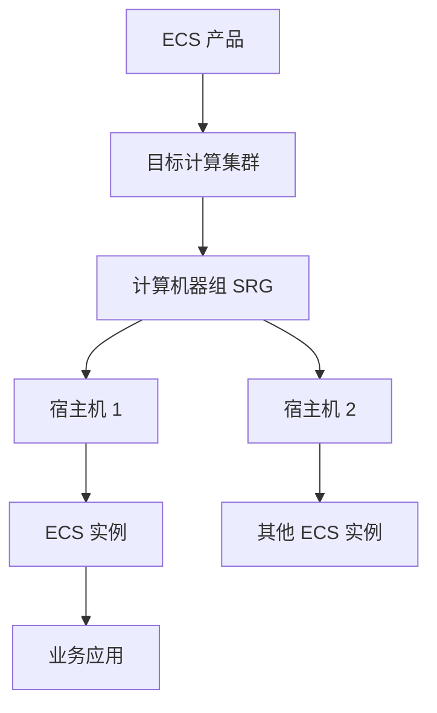
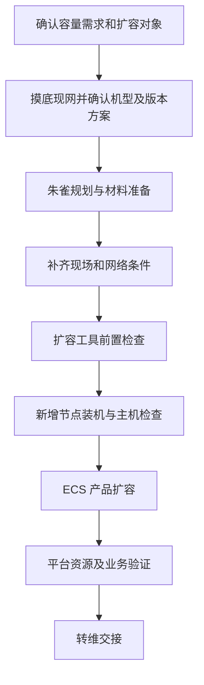

---
{"dg-publish":true,"permalink":"/培训/2026.10.11 云平台/2026.10.13 ecs扩容/","dg-note-properties":{}}
---

# ECS扩容

> [!note] 阅读说明
> 本页面向第一次接触云平台扩容的人员，依据 [[培训/2026.10.11 云平台/2026.10.12 扩容交付\|扩容交付培训笔记]] 整理，重点是阿里云飞天平台侧增加 ECS 计算承载节点。基础概念、检查建议和假设案例属于补充说明；具体产品限制、界面路径、参数、命令和执行顺序，以本环境版本的正式扩容方案为准。

## 一、先弄清楚：这次到底扩什么

**ECS（Elastic Compute Service）是云服务器服务。** 业务人员使用的是一台台云服务器实例；这些实例背后，需要物理服务器提供 CPU、内存等计算资源。承载虚拟机的物理服务器，也常称为宿主机。

听到“ECS 不够用了”，先确认是哪一层资源不足：

| 需求 | 实际要改变什么 | 与本页的关系 |
| --- | --- | --- |
| 某台云服务器 CPU、内存不够 | 调整该实例的规格 | 属于实例升配，另查实例变更方案。 |
| 某台云服务器磁盘空间不够 | 扩大对应磁盘，按需扩分区和文件系统 | 属于存储扩容，步骤取决于磁盘及操作系统。 |
| 应用需要更多服务器 | 新建更多 ECS 实例，配置应用与流量分配 | 需要先确认平台有足够资源、配额及网络条件。 |
| 平台可用计算资源不足 | 新增承载 ECS 实例的计算节点，或按支持方式新增计算集群 | **本页重点讨论的场景。** |

增加底层宿主机后，已有虚拟机的 CPU、内存不会自动变大，应用也不会自动获得更多实例。扩容是否解决问题，要回到最初的资源瓶颈和使用需求验证。

下面是简化的承载关系，具体组件和拓扑因平台部署而异：

## 二、看懂几个常见名词和工具

| 名词或工具 | 新手可以怎样理解 | 在扩容中负责什么 |
| --- | --- | --- |
| 集群 | 一组按产品架构协同提供服务的节点和组件 | 明确本次资源加入哪个集群，或是否需要新增集群。 |
| SRG（Server Role Group，机器组） | 集群中组织相应服务角色节点的分组 | 确定机器承担什么工作、属于哪个组。角色及分组规则按产品定义。 |
| 服务角色 | 节点在产品中承担的职责 | 例如计算或管理；这里是概念举例，ECS 实际角色名称需查方案。 |
| 朱雀 | 交付规划系统 | 规划产品、版本、集群、机器、数量及网络等，生成规划包。 |
| ASO | 本次培训使用的扩容交付工具 | 读取规划等材料，按支持流程组织扩容准备、装机、产品扩容和检查。英文全称未在资料中明确。 |
| ASI | 培训介绍的旧版扩容工具 | 部分旧环境可能使用；与 ASO 的适用版本边界待核实。 |
| 飞天基础运维平台、天机 | 培训中查看和管理平台资源、集群信息的入口或系统 | 演示涉及从“资源管理”进入新版天机查看信息；两者及 ASO 的具体衔接以现场版本为准。 |
| CI/CD 出包平台 | 本次培训中的软件材料准备平台 | 根据目标版本和现网情况分析依赖、生成软件包。 |
| 基线 | 产品版本及相关软件材料的引用信息 | 确认要使用哪些产品版本；多个产品可按需组合自定义基线。 |
| 规划包 | 朱雀输出的部署规划数据 | 告诉后续工具哪些节点以什么配置加入哪里。它与软件包用途不同。 |
| SN、机位、IP | 设备序列号、安装位置、网络地址 | 对应“哪台设备、放在哪里、怎样访问”；主机可能有多个 IP。 |

理解工具分工时，可以沿着这条线看：**朱雀形成规划，CI/CD 按需准备软件材料，ASO 按支持流程组织实施，运维平台提供相应资源和状态信息。** 具体入口不一定都在同一个页面。

## 三、ECS 扩容最先判断的几件事

### 1. 新机器能否加入原集群

**同构**表示新增机器满足该产品要求的硬件一致性；**异构**表示存在需要评估的机型或配置差异。不要仅凭服务器外壳、品牌或整机名称判断同构，还要按方案核对 CPU 架构及型号、内存、磁盘、网卡、驱动等要求。

按本次培训讲解，**ECS 对硬件一致性要求较强，异构场景不能照搬其他产品“新增一个 SRG 就能混部”的做法，需评估新增或拆分集群的方案。** 支持范围和具体做法应核对当前版本，不能把培训口述当作所有 ECS 环境的统一规则。

| 现场情况 | 下一步判断 |
| --- | --- |
| 新机器满足原集群同构要求 | 确认原集群及目标计算机器组支持本次增加节点的方式。 |
| 新机器与现网机型或关键配置不同 | 先确认适配结论及集群规划方案，再做朱雀规划。 |
| 平台尚未部署 ECS 产品 | 按新增产品场景确认依赖、版本和部署条件。 |

这里的“新增集群”是在规划中增加一套产品集群安排；是否涉及现有集群调整、业务迁移，要看专项方案。创建规划对象本身不会自动完成业务迁移。

### 2. 版本和商务配置是否正确

- **版本**：已有产品扩容先核对现网基线和产品版本。培训后续强调已部署 ECS 产品新增集群时也要考虑产品版本一致性；相关口述有矛盾，正式规则待核实，不能直接选择最新版本。
- **共享或独享**：培训出现 `share`、`exclusive` 等模式，应与 SA（方案接口人）确认本次选择。字段的实际资源边界不能仅按字面推断。
- **数量**：区分“现网继承数量”和“本次新增数量”，核对页面每一列的定义。不要照搬 [[培训/2026.10.11 云平台/2026.10.14 mysql扩容\|MySQL 扩容笔记]] 的双数要求，ECS 的数量和分布按自身方案确定。

### 3. 计算以外的资源是否配套

宿主机增加后，仍需要可用的网络、存储和管理能力。计算资源充足，不代表对应实例所需的存储容量、I/O 性能、地址、配额及调度条件都满足。新增集群还需确认后续怎样被使用。

## 四、从准备到转维，逐步理解流程

图中按工作目的归纳环节，材料准备与现场工作可按项目安排开展；执行变更前应完成所需审批和授权。各阶段检查通过后，再进入依赖它的下一阶段。

### 第一步：明确需求，记录扩容前状态

**目的：确定增加什么资源，以及完成后怎样判断有效。**

1. 记录环境、目标产品、集群、SRG 和服务角色，区分底层节点扩容与实例升配。
2. 核查容量和增长趋势，确认瓶颈是计算能力、可分配资源还是其他条件。实例创建失败也可能与配额、规格或调度约束有关，需先查原因。
3. 记录现有节点、容量、资源使用和告警状态，作为扩容前基准。
4. 明确业务影响、实施窗口、验证方式及异常处理安排，按本单位要求完成变更审批和账号授权。

这一阶段应得到：**明确的目标对象、增量需求、现网基准和适用方案。** 在电力信息通信场景中，还需结合承载应用及上下游关系确认影响范围。

### 第二步：摸底设备、机型和版本

**目的：确认到货设备能够按方案投入使用。**

1. 核对实际设备的 SN、型号和硬件配置；确认同构要求，异构或非标设备先取得适配结论和装机模板参数。
2. 核对现网 ECS 及相关依赖版本，确认本次采用的基线、软件材料和扩容工具版本。
3. 核对机柜、供电、机位、布线、交换机端口及地址等条件，列明缺项并补齐。

设备清单、现场状态与方案不一致时，先协调确认，不能只在规划表里换一个相近机型继续执行。

### 第三步：在朱雀中完成规划

**目的：把需求落实到真实设备、目标集群及部署参数。**

1. 核对商务配置单所属环境、交付视图和打标状态，确认本次产品范围。
2. 选择已确认的基线与组件，核对继承的现网集群、机器组、机型和数量。
3. 根据同构或异构方案填写新增数量，完成所需集群规划。培训演示的 ECS 异构场景使用“添加集群”，实际入口和条件以版本为准。
4. 填写相应集群商务配置，确认 CPU 型号及共享、独享等模式。
5. 按实际范围填写网络扩容、机房勘察、交换机和服务器上架信息，复核 SN、机位、产品用途及网络连接。
6. 按流程完成所需虚拟资源调度、地址分配和规划同步，核对自动生成结果，再导出规划包。是否涉及两侧规划及额外文件，按本次场景确认。

这一阶段应得到：**与实际设备及获批范围一致的规划包、节点清单和版本信息。** 按需准备的软件包也要与这些信息匹配。

### 第四步：进入扩容工具，完成前置检查

**目的：确认工具看到的对象与规划一致，具备执行条件。**

1. 使用本环境确认的 ASO 或 ASI 地址和获批账号，确认工具支持当前 ECS 产品版本与扩容场景。
2. 按方案进入扩容流程并加载所需材料，逐项复核环境、产品、集群、节点、机型和数量。
3. 完成规定的依赖、资源和网络检查；涉及网络扩容时，先验证新增节点所需连接已经可用。
4. 保存检查结果。失败项应查明原因，不能因为界面允许继续就认为可以忽略。

现有资料没有完整的 ECS 专项页面截图，**具体菜单、检查项名称及任务参数待核实**。

### 第五步：新增节点装机与主机检查

**目的：让新增设备具备运行 ECS 相关服务的系统条件。**

装机前复核 SN、主机名和管理地址，确认全部是本次新增节点。按方案使用匹配的装机模板，完成后核查：

- 操作系统、内核、驱动和固件是否符合方案要求。
- CPU、内存、磁盘和网卡是否被正确识别；虚拟化支持及相关设置是否符合要求。
- 磁盘分区、文件系统、挂载及容量是否符合 ECS 对应机型、角色的标准。
- 管理及业务所需网络、名称解析、时间同步等是否按方案正常。
- 必需组件和管理能力是否具备，是否出现新增主机告警。

上述是通用检查方向，具体项目以方案为准。MySQL 页中的 `/u01`、`/u02` 检查不能直接作为 ECS 分区标准；也不能把宿主机空闲磁盘直接认作可用云盘容量。

### 第六步：执行 ECS 产品扩容

**目的：让装好系统的机器成为 ECS 产品能够管理和使用的资源。**

1. 按方案执行产品扩容任务，部署所需组件，将新增节点纳入规划中的目标集群及服务角色。
2. 每个阶段完成后检查任务结果、节点状态和日志，保留任务编号及异常信息，再继续后续步骤。
3. 按方案完成新增资源所需的调度配置或开放动作，确认节点具备被使用的条件。具体动作及入口待核实。
4. 观察现有节点、实例和业务告警，发现异常时按预定条件暂停或处置。

**装机成功、产品部署成功、资源可调度、业务验证通过，是需要分别确认的结果。** 新增集群的资源是否能供目标租户、规格或业务使用，也需验证。

### 第七步：验收与转维

**目的：证明新增资源可用，并让后续运维掌握实际变化。**

| 验证层次 | 检查什么 | 能说明什么 |
| --- | --- | --- |
| 节点与归属 | 数量、SN、主机名、集群、机器组及角色与规划一致 | 加入了正确的机器和位置。 |
| 服务与健康 | 方案规定的组件、节点健康检查及监控告警正常 | 节点具备相应服务条件。 |
| 容量与调度 | 比较扩容前后的资源统计，确认新增资源可分配 | 容量被平台识别且具备使用条件。具体统计口径按平台定义。 |
| 实例使用 | 按获批方案创建或使用测试实例，并确认实际落在新增资源上 | 新资源能承载目标实例；只在旧节点创建成功不能证明这一点。 |
| 网络与存储 | 验证测试实例所需网络、磁盘访问和对应功能 | 计算资源所依赖的能力可正常使用。 |
| 原有业务 | 对照扩容前基准，核查既有实例、关键业务和告警 | 扩容未引入已识别的业务异常。 |

验证范围、阈值、观察时长及测试资源清理由实际方案确定。新增硬件的 CPU、内存总量与租户可分配量，可能因系统预留和调度策略等不同；不直接按物理规格计算可售实例数。

转维时更新节点台账、实际集群和网络配置、版本信息、容量、监控、任务及验收记录，并移交遗留问题。

## 五、用一个假设案例串起来

> [!example] 仅用于理解，不代表实际项目或最低扩容数量
> 某电力企业的内部信息应用需要新建一批云服务器。经核查，配额、存储和网络条件满足，但目标 ECS 计算资源余量不足。假设方案确认向原集群增加三台满足同构要求的计算节点。

1. **明确需求**：增加底层计算承载能力；已有业务实例的规格不因此自动改变。
2. **核对设备**：检查三台服务器的真实 SN、配置和适配条件，确认可以加入原集群。
3. **完成规划**：在朱雀中引用匹配基线，把三台设备规划到正确集群和机器组，填写商务配置及网络信息，输出规划包。
4. **实施扩容**：工具检查通过后，按方案装机、核查主机条件，再执行 ECS 产品扩容。
5. **验证结果**：确认新增资源可分配，并按获批方案验证实例能够落到新节点且网络、存储正常，同时观察原有业务。
6. **转维交接**：记录实际资源增量和验证结果，完成台账及运维资料更新。

如果到货的是与原集群不同的机型，应回到适配和集群方案确认阶段；不能仅在朱雀里改成另一种机型就认为已经满足产品要求。

## 六、遇到问题时先定位在哪一层

| 现象 | 优先核查方向 |
| --- | --- |
| 规划中没有预期产品或集群 | 环境、配置单、打标、基线、组件选择及现网继承结果。 |
| 装机或前置检查失败 | 设备身份、管理连通性、机型模板、软件材料及工具日志。 |
| 节点装机成功，但产品中不可用 | 产品扩容任务、组件状态、集群归属及角色配置。 |
| 平台容量增加，但实例仍无法创建 | 规格支持、配额、可用区、资源预留、调度约束及网络存储依赖。 |
| 实例创建成功，但业务访问异常 | 实例网络、访问控制、路由、存储及应用本身，结合日志判断。 |

任务失败时先保存失败阶段、节点和日志，确认哪些操作已完成，再按方案重试或恢复。节点已经承载实例后，退出节点、迁移、重装或回退需按产品流程处理，不能直接删除或重新装机。

## 七、现场还需要补齐哪些信息

- 本环境平台、ECS 产品及扩容工具版本，正式方案及适配结论。
- ECS 扩容的实际菜单路径、页面截图、任务阶段、服务角色及参数说明。
- 同构硬件标准，异构时新增或拆分集群的支持条件及版本规则。
- 共享、独享模式含义，新增数量、资源分布、网络和磁盘标准。
- 资源开放与调度要求、验收阈值、观察时长和分阶段异常处理步骤。
