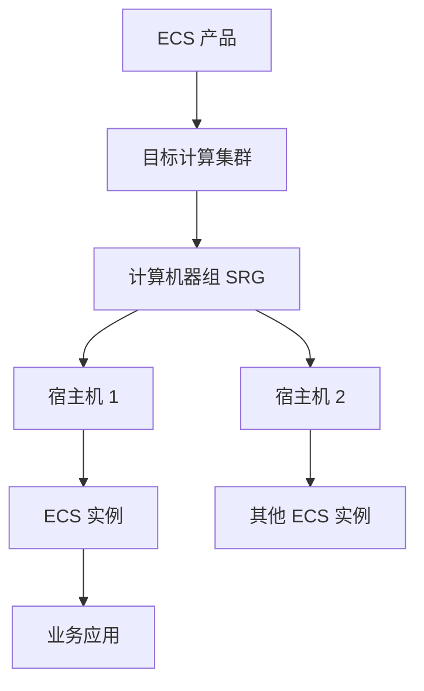
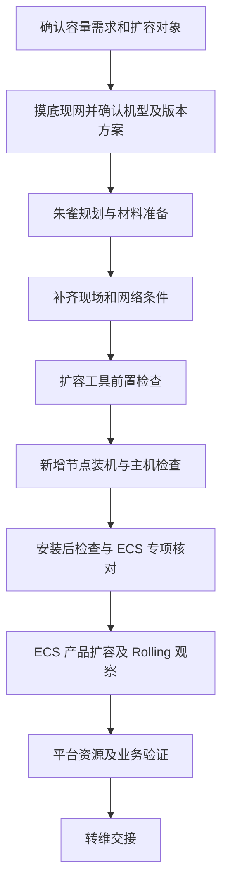

---
{"dg-publish":true,"permalink":"/培训/2026.10.11 云平台/2026.10.13 ecs扩容/","dg-note-properties":{}}
---

# ECS扩容

> [!note] 阅读说明
> 本页面向第一次接触云平台扩容的人员，依据本页录音转录和 [[培训/2026.10.11 云平台/2026.10.12 扩容交付\|扩容交付培训笔记]] 整理，重点是阿里云飞天平台侧增加 ECS 计算承载节点。转录包含通用装机流程、ECS 专项检查及天机产品扩容演示；下面会区分它们的适用范围。基础概念、只读检查命令和假设案例属于补充说明；具体产品限制、界面路径、参数、命令和执行顺序，以本环境版本的正式扩容方案为准。

第一次阅读可先看第一、二节理解对象和名词，再按第四节逐步核对。**主线是：规划正确 → 安装系统 → 检查新增节点 → 加入 ECS 产品 → 观察任务 → 验证可用。** 原始转录保留在文末，便于回查。

## 一、先弄清楚：这次到底扩什么

**ECS（Elastic Compute Service）是云服务器服务。** 业务人员使用的是一台台云服务器实例；这些实例背后，需要物理服务器提供 CPU、内存等计算资源。承载虚拟机的物理服务器，也常称为宿主机。

听到“ECS 不够用了”，先确认是哪一层资源不足：

| 需求 | 实际要改变什么 | 与本页的关系 |
| --- | --- | --- |
| 某台云服务器 CPU、内存不够 | 调整该实例的规格 | 属于实例升配，另查实例变更方案。 |
| 某台云服务器磁盘空间不够 | 扩大对应磁盘，按需扩分区和文件系统 | 属于存储扩容，步骤取决于磁盘及操作系统。 |
| 应用需要更多服务器 | 新建更多 ECS 实例，配置应用与流量分配 | 需要先确认平台有足够资源、配额及网络条件。 |
| 平台可用计算资源不足 | 新增承载 ECS 实例的计算节点，或按支持方式新增计算集群 | **本页重点讨论的场景。** |

增加底层宿主机后，已有虚拟机的 CPU、内存不会自动变大，应用也不会自动获得更多实例。扩容是否解决问题，要回到最初的资源瓶颈和使用需求验证。

下面是简化的承载关系，具体组件和拓扑因平台部署而异：



## 二、看懂几个常见名词和工具

| 名词或工具 | 新手可以怎样理解 | 在扩容中负责什么 |
| --- | --- | --- |
| 集群 | 一组按产品架构协同提供服务的节点和组件 | 明确本次资源加入哪个集群，或是否需要新增集群。 |
| SRG（Server Role Group，机器组） | 集群中组织相应服务角色节点的分组 | 确定机器承担什么工作、属于哪个组。角色及分组规则按产品定义。 |
| 服务角色 | 节点在产品中承担的职责 | 例如计算或管理；这里是概念举例，ECS 实际角色名称需查方案。 |
| 朱雀 | 交付规划系统 | 规划产品、版本、集群、机器、数量及网络等，生成规划包。 |
| ASO | 本次培训使用的扩容交付工具 | 读取规划等材料，按支持流程组织扩容准备、装机、产品扩容和检查。英文全称未在资料中明确。 |
| ASI | 培训介绍的旧版扩容工具 | 部分旧环境可能使用；与 ASO 的适用版本边界待核实。 |
| 飞天基础运维平台、天机 | 培训中查看和管理平台资源、集群信息的入口或系统 | 演示涉及从“资源管理”进入新版天机查看信息；两者及 ASO 的具体衔接以现场版本为准。 |
| CI/CD 出包平台 | 本次培训中的软件材料准备平台 | 根据目标版本和现网情况分析依赖、生成软件包。 |
| 基线 | 产品版本及相关软件材料的引用信息 | 确认要使用哪些产品版本；多个产品可按需组合自定义基线。 |
| 规划包 | 朱雀输出的部署规划数据 | 告诉后续工具哪些节点以什么配置加入哪里。它与软件包用途不同。 |
| SN、机位、IP | 设备序列号、安装位置、网络地址 | 对应“哪台设备、放在哪里、怎样访问”；主机可能有多个 IP。 |
| Buffer | 培训中新增机器装好系统后、进入目标产品前所在的过渡集群或机器组 | “八份、八分儿、八核装机”等多处转录按上下文理解为 Buffer 或 Buffer 装机，不是指 CPU 必须为八核。具体对象名称以页面为准。 |
| iClone、iHardware | 转录中的装机和硬件／环境检查系统 | 前者查看装机队列、阶段和结果，后者查看环境检查明细；入口以本环境为准。 |
| OOB、带外、KVM | OOB 是带外管理；KVM 在此处指服务器远程控制台 | 通过服务器管理通道查询或控制设备，用于装机启动、查看控制台等；此处 KVM 不指虚拟化技术。 |
| PXE | 通过网络引导机器启动的方式 | 装机时引导新增节点进入临时系统，继续检测和安装。 |
| 临时免密通道 | 让扩容工具在授权期限和范围内连接待检查主机的通道 | 自动检查可能依赖它；创建后还要确认已生效并覆盖实际目标节点。 |
| Rolling | 按依赖和策略分批执行组件变更的任务过程 | 查看运行、等待、失败等状态，观察任务是否持续推进；不是一次性重启所有节点。 |
| Diff（变更预览） | 对比变更前后配置，显示增加、删除和修改内容 | 提交前确认新增节点、集群、机器组及相关配置的变化符合方案。 |

理解工具分工时，可以沿着这条线看：**朱雀形成规划，CI/CD 按需准备软件材料，ASO 按支持流程组织实施，运维平台提供相应资源和状态信息。** 具体入口不一定都在同一个页面。

## 三、ECS 扩容最先判断的几件事

### 1. 新机器能否加入原集群

**同构**表示新增机器满足该产品要求的硬件一致性；**异构**表示存在需要评估的机型或配置差异。不要仅凭服务器外壳、品牌或整机名称判断同构，还要按方案核对 CPU 架构及型号、内存、磁盘、网卡、驱动等要求。

按本次培训讲解，**ECS 对硬件一致性要求较强，异构场景不能照搬其他产品“新增一个 SRG 就能混部”的做法，需评估新增或拆分集群的方案。** 本页转录还明确讲到 x86 与 ARM 不放在同一个 ECS 集群，分别规划。支持范围和具体做法应核对当前版本，不能把培训口述当作所有 ECS 环境的统一规则。

| 现场情况 | 下一步判断 |
| --- | --- |
| 新机器满足原集群同构要求 | 确认原集群及目标计算机器组支持本次增加节点的方式。 |
| 新机器与现网机型或关键配置不同 | 先确认适配结论及集群规划方案，再做朱雀规划。 |
| 平台尚未部署 ECS 产品 | 按新增产品场景确认依赖、版本和部署条件。 |

这里的“新增集群”是在规划中增加一套产品集群安排；是否涉及现有集群调整、业务迁移，要看专项方案。创建规划对象本身不会自动完成业务迁移。

### 2. 版本和商务配置是否正确

- **版本**：已有产品扩容先核对现网基线和产品版本。培训后续强调已部署 ECS 产品新增集群时也要考虑产品版本一致性；相关口述有矛盾，正式规则待核实，不能直接选择最新版本。
- **共享或独享**：培训出现 `share`、`exclusive` 等模式，应与 SA（方案接口人）确认本次选择。字段的实际资源边界不能仅按字面推断。
- **数量**：区分“现网继承数量”和“本次新增数量”，核对页面每一列的定义。不要照搬 [[培训/2026.10.11 云平台/2026.10.14 mysql扩容\|MySQL 扩容笔记]] 的双数要求，ECS 的数量和分布按自身方案确定。

### 3. 计算以外的资源是否配套

宿主机增加后，仍需要可用的网络、存储和管理能力。计算资源充足，不代表对应实例所需的存储容量、I/O 性能、地址、配额及调度条件都满足。新增集群还需确认后续怎样被使用。

## 四、从准备到转维，逐步理解流程



图中按工作目的归纳环节，材料准备与现场工作可按项目安排开展；执行变更前应完成所需审批和授权。各阶段检查通过后，再进入依赖它的下一阶段。

### 第一步：明确需求，记录扩容前状态

**目的：确定增加什么资源，以及完成后怎样判断有效。**

1. 记录环境、目标产品、集群、SRG 和服务角色，区分底层节点扩容与实例升配。
2. 核查容量和增长趋势，确认瓶颈是计算能力、可分配资源还是其他条件。实例创建失败也可能与配额、规格或调度约束有关，需先查原因。
3. 记录现有节点、容量、资源使用和告警状态，作为扩容前基准。
4. 明确业务影响、实施窗口、验证方式及异常处理安排，按本单位要求完成变更审批和账号授权。
5. 在天机／平台任务管理中查看运行中及中断、未结束任务，确认没有与本次扩容冲突的变更。转录的天机演示强调 Rolling 期间的并行变更限制；本次 ECS 会影响哪些组件、需要冻结哪些操作，应查 ECS 方案后与运维确认，不能推定扩容必然不影响业务。

这一阶段应得到：**明确的目标对象、增量需求、现网基准和适用方案。** 在电力信息通信场景中，还需结合承载应用及上下游关系确认影响范围。

### 第二步：摸底设备、机型和版本

**目的：确认到货设备能够按方案投入使用。**

1. 核对实际设备的 SN、型号和硬件配置；确认同构要求，异构或非标设备先取得适配结论和装机模板参数。
2. 核对现网 ECS 及相关依赖版本，确认本次采用的基线、软件材料和扩容工具版本。
3. 核对机柜、供电、机位、布线、交换机端口及地址等条件，列明缺项并补齐。

设备清单、现场状态与方案不一致时，先协调确认，不能只在规划表里换一个相近机型继续执行。

### 第三步：在朱雀中完成规划

**目的：把需求落实到真实设备、目标集群及部署参数。**

1. 核对商务配置单所属环境、交付视图和打标状态，确认本次产品范围。
2. 选择已确认的基线与组件，核对继承的现网集群、机器组、机型和数量。
3. 根据同构或异构方案填写新增数量，完成所需集群规划。培训演示的 ECS 异构场景使用“添加集群”，实际入口和条件以版本为准。
4. 填写相应集群商务配置，确认 CPU 型号及共享、独享等模式。
5. 按实际范围填写网络扩容、机房勘察、交换机和服务器上架信息，复核 SN、机位、产品用途及网络连接。
6. 按流程完成所需虚拟资源调度、地址分配和规划同步，核对自动生成结果，再导出规划包。是否涉及两侧规划及额外文件，按本次场景确认。

这一阶段应得到：**与实际设备及获批范围一致的规划包、节点清单和版本信息。** 按需准备的软件包也要与这些信息匹配。

### 第四步：进入扩容工具，完成前置检查

**目的：确认工具看到的对象与规划一致，具备执行条件。**

#### 4.1 导入规划包，生成任务流

1. 使用本环境确认的 ASO 或 ASI 地址和获批账号，确认工具支持当前 ECS 产品版本与扩容场景。以下按录音中的 **ASO** 演示说明。
2. 在朱雀完成规划后，下载用于企业版扩容场景的规划数据包。转录称为“SD Data”（正式名称待核实）；它是规划数据，不是操作系统镜像或产品软件包。
3. 在 ASO 的扩容包导入／创建入口上传并提交规划包。入口名称按现场页面核对，录音未提供完整菜单路径。
4. 对照朱雀及节点清单，核对“产品概览”中的产品、机型、服务器数量，并继续核对具体集群和节点。录音演练导入了多个产品，**本次实际计划扩哪些就核对哪些**，不照搬演示的产品数或机器数。
5. 检查导入后识别的“服务器安装”和各产品扩容任务，为流程填写能区分环境、产品和批次的名称，再完成创建。
6. 打开生成的任务列表，确认 ECS 任务的目标正确，并查看前置依赖。录音中产品扩容依赖服务器安装完成，不能跳过装机直接提交产品任务。

**完成标志：**规划包成功导入，任务流生成；产品、机器及目标集群与本次方案一致。保留概览、流程名称和任务编号，后续回到这条流程操作。

#### 4.2 建立检查通道，逐项完成安装前检查

1. 按方案建立临时免密通道／自动化凭证，确认有效期、目标范围和生效状态。录音中为演示手工检查没有正常使用全部自动化能力；实际操作按适用方案选择检查方式。
2. 执行安装前检查，阅读每一项的状态和详情。常见方向包括 IP 可用性、相关磁盘空间、依赖集群和数据库主备状态、运行中或中断任务、时间同步及适用的证书、开关检查。**实际出现什么、是否涉及，由本环境和产品方案决定**，不将录音中其他产品的专属项一律加入 ECS。
3. 录音演示在 OBS 相关节点用 `df -h` 查看 `disk2` 镜像仓库空间，当时要求使用率低于 80%。这是该演练的检查项和阈值；本环境主机、挂载点、阈值需核对方案。不要因此把新增 ECS 节点的数据盘当成镜像仓库检查。
4. 对自动检查失败或无法连接的项，先区分“检查没执行成功”与“被检查对象确实不合格”。前者查通道、权限和连通性，后者处理实际问题后复查。
5. 方案允许人工检查时，保存查询对象、结果和结论，再按工具要求登记人工确认；不涉及的项注明依据。录音中的“忽略／跳过”经常对应已经人工查过或演练不涉及，不能直接作为生产操作模板。

| 页面结果 | 初学者应怎样判断和处理 |
| --- | --- |
| 自动完成且结果通过 | 查看检查对象和明细是否覆盖本次节点，保留结果。 |
| 自动失败／无法连接 | 尚未证明检查合格；修复执行条件，或按方案完成等效人工检查。 |
| 人工确认／忽略／跳过 | 核查是否有人工检查证据或明确的不适用依据；页面放行本身不能证明合格。 |
| Debug 模式下全部忽略 | 录音里的特殊演练设置，不能据此认定真实硬件检查已通过。 |

#### 4.3 装机前，再核对设备身份和地址

- 对照朱雀服务器上架表，逐台确认 **SN、机位、主机名、IP、产品用途**，尤其避免把其他产品或其他批次的机器选进来。
- 在现网资源记录、名称和地址分配信息中核查主机名、IP 是否冲突。录音提到使用探测命令辅助判断，但 **ping 不通不代表地址一定空闲**，还需结合实际占用记录核查。
- 在 OOB 系统中按 SN 查到对应设备，核对带外地址和管理连通性。查得到是装机准备的一项条件，不能单凭查到 SN 就认定 PXE 一定成功；网络引导仍要看实际任务结果。
- 核对装机模板、所需软件材料和网络条件，保存安装前检查及待安装节点清单。

**完成标志：**所需检查均已通过，或按方案有充分的人工确认／不适用依据；目标机器身份无误，装机条件齐备。

### 第五步：新增节点装机与主机检查

**目的：让新增设备具备运行 ECS 相关服务的系统条件。**

#### 5.1 安装系统，观察完整过程

1. 在“服务器安装”中复核待装节点，勾选本次新增机器，确认选中数量。**装机会改变目标机器系统和磁盘内容，提交前必须确认对象。** 保存开始前的页面，再按方案开始安装。
2. 在 ASO 查看总体进度，在 iClone 查看逐台装机状态，在 iHardware 查看环境／硬件检查详情。跳转失效时，使用本环境确认的入口，不从转录猜地址或账号。
3. 按录音描述，主要过程可理解为：**初始检查 → PXE 网络启动 → 进入临时系统 → 环境／硬件检测 → 正式装系统 → 重启 → 交付检测（录音称 DC）→ 已完成**。正式安装前的检测通过后，才继续后续安装。
4. 录音中约 95% 对应重启阶段，之后还要完成检测；**不能看到 95% 或系统能登录，就认定装机完成**。百分比与阶段映射以实际版本为准。
5. 失败时按节点查看失败阶段和日志，处理后按方案重试。录音演练存在 Debug 忽略检查的情况，真实环境应核实检测结果。
6. 确认本批次应安装的节点全部完成，再按页面流程完成安装，进入安装后检查。若方案允许分批推进，也只能使用已完成安装且检查合格的节点。

**完成标志：**逐台显示安装和交付检测完成；ASO 中计划安装数量与成功数量对应，失败或未完成节点已明确处置。

#### 5.2 确认新节点已纳管，准备安装后检查

“纳管”就是平台已经识别并管理这台机器。录音提醒，装机完成与密码管理系统同步完成可能存在时间差，纳管后登录凭据也可能由系统更新。

1. 在天机及密码管理系统中查到新增节点，核对身份与状态。
2. 按方案重新创建或更新临时免密通道，确保覆盖这批新加入的 Buffer 节点；装机前的通道未必覆盖它们。
3. 按正式方案在指定执行主机配置所需凭证，并确认可连接目标节点。录音未完整给出命令、路径和权限，不能照“粘贴、EOF、加权限”的口述拼接执行。
4. 执行安装后检查。如果显示无法连接，先处理纳管、通道或权限问题，不能直接得出“硬件不合格”或“检查通过”的结论。

#### 5.3 找到正确的线上对照节点

同构扩容时，需要把新增节点与**目标 ECS 集群中相同角色、符合标准的在用节点**对比，不能随便找一台云平台服务器。

1. 在 ASO 的 ECS 任务中记下新增节点主机名、目标集群和 SRG。
2. 参考录音，在天机“产品集群运维”中查对应 Buffer 对象，核对其关联目标；也可以直接按 ASO 给出的目标集群查询。
3. 在目标集群的机器分组／关联机器中，找到与本次计算节点角色匹配的线上节点。具体页面名称以版本为准。
4. 分别打开线上对照节点和新增节点的授权终端，执行相同的只读检查，按“节点、项目、线上值、新增值、结论”记录结果。

新增异构集群没有合适的同构对照节点时，应按已确认的机型适配标准及模板检查。即使与线上一致，也还要满足本次方案，不能用“线上能跑”代替适配结论。

#### 5.4 完成主机通用检查和 ECS 专项检查

| 检查项目 | 要看什么 | 依据及注意点 |
| --- | --- | --- |
| 系统与硬件识别 | 操作系统、内核、驱动、固件；CPU、内存、磁盘及网卡识别情况 | 通用补充检查方向，按机型模板和正式方案核对。 |
| CPU 架构及配置 | x86／ARM、CPU 型号、逻辑 CPU 数、每核线程数、NUMA 拓扑及 BIOS 相关项 | 转录要求对照线上；“木马”疑为 NUMA，具体所指待核实，不直接据此改 BIOS。 |
| 网卡 | 型号、数量、速率、驱动及接入配置 | 转录专门强调 ECS 网卡要与线上核对；哪些字段必须一致按方案确定。 |
| 磁盘、分区与挂载 | 盘型、容量、分区、挂载路径，以及路径实际对应哪块设备 | 转录强调 ECS 挂载容量不能比线上小；容量更大仍须满足机型和模板要求。不能只比较总容量。 |
| CPU 性能模式 | 本机型要求的 BIOS 电源策略、系统调频策略及适用检查项 | 转录特别强调海光 ECS 节点的性能模式，鲲鹏新旧机型口述有所区分；具体机型规则待核实。 |
| 时间、网络与管理 | 时间同步状态、所需网络、名称解析、管理能力及新增告警 | 依据安装后检查清单与产品方案逐项确认。 |

下面是**补充的 Linux 只读检查示例**，用于理解怎样取数，不是录音完整提供的专有命令，也不能代替平台检查脚本。先确认登录主机身份；同构对比时在对照节点和新增节点分别执行，并保存输出。

```bash
hostname
lscpu
free -h
lsblk -o NAME,TYPE,SIZE,FSTYPE,MOUNTPOINT
df -hT
ip -br link
```

- `hostname`：确认当前查的是哪台机器。
- `lscpu`：看架构、CPU 型号、线程和 NUMA 信息；`free -h` 看系统识别的内存。可用内存会随负载变化，不能拿两个瞬时空闲值判断机型是否一致。
- `lsblk`：看磁盘、分区及挂载对应关系；`df -hT`：看已挂载文件系统的类型、总量与使用率。需要同时看两者，才能发现“容量差不多，但挂错设备”的问题。
- `ip -br link`：先看接口及状态；网卡型号、驱动和速率仍需按方案进一步查询，这条命令本身不能完成全部网卡检查。

> [!important] CPU 频率显示不能单独证明性能模式
> 录音用 `lscpu` 中是否出现 Max／Min 频率辅助说明性能模式，并提及 `cpupower`。这些输出会受 CPU、驱动、内核和工具版本影响；**有无 Max／Min、某一时刻的频率高低，都不能单独证明性能模式已开启或关闭**。如环境已安装并支持，可用 `cpupower frequency-info` 辅助查看调频信息，再结合 BIOS 电源策略、系统策略及本机型正式检查项判断。不要直接套用 Intel、海光或鲲鹏其他机型的设置方法。

MySQL 页中的 `/u01`、`/u02`，以及转录中 CDS／OSS 的 NVMe 型号、扇区和 AES 等检查，均有各自适用产品，不能一律作为 ECS 标准；也不能把宿主机空闲磁盘直接认作可用云盘容量。

**完成标志：**安装后检查有明确结果，ECS 适用项逐台核对合格。需调整 BIOS、盘序或系统配置的问题，尽量在 Buffer 阶段、产品扩容开始前处理并复查；具体调整与重启按方案执行。

### 第六步：执行 ECS 产品扩容

**目的：让装好系统的机器成为 ECS 产品能够管理和使用的资源。**

> [!note] 本步的来源范围
> 录音后半段实际演示的是天机产品扩容。下面提炼其 ASO 操作思路，帮助理解 ECS 页面；ECS 的任务名称、Diff 文件、前置项、集群流转和 Rolling 影响范围，必须与 ECS 正式方案核对。天机 Docker Host 的网络和用途检查不直接作为 ECS 的必做项。

#### 6.1 找对任务，选对服务器

1. 回到本次流程的任务列表，核对流程名称、**产品是 ECS**、描述及目标集群，再打开任务详情。录音特别提醒，不要误启动其他产品的任务。
2. 刷新服务器状态，核对 SN、主机名、IP、目标集群、SRG 和角色。只选择安装成功且检查合格的本批次节点。
3. 如果仍显示“待克隆／克隆失败”，刷新后再次核实真实装机结果；不能把持续失败简单归因于缓存，更不能勾选失败节点继续。
4. 勾选后再看“选中服务器数量”是否与计划一致。录音中未勾选时数量为 0，不代表没有待扩机器。
5. 若页面询问是否再次执行安装后检查，按方案和已有检查覆盖情况选择。后补装、重装或修复后的节点需要重新确认，不能因为其他机器已查过就省略。录音中因通道问题选择“否”是演练处理方式，不作为 ECS 的默认选项。
6. 保存所选节点和归属信息，复核后再完成服务器选择。后续按钮可能触发任务，应按当前页面说明及方案逐步提交。

#### 6.2 检查 Diff 和产品扩容前置项

1. 逐个查看变更预览文件，确认新增节点进入正确集群和机器组，相关配置变化与方案一致；检查是否有误删线上节点、改错组或超出本次范围的变更。
2. 不仅看高亮颜色，还要读具体的增加、删除、修改内容；新建集群可能涉及多处配置，不能把“只加一行”当成所有场景的规则。
3. 完成 ECS 方案要求的产品扩容前检查，确认目标集群处于允许变更的稳定状态，没有冲突任务；提交执行前若状态变化，重新核查。
4. 录音天机流程包含“扩容提效”，讲师解释为复用已安装系统、避免二次装机，并口述“假克隆”。ECS 是否有此步骤、适用条件及参数待核实；不自行创建、修改任务或开启提效。

下面只是帮助读懂 Diff 的假设片段，**不是实际配置文件格式，不能直接导入**：

```diff
  ecs-compute-01
  ecs-compute-02
+ ecs-compute-03
```

原有两台保留、新增一台，且所属集群和组正确，才符合这个例子的意图。若出现 `- ecs-compute-01`，应先查清删除原因再继续；实际还需检查其他关联文件。

#### 6.3 提交执行，观察节点及 Rolling 任务

1. 按方案完成最终复核并提交，记录任务编号、开始时间和所选节点，保存执行前后页面。
2. 在 ASO 看任务阶段，在天机查节点归属、健康状态及关联自动化任务。录音天机演示经历 **Buffer → default → 目标产品集群**；这是其演示路径，不能手动照此搬动 ECS 节点，ECS 的实际流转以任务和方案为准。
3. 在平台任务管理中查看本次关联 Rolling 任务，可结合任务编号、目标集群筛选“运行中／未结束”，展开组件、角色和节点明细。不要只看总进度条。
4. 按下表判断当前进展，持续观察已有实例、关键业务和告警。异常时保留日志和现场状态，按方案联系运维／产品支持处理，不擅自重启、跳过依赖、修改审批策略或重复提交。
5. 全部相关任务成功、节点及集群达到方案要求状态后，再做资源开放／调度配置及验收。**节点已经出现在目标集群中，不等于扩容任务已经完成。**

| 状态或现象 | 怎样理解 | 下一步看什么 |
| --- | --- | --- |
| Running／运行中 | 当前子任务正在执行 | 阶段、日志、更新时间及节点进度是否变化。 |
| Block／等待依赖 | 可能因前置任务未完成而等待，不必然是故障 | 查看具体依赖及上游任务；上游失败或长期无进展时需排查。 |
| 下载中、审批中、升级中、观察中 | 录音中的组件变更阶段，各节点可能处于不同阶段 | 按策略等待并观察；“观察中”仍不是最终成功。实际状态名按版本为准。 |
| Failed／中断／长期停滞 | 可能存在执行条件或产品异常 | 保存首个失败点、节点、错误信息和依赖关系，按方案处理后再确认恢复方式。 |
| Good、Production 等节点标识 | 录音用来说明节点状态，具体字段含义待核实 | 结合集群、任务和健康检查确认，不能只凭一个标签判定完成。 |

录音提到部分 ECS Rolling 可能耗时约三小时，只是经验口述，不是完成时限或正常判据。判断慢还是故障，应看依赖、日志和进展，并使用本次方案的观察及超时要求。

**装机成功、产品部署成功、资源可调度、业务验证通过，是需要分别确认的结果。** 新增集群的资源是否能供目标租户、规格或业务使用，也需验证。

### 第七步：验收与转维

**目的：证明新增资源可用，并让后续运维掌握实际变化。**

| 验证层次 | 检查什么 | 能说明什么 |
| --- | --- | --- |
| 节点与归属 | 数量、SN、主机名、集群、机器组及角色与规划一致 | 加入了正确的机器和位置。 |
| 服务与健康 | 方案规定的组件、节点健康检查及监控告警正常 | 节点具备相应服务条件。 |
| 容量与调度 | 比较扩容前后的资源统计，确认新增资源可分配 | 容量被平台识别且具备使用条件。具体统计口径按平台定义。 |
| 实例使用 | 按获批方案创建或使用测试实例，并确认实际落在新增资源上 | 新资源能承载目标实例；只在旧节点创建成功不能证明这一点。 |
| 网络与存储 | 验证测试实例所需网络、磁盘访问和对应功能 | 计算资源所依赖的能力可正常使用。 |
| 原有业务 | 对照扩容前基准，核查既有实例、关键业务和告警 | 扩容未引入已识别的业务异常。 |

验证范围、阈值、观察时长及测试资源清理由实际方案确定。新增硬件的 CPU、内存总量与租户可分配量，可能因系统预留和调度策略等不同；不直接按物理规格计算可售实例数。

转维时更新节点台账、实际集群和网络配置、版本信息、容量、监控、任务及验收记录，并移交遗留问题。

#### 建议保留的过程记录

录音反复强调检查和执行要截图留痕。学习时可把证据放在对应步骤后；实际交付按项目要求保存，手工检查要能对应到具体节点和项目，不只放一张“已跳过”的页面。

| 阶段 | 建议记录的证据 |
| --- | --- |
| 导入与创建 | 规划包版本／批次、产品概览、节点数量、流程和任务编号。 |
| 安装前 | 主机名及 IP 占用核查、OOB 身份核对、自动或人工检查结果。 |
| 安装中与完成 | 开始前选中节点、逐台装机结果及交付检测结果。 |
| 安装后 | 对照节点与新增节点身份、检查输出、ECS 专项结论及不适用依据。 |
| 产品扩容 | 正确的 ECS 任务、选中节点与数量、Diff 审核结果、前置检查及执行记录。 |
| Rolling 与验收 | 关联任务最终结果、节点和集群状态、容量对比、实例落点和业务验证结果。 |

**单项检查记录示例（空白模板）：**

```text
检查项目：
新增节点（主机名 / SN）：
目标 ECS 集群 / SRG：
线上对照节点或适用标准：
检查方式及结果：
结论（通过 / 不通过 / 不涉及，并说明依据）：
证据位置及遗留问题：
```

## 五、用一个假设案例串起来

> [!example] 仅用于理解，不代表实际项目或最低扩容数量
> 某电力企业的内部信息应用需要新建一批云服务器。经核查，配额、存储和网络条件满足，但目标 ECS 计算资源余量不足。假设方案确认向原集群增加三台满足同构要求的计算节点。

1. **明确需求**：增加底层计算承载能力；已有业务实例的规格不因此自动改变。
2. **核对设备**：检查三台服务器的真实 SN、配置和适配条件，确认可以加入原集群。
3. **完成规划**：在朱雀中引用匹配基线，把三台设备规划到正确集群和机器组，填写商务配置及网络信息，输出规划包。
4. **实施扩容**：导入规划包并创建 ASO 流程，完成安装前检查；三台机器装机及交付检测完成后，核对纳管和检查通道，逐台完成安装后及 ECS 专项检查。随后选中正确的 ECS 任务和三台节点，审核 Diff、完成产品前置检查，再提交并观察关联 Rolling 任务。
5. **验证结果**：确认新增资源可分配，并按获批方案验证实例能够落到新节点且网络、存储正常，同时观察原有业务。
6. **转维交接**：记录实际资源增量和验证结果，完成台账及运维资料更新。

如果到货的是与原集群不同的机型，应回到适配和集群方案确认阶段；不能仅在朱雀里改成另一种机型就认为已经满足产品要求。

## 六、遇到问题时先定位在哪一层

| 现象 | 优先核查方向 |
| --- | --- |
| 规划中没有预期产品或集群 | 环境、配置单、打标、基线、组件选择及现网继承结果。 |
| 自动检查报无法连接 | 目标节点是否已纳管、临时通道是否覆盖且生效、凭据、权限和网络连通性。检查未执行成功不代表节点已经合格。 |
| 装机或前置检查失败 | 设备身份、管理连通性、机型模板、软件材料及工具日志。 |
| 装机看似完成，产品页仍显示待克隆 | 刷新状态，并核对 iClone、交付检测和 ASO 真实结果；持续失败的节点不参与产品扩容。 |
| 节点装机成功，但产品中不可用 | 产品扩容任务、组件状态、集群归属及角色配置。 |
| Rolling 总进度不动、存在 Block | 展开任务看具体依赖，确认上游在推进还是已失败；结合日志及方案时限判断。 |
| 平台容量增加，但实例仍无法创建 | 规格支持、配额、可用区、资源预留、调度约束及网络存储依赖。 |
| 实例创建成功，但业务访问异常 | 实例网络、访问控制、路由、存储及应用本身，结合日志判断。 |

任务失败时先保存失败阶段、节点和日志，确认哪些操作已完成，再按方案重试或恢复。节点已经承载实例后，退出节点、迁移、重装或回退需按产品流程处理，不能直接删除或重新装机。

## 七、现场还需要补齐哪些信息

- 本环境平台、ECS 产品及扩容工具版本，正式方案及适配结论。
- ECS 扩容的实际菜单路径、页面截图、服务角色、Diff 文件及参数说明；录音的通用装机和天机演示已在上文分开标注，ECS 专项任务流仍需补齐。
- 同构硬件标准，异构时新增或拆分集群的支持条件及版本规则。
- 共享、独享模式含义，新增数量、资源分布、网络和磁盘标准。
- 资源开放与调度要求、验收阈值、观察时长和分阶段异常处理步骤。
- ECS 对应机型的网卡、磁盘及挂载标准，海光／鲲鹏各机型性能模式的正式判断方法；CPU 频率显示不能作为唯一判据。
- 规划数据包正式名称、检查通道的执行主机／命令／权限、iClone 与 iHardware 入口及所需账号权限。录音没有完整给出，不据口述拼接。
- ECS 是否采用提效／免二次装机流程、实际节点流转、Rolling 依赖及并行变更限制，不能直接沿用天机 Docker Host 的演示。

### 转录术语与整理依据

原始转录保留在下方；上文整理时统一了可由上下文确认的术语，并保留不能确认的内容：

| 转录表述 | 上文采用的表述及依据 |
| --- | --- |
| 八份、八分儿、八核装机 | Buffer／Buffer 装机；同一段落明确出现 Buffer，且讲解其为安装系统后进入产品前的过渡状态，不据此推导 CPU 核数。 |
| P 差异、P 叉一等 | PXE；上下文描述网络引导、重启进入临时系统并继续装机。 |
| 柔力、肉钉、routine 等任务称谓 | Rolling；上下文多次出现 rolling，并描述组件按依赖分批变更。 |
| 第五文件、地服文件 | Diff／变更预览；上下文是在逐份核对配置的增加、删除和修改。 |
| 木马、中态／终态、甲克隆 | 分别疑指 NUMA、集群是否达到稳定终态、假克隆；具体字段、含义及 ECS 适用性仍待核实，不据这些词直接生成配置或执行命令。 |

录音中的“自动失败后跳过”“Debug 全部忽略”“不再执行安装后检查”，均结合演练背景解释；CPU 性能模式则补充了通用技术判断，避免将口述的频率显示经验当作确定规则。

# 转录
你先这里对应截图就好了，把这个图给它清化掉，然后这里就可以证明你是把这一个检查给完成了，对吧？ 如果你看方案的时候，比如说它这里还有个 ASO 部署，呃，截图计划完成了吗？啊，我没操作，我在看你操作。好吧。你可以，你看我操作也可以，自己操作也可以，可以留给大家时间操作的，反正也有截图演示嘛。然后，比如这里 ASO 部署的时候，因为我们已经部署好了。如果你看你自己忘记，你可以自己给自己写一个提示。部署更新。

 好，你这里就可以提示自己，就不需要不说了。然后这里，你反反正你看的时候，你就跟着方案严格做，它提示什么就注意一下。比如说这里，这个铜雀宴签产品包，但我们没有新增产品就可以跳过，所以这里直接就跳过就可以了。也可以直接反。 用双层镜给他助视力啊！好，你继续往下呗。这个墨尔济产品印象也是一样，还没有跟新增产品那些也是，也可以把那个笔助视力啊。

 啊，这个新增产品基线也是一样，我们是只有二次测产品，没有新增 unpass 的，所以说这个也可以忽略掉。做这些只是为了大家看方案的时候，比如说，如果你不小心把东西擦掉，你要从中再来翻，你可以及时找到对应的地方。还有这里，呃，二点二点二点幺五这个就是最，嗯，正式开始系统装机了嘛。嗯，那大家就登录，呃，我想想啊。 要不就我来实操一下，你们这个就跟着截图吧。不知道这个是最后会如何证明。我把对应的不详细步骤进来，给大家截图一下。这里，首样的你第一个进来，进入到这个ASO扩容工具里面，它叫这个扩容容。然后你进来之后，你点击这一个扩容包的。

 创建导电，啊，它这里其实也有实例的，实例图里面其实你能看见也有，只不过我把它就重新替换了一下，然后你就点点击进去，它这就有一个，它这里就有一个扩容规划包，点击上传提交，这个这个应该知道吧？这个就是我们昨天做规划，然后你从那里面拿到数据包。 然后导入到这里面，嗯，我在我把它一下载出来了。昨天不是上面这里有什么演练什么还没完成嘛，已经完成掉了，它就已经生成出来了，对吧？你看，生成出来之后，下面就有一个这一个，用于企业版扩容场景的 S D Data 数据包，那你就在这里把它下载出来。下载完成之后，你就去这里对应导导入就好了。

 哎。 好，这里你就上传成功了，对吧？然后你就看它下面是怎么说的，什么检查产品概览是否预期，那就是看一下。我给大家说一下怎么看。比如说我们规划四个产品，对吧？往下拉一点，这儿，这一个就对应这下面四个，对吧？你看，天机，ECS，CDS。

 RDS，这四个，然后机型，就是这四个，它它每个机型是不一样的，你可以从这里看出来，对吧？那也是符合预期的。然后至于机型数量，因为咱们这边不是说只实操一次嘛，为了减少就是说大家后续在这个实操过程中它的那个 rolling 的时间过长，我把它缩减了一下，就导嗯，就基本上是用一个可嗯达到最小的一个执行标准吧，也可以这么理解。 一般就是这么看。我给你看的时候，我我重新写一下。核对机型、产品数量、机器、服务器数量。

 是否与下方一致？这一步做的就是这个，这里没有什么疑问吧？这里就是对照，然后教你怎么，呃，这里就是说一下，大概到时候大家如果遇见了，要怎么找，如何对照。然后你这里对照完了，就相当于你刚刚看了这里，我们这里不是一一对应嘛，没有问题，那就点下一步。 嗯，它方案里也是这样，就点下一步，就是到了什么扩容包导入流程，看见没？这个就是跟 S O A S I 的区别，A S I 必须你装完八核装机之后，然后你需要自己去把产品的一些步骤自己给它创建出来。但是这一套这一套，它就靠自己自己的一套任务流自动识别的，它就自己识别出来一个服务器安装，然后扩容这四个任务。但是呢，这个 C E D S，呃，我们有特殊的，后面再提吧。

 然后你相当于就是说，无需你自己做任何操作，只需要你再核对一下，嗯，刚刚的云产品任务，还有系统那个撞击数量，但你在前面就你在前面就已经核对遍、核对好了，所以说这里就可以不用再管。你想细心一点，可以再确认一下，这里就有四个产品对吧？然后六台机器，四款云产品，那就是符合预期的。昨天我们是九台机器。 哎，我刚刚还在说，九台为什么简单？因为想想着后面大家实操的时候，有多一台，它的时间可能要稍微长一点，所以就砍到了，基本上是一个最小的一个扩容度。因为咱们只实操一次，对吧？啊，然后这里，这里你就扩容流程，你就随便填。比如说我自己就写湖北电，湖北，湖，湖北电力培训。

 一零一三，其实这个无所谓，只是说区分一下，因为可能啊，你这个环境，因为之前做过很多扩容，你它可能扩容流程很多，等我先创建出来再给大家说。你在这一步，你在这个扩容流程这一步。 就是这里。其实只要你前面核对好了，那你只需要在这里输一下，那你就完成了。啊，然后你就点完成创建就好了。好，它就会根据自己的一套任务流，它自己去生成，那你就不用管。你看，它这里在进行中，对吧？

 那就怎么样生成出来一个？好，你看它已经生成出来了，然后这里就到服务器安装了，对吧？它这里你看，它这里还能给你再复合一下，比如说你这里云产品的数量、机型数量，然后这就是所有的扩容的任务流都已经在这里面了。你必须，而且它还有个前置依赖，你看见没？ 呃，必须要等你服务器安装完成之后，然后你才能去扩容。扩容，我们可以提前先看一下，比如说这个 E C S 这里，对吧？看没？你这这两台机器它是没有克隆的，没有显示那个嗯，装机克隆成功。你到时候就是，如果你在只搞这一个产品扩容任务的时候，你要刷一下，按一下这上面这个按钮。这个自己做一下笔记啊，我就我截图了。

 你就刷新一下，如果可能有些，比如说一台刷新，一台是克隆成功，一台是显示待克隆或者是克隆失败，那可能是那个系统缓存，你刷新一下。如果它从克隆失败的状态没有变回克隆成功，那就说明这台机器没有装好。那你点产品扩容的时候，你就千万不能点这台失败的，你就只能勾选一台克隆成功的，对，懂了吧？然后就是题外的，后面的，然后最主要的其实就是还是我们先按流程走吧。 我们创建任务完之后，它这里其实不是有说吗？呃，要创建，要创建临时通道。但是我们这次是带着大家一起做这个操作，其实说就是它有一个自动检测的任务流，它能从一到自己检测。但是我们这次就不不创建临时通道了，就带着大家一起手做。这一边它很简单，它已经有很详细的截图，你只要到时候按照方案去做就好了。一般这个应该是有的，就不用管，我们就直接进入这个流程，对吧？你看。

 它这里第一步，它就已经创建ASO自动凭证，它是创建什么？你看，它有些它能自动检查的，这些灰的。嗯，截图示意一下。它这一步就是刚刚的创建临时通道。 你可以看见，它创建临时通道，但是它有些还能自跑，说明这些是不受这个临时通道的影响。它有些智慧的，比如说这个，它检查第十一、第十二水位的，它就会受这个影响。那到时候我们就手动查一下，你看这些手动自己能检测到的，它就自动通过了。如果智慧的，那就说明是依赖第一个。

 这个最前面开始的这个临时通临时通道的临时免密的，所以说这个到时候我大家大家一起做一下就好了，你也能更清楚一下，知道这些到底该怎么做。那我这边就先点个执行了。嗯，它这个是有点浏浏览器问题还是设备问题，它有偶尔会这个样子。如果你遇见它在这里右边收缩，你刷新一下就好了。好，我这边先执行。 一般来说，这里是你要只，嗯，创建完通道，比如说按那个方案里的要求做好了之后，你才去做在点执行，对吧？我这次是带着大家一起做，嗯，你在做的时候，你最好想图方便省事儿，或者你想自己检查，你就不去创建。想如果想省事儿一点，你就去按着有方案去创建一下，然后它就会你看，这里自动跑，然后这些就会失败，大概率就是会失败的。

 这肯定，这个直播有延迟啊！有延迟吗？啊，延迟大概十秒。十秒是吧？那要不还是开钉钉会议？有延迟的话直播。行，那就。声音卡了，嗯。声画不同步。好，行，那我先我结束直播，重新开一下会议嘛。嗯。还是进昨天那个老链接，我把那个链接发出来。 对，有问题就及时反馈就好了。我们可以，因为大家都在现场嘛，及时反馈、修改、订正就好了。

 你看这个。 全部都是。

 这个工具太卡了，我只是跟大家说明一下，因为咱们不是遇见这一个，这里，呃，如果大家在做这个版本装机的时候，你你最好留痕一下，比如说他这里通过的，你就截图，好，证明你自己是证通过的。 你看，它前面这里，我们，我们直接就到这个安装前检查了。它没有什么密评，没有证书，那就说明我们都不涉及。如果涉及的话，它会自动出现的，到时候就正常做就好了。然后主要的问题就是签发证书也没有，你看没？我们这里直接就给你忽略掉，它没有扩容前的这个安装状安装准备，你就不用管它。还有这里，这个就是我们刚刚等会儿要做的。

 确认安装前检查通过，好，那我们就把对应的检查通过的图给放进来。我们现在已经到这个确认IP是否可用，然后检查disk二的水位，对吧？你如果到时候大家不能像用你用百宝袋，因为可能你实操环境没有百宝袋这种东西，你可能就直接从O O B，你直接搜，你在这上面，在这个上面。 搜索 OB，好，你搜索完 OB，它这里就会直接出来。这个就是 OBS 一，这个就是 OBS，这个就是 OBS 二。你就可以直接在这里去查询它的水位状态。嗯，水位状态检查命令很简单，然后我直接方便一点，我就直接用那个。

 终端登录了，不用这里，红雀有点慢。只不过说，跟大家提供另一种方法，你到时候用红雀怎么查，就用这样查就好了。你到时候就输入 D F 杠 H。 好，你去看 disc 二的水位，这个 disc 二呢，它就是存放镜像仓库的，你大概可以做一个了解。如果你不涉及新的产品，那你不用不用盒包，不用盒镜像，那你这个其实就它有点大也不受影响。但是我们这儿是百分之五十四，对吧？你可以看到百分之五十四，它的刚刚的要求是低于百分之八十，那就是安全的，那这个就是通过的。然后这个也是，你看这个就是 disc，就是镜像仓库，它可能做了一下改造。

 嗯。 好，你可以看Disc二也是一样，啊，Oms二呢水位也是百分之五十四，是处于一个安全水位，那你就正常截图记录，记录完成之后，你就往这里给他显示一个。

 忽略，因为咱们已经手动检查过了，之前这个是自动化执行的，那你就输入自己名称，好，那这里我们就也通过了，对吧？那继续再截个图。下面它会自动校自动校验，如果你涉及TLOG，它也会去检验你的那个主机名的规则是否满足这个排序，如果不满足的话，它会给你进行拦截，那你只能重新把TLOG更换主机名，重新给它改一下上架表。 好，还有这里，怎么检查T T Z以及按hardware开关？那你就去到这里，在O P S一下。

 嗯。 在这里，这是扩容检测的，然后这是你要查的这个存在的，然后这个就是它对应路径，到时候你直接cd到这个路径就好了。

 就就是就这两条命令，一个 cat，一个 ll 过过滤一下。好，那这里你检查完了，那你就手动给他通过一下就好了。 好，这个 D B S 主备，那你就只能上到 Min 加 D B S 硬盘上面。

 哦，这个跟我们内部的不太一样。我看一下，白宝宝，你能上去吗？因为一般环境就是咱们自己客户的环境上，直接可以杜康直接跳转了。 这个可能是因为百宝袋的原因，他做了统一的收纳。

 它这个只是杜康，不是迷你杜康，所以那这个其实。 我们就不用管吧，反正也不涉及新增产品，它影影响不是很大，有问题再处理吧。如果但是大家遇见的话，就像，嗯，如果会议让你查，你就这样查就好了，你就到这里到这个密度康俊维这儿，但杜康和小大杜康和小杜康他们界面是长得类似的啊，长得基本上没什么区别，到时候你就点击这里，你点击这个实例列表，然后你搜索这个名称，它就会出现，它有两个，你就点。

 嗯，它有两个，一个是，还有一个，你就点上面这个好了。完成之后，我这边随便拿一个实例做一下演示吧。 你搜索之后，你直接点击点击进去，好，然后这里你就能看见，它这有一个主机实例信息域，你就点这里，这个就是主的，这个就是备的，只要你看见他们是正常运行，那这里就是通过的。

 啊，那你就接着往下，把你这一条给过滤掉就好了，通过就好了。啊，这里检查通过了。 那我们就接着往下，然后这里这些就是呃一系列的这个检查了，然后这个因为进不去嘛，那我们就正常不用管就好了，直接给他通过一下。嗯，一样的看法就是在这里，你只不过点任务与管理这里。

 你就点击这，你就点击这个任务管理，然后这里有个终端任务。 你就正常的去看有没有中断任务就好了，看的方法是一样的。好，这个检查产品依赖集群，我们这次只涉及八份，你可以登录看一下。

 你看它这里没有空的对吧？它没有空的，说明它不受依赖。这里面就没有，如果有八分儿集群，就是可能有残余的空八分儿集群，也可以看见八分儿这里对其他的都是没有依赖的。那你这里就是通过，你可以截一个全面的截图，比如说现在。 现场中台情况和不中台情况，好，那这一步也通过了。呃，这个也是一样，这个就是内部流程，就是要告知PM或者项目经理，告知客户，咱们要进行开始了。

 然后我们这边也不涉及。然后这个昨天已经查过了，大家已经知道怎么查了，对吧？还是在那个路径下。然后始终也检查，昨天也检查了有没有冲突，没有冲突。然后版本已经是最新的了，那你直接通过就好了。好，然后这个SRS我们是三幺八六版本，也不用涉及，那你就直接跳过就好了，因为它下面有描述，你跟着描述看就好了。 然后证书我们没有涉及证书，那你直接就通过就好了。如果有，你就正常截图就好了。那我们这里就检查通过完成了。我试一下我自己账号密码，你学吗？

 不行，这个不行。嗯，那你不用管。啊，这里通过之后，你你看它自动会自动，十秒之后自动进入下一页，那你直接点刷新就好了。好，它就已经跳过来了。然后你这里就是我们正常的六台对吧？你就直接点勾选，然后就可以，其实就可以开始我们的方法装机了。 然后这个在做之前，就跟大家说一下，呃，如果大家后面真的要做这个，你最好也养成一个好习惯，比如说你自己去手动检查一下你朱雀里面的这些主机名IP是否有冲突，就比如你可以自己手，不用等到你这个扩容流程帮你去走，你可以自己去检查一遍。

 就用你回到，它所有的IP和主机名都在这里，或者在主第前面那一页也能看见。你看这里，IP和主机名都在这里，你可以直接放到OC里面去用就好了。我已经把它放好了，到时候大家直接可以看我操作一遍。 我已经把它提前放进去了，到时候你就用 F 并命令去拼一下。

 这个就是看你自己给出去系统给它分配的IP和主机名，在那个云平台里面到底有没有人在用它？没有的话，那这里你看，它这里就是找不到。然后还有一个，你要去当OOB里面，你看对应的那个机器的SN号是否能OOB查到？如果OOB查不到，那你说明你不能正常的P叉一启动，那你系统系统装机就是有问题了。 你看，我这已经提前好了，你就直，我直接执行一下。你看，然后你再统计数一下，就有六台。那这里你就能确保，你正常P差异，它能正常拿到OB，那就是成功P差异启动的。然后你SN，你就从这里拿，这里，这里拿完之后，那你就知道。

 它正P，它也能正常启动。主机名跟IP跟现场的都没有冲突的话，那你就可以正常直接开始了。呃，需要把前面的那一个检查的有些自己再做一遍吗？还是直接开始？这个开始之后检查做不了是吧？你说前面的吗？啊。可以做，因为它只是一个流程化的东西，你可以去做。你直接开始。 那直接开始啊！嗯，开始之前呢，大家先把这几个网址登录上吧。我我等会儿直接我直接给大家放进去。

 嗯。 好，这里就是一个开始环境检查的一个检，那个硬件检查的一个页面。

 嗯。 我这次进来了，我可能敲了一些问题。我这次进来了是吧？我把大密账号密码都给大家放到昨天那个地方，大家可以到时候登录看一下。

 嗯。 嗯。

 好，你看它这里现在是空的嘛？可能到时候它会加进来，因为它可能设置第八个，可能也不会。到时候大家可能装机的时候就会用到两个。第一个，它装机列表，所有机器出发之后，它会在这里生成一条条数据，你就能看见对应的它装机进度以及怎么样。 然后这个呢，它是一个环境检查的一个东西，它只有这里通过之后，然后它这是才能正式进OS有进度。给你看一下它的状态啊，你看，那第一步会会初始化，然后就P差异，P差异重启完之后，它就会进程进入一个RAM，哎，这个没错，听到大。嗯，能看见我的那个共享是吧？啊，还有就是正常P差异，重新检查初始化，然后正常P差异，P差异完成之后。

 然后大家就可以看到，他会发起一个环境检测，环境检测通过，它就是在这里去检查，它会这里检查警告或者怎么样。如果通过之后，它会放行，它才会正式的一个进行一个装机，装机进度就是有正常的进度，到时候看一下有没有。然后最后装机完，它用百分之九十五，它会重启一遍，它就会是一个正式系统。然后它会进行一个交付检测，交付检测俗称DC，那DC通过，那这里就会显示已已完成，那就是这套。 这个双击这一台机器的系统就已经正式装完了，所以大家可以开始下一步了。这个简单的，它的从哪儿到哪儿，这个能理解吧？那我这边就点开始了哈。

 那两个，一个 I Chrome，一个 I，哈特菲尔那两个系统是单独的是吧？你说什么叫单独？就那个基石，单独就是脱离 ACO 工具跳转过去。对，有用啊，它也有跳转。我说这里跳转失效了。这时候应该可以通过 ACO 跳转，我们哪知道这个地址？啊，这不是跳转的基石吗？这个，这对他里面有。 有，但是只不过说他跳转不太生效而已。一般你可以跳，你不知道你可以记下这个一两个域名还是挺好记的。你去到无论哪个云平台环境，只要他把这个端口给你放通，或者是你那台电脑能直接访问服务器环境，你只你输入这个域名，输这个账号密码都可以用的。但是建议大家不要这么做，因为你不是交付人员，你去动别人的干什么呢？对吧？容易触发一些不必要的误会。非常关键。

 这是全所有节点都通用的吗？对对对，这是内部通用的，因为你都是到你引接能接触云平台内环境的话，都是可以用。主播说，你除了不装机，你不装机你就不用去参，不用去看它，你看它也没什么意义。好，你看他们，他这里正在发起 IDC 等待提交，等待执行完成。然后你看他这里就来了一个第一个集群对吧？你看四个他已经提交进来了，然后他已经相当于在提交开始了。 然后你看，他已经把集群给创建出来了，但是说他还没有把机器给加入进来。他现在等机器加入进来之后，他这里就会正常的有流程了。你看，他现在还是在集，还是还是显示待克隆中，因为这边还没拉出来。你看，四个集群对吧？我们有四个。比如说这个是我们时间零幺幺零幺二，然后这是给天机的，然后后面那个是给MySQL的。

 后面这一个又是给 E C S C P U 的，然后这个是给 C D S O S S 的。这个你从这里能看出来，它到底是给这个集群是给哪个集群用的？稍微等一下吧，它正在慢慢拉。啊，你看这里显示准备克隆。嗯，你你在这里点开始，我刚刚忘截图了。 就是跟大家讲解的时候忘记截图了，所以说你开始之前还是截一个图，证明你自己是从头到尾严格按照方案执行，你不是说你突然跳过了一些步骤，因为你这里没截图，你没有刚刚那个蓝色的开始按钮，那你这里就截不了图了已经。啊，你看已经克隆中了，那克隆中呢，它就会，你看它这里天机的界面的话，它就已经这几台服务器已经加入这里面进来了。

 然后它就会提交到 iHardware 这里，啊，那个 iClone 这里。你看，iClone 这里你已经能看到吧？咱咱们有六台机器，然后六台它已经加入到这个队列了，然后它就正常的，嗯，它已经在环境检测。你可以看一下，它是初步的环境检测，它有两两步。 在这里等就好了，你等它环境检测完成，它就会正常提交那个。这里大家都可以登，就是这个平台和刚刚那个平台，大家都可以登录，然后你自己都可以去观察。

 主播说，呃，尽量减少刷新的频率，因为大家登的话，你重新刷新，它触发的，呃，它负载可能比较大。我先去看一下，我这里找到账号密码，给大家再去看一遍。 你看，这个迷你呢就已经进来了。这个是小杜康，因为有一外面有个RDS杜康，我们俗称就是大杜康、小杜康。带mini的，就是小杜康。然后稍等一下，这个就像刚刚所说的，你正常搜，你看它有两个对吧？你去，然后你看，我记得是，哎，看一下。

 哎，dBs dB组备，我刚刚说错了，dB dB它是带dB的，那你就去找这个带dB的，你点进去。 步骤跟刚刚讲的是一样的，你也是经常进去看，你可以进去看一看。两个是正常运行的，那那就是成功，那就是不不用管它，它是正常的，那你这个正常关掉就好了。你看，刚刚那个环境检测，大家看一下屏幕呗。你正常环境检测，它是初始的，然后初始完成之后，它就会正常进行P差异，它P差异重启完，它会正常进入一个临时系统。

 临时通临时系统里面，它才会正式的拿到对应的检测包，然后再进行环境检测。第一个环境检测只是个初始检测而已，后面那一个才是真正的环境检测。到时候你不确定的话，你就使劲刷新看环境检测会不会出现P差异，那你就能判断它是初始的一个检测。好，你看这里中断任务也是没有的，反正方法是一样的。我直播进入给大家看一下。啊，这里成功之后，大家可以休息一会儿吧。它现在要P差异，还是要等一会儿的。 基本上现在，呃，如果你是到时候你考试会实操到这一波，那你基本上就是，这里就刚刚点提交都是前面都是要一些自己人为操作，对吧？现在你就等它。如果这里环呃P差有问题，它会报错，你就正常处理就好了。没有问题，那就它会自自一套自动化的流程自己组装的。然后呃，刚等会儿环境检测，也就说你可以看一下屏幕，环境检测这里会有一个这个，它会到这个硬件检查I hard I I hard wire这里。

 它这里如果通过，那你环境检查、环境检查检测就会直接放行，就会开始装机。如果不通过，那我们就要手动。如如果等会儿有失败，我们就要手动去看一下到底是哪里有问题，看是不是要给它跳过或者是忽略怎么样的。这个能明白吧？到时候那大家先休息休息吧。我时间够吗？我刚刚。嗯，刚刚是初次检测，刚刚一直重启，重启之后还有绿砖也烧下去。 然后里面带了穿进去那个包，就这么多。他们穿进去之后，其实有点多，然后就多。

 我好搞笑啊！你这是。 当时真的好搞笑。哎，我们已经三十分钟了，三十分钟，我们只有九九个人吗？是不是一次就班吗？再搞一次我们排位赛。

 百分之十七。我操，感觉特别高。七十七，什么呀？啊，就羽毛球赛，羽毛球赛那个那个排名。丁俊晖有多厉害嘛？丁俊晖就是那么高冷的。嗯。 他们就是三十二零五，哎，他们青年组也是三十二零五分，我又不能说多少。他们差了两分而已。我去，我看到了青年组这么黑啊！难怪，他做的东西太少了。打个垫子。

 还是那个，嗯，还是那个，别人特别高，我一看他那脸，至少比我们高。也没有很高吧，我感觉都没得高。 啊，我们不能都划科一家，但是你刚才那个……啊，我们不能都划科一家。好的。哎，我们这划科加起来十七名跟十八名，代表人数超过十多个。哦哦。我们我们划科七名。但是但是不应该是就是一加二除以二吗？

 我只能说，这么高，这么高，我们以前都是垫底的。人海战术，打下那三个队都拿了十五分。这是我们比较，我们比较，就算没有打很烂，但是我们勇于参与。参与分，努力分。 问题是我们和房客都加起来也打不过，班长。

 中国那边村子里面，去过去，回家去。 嗯。

 嗯。 嗯。

 嗯。 什么叫两个六七零？怎么看？嗯，嗯，哦，就是那个，就是，嗯，嗯，取不到你们那个单子，就给你三千块钱。

 是吧？这个武汉男教练是不是？啊，这个教练，男双这个教练。哦，就是。在我们那里教。哦。哦，那教练是武汉本地的。对。不是那么年轻。你说那个研究生是哪年的？八二年。 去年那个房子。

 没事，明天帮你交好啊，你再看。下一个是南京的，他们三四万，真的，对吧？就左右的样子。那个还比我们那个高。 尴尬，那你就后面就是减分儿是吧？这谁说P五分不高啊？你看，你可以看屏幕，在这里，就从P差已经全部到那个环境检测里面了。比如看环境检测，你看它就会在这个另一个界面，它会去自动的去。

 找一下，它就会自动去判断检查是否是否通过或者是怎么样。它这里应该是设置debug是直接忽略掉的。如果正常的话，它就会有成功或者失败或者是放弃怎么样。你看它就全是忽略忽略。那忽略的话呢，它就会正常说期待你通过，对吧？但是，呃，但是这种是特殊情况啊，因为它那里设置的debug。但是正常情况下，它会基本上就失败或者成功，你直接放弃或者是这种警告，或者是有些部分忽略项，呃，可以忽略的那种。 好，它这里检查通过，你看，它就正常的开始装机了，就跟我们刚刚说的流程一样，P差异，初始环境，初始检测，然后P P差异，然后环境检测，然后开始装机，环境检测通过才能装机啊，这个是要注意一下。我这里就不用检查，那就等它自己装的话，有问题处理一下就好。好，这里不用，那这里全我都开始装了。

 嗯。 这个比较可以，那还是有品位，高有品位。你们对象要一起出去玩，一起去韩国。

 别别别，别闹了！出现一个乱磕。上面放的呀，第十八，第十八，十五，第十八。 嗯。

 嗯。 嗯。

 嗯。 嗯。

 嗯，嗯，嗯，嗯。 嗯。

 嗯。 嗯。

 嗯。 嗯。

 啊，你看这一台已经九五了，九五就是重启的这些接触，已经超完了，那就九九五。啊，九五之后就一百，一百再再分B、C。看一下就行了，大简单简单了解一下。反正到时候考试，应该他们提前会把这个准备好的，就算没准备好。 因为大家用的都是同一批机器，同一套配置，那有问题，那家大家都有问题，没问题。除非是你运气特别不好，万一你真要你装，你运气不好那台机就是坏了，那就没办法。我觉得不可能装八份，装八份机器问题不可控。如果你一个人遇到那个问题卡住了，那很不公平。所以这个东西你简单作为了解就行了。我理解，你可以了解，反正整整个流程就是这个样子，像刚刚所说的，它整个触发的流程就是这个样子。

 嗯，不对。 这。

 嗯。 嗯。

 嗯。 嗯。

 你看，它九五重启之后直接到一百了，它就显示已完成，那就是真的完成。这台机就已经装好了。 哇！

 嗯。 嗯。

 嗯。 这个月的，这个是他们家的剧。嗯。你说这个月是几？但是我不知道我最最。我看看看，我看看。好看，一起看，看美女。他说：“就那个，就是美女，不要看。” 谁不爱看见美女啊？看见美女不是？嗯，美女，这网还可以。这网是怎么连上？群里面吗？群里面我还不迷。确实。

 跟，我还有一个是你的，那个是我，跟我一个办公室，我没改这个名字。哎，这能用吗？你要你要，对，身份证。我不是拉拉。后六位，然后，at，大写的W，大写的W，小写的H，B D C。大写的H。对。 这个at又，我忘了。我觉得这边以前我用校园网一模一样，这个系统。在美国也用也用。不是不是我在排课。嗯。美国人也用中国校园网。嗯。这怎么差不多？哎，微笑的，笑起来了。这么卡吗？

 这么卡？起码我我听歌还可以，我听的一百兆一首也也挺好的。我不信这么卡。 嗯。

 嘶。 嗯。

 嗯。 怎么切那个？哎呀，这个是……嗯，刚才我忘记打开。刚才去了，没有信号。要要要要，开机开机。没电了。嗯嗯嗯嗯。

 是，干这个，干干兵海，是。是，要我们自己，这个，比如啊，要我穿一个什么新兵，在企业的工工，所以说才能去拉动起来。新兵怎么？反正你，平常都在自己公司干，后面反正这个还是，要按时按点的，对。 行，那现在已经装好了两台，然后剩下两台它正在最后一个 DC 阶段， DC 完成，然后它就变成已完成，然后已完成之后呢，就是它已经装好了，看。

 但是因为这个东西怎么说呢？你自己投入使用，你如果用它后面这个，比如说这里有一个安装后检查，安装后检查，它也需要你去放那个临时通道。那个临时通道，我给你说一下它在哪里创的，你看这个方案，你看得出来还是在这里，它在这个地方，但是它这个地方有一个弊端。 它必须，你这你这台这几台机器不是刚加入云平台嘛？它是不可能很快的时间在这个那这个里面去，这怎么了？哎，好像直接加入进来了吗？我看一下。

 行，它自己加入进来，来加入进来，那你就不用管了，你就可以正常的登录就好了。我用密码备注给你。稍等，我尝试一下。 可以订正。呃，只要这些机器在这里面，它显示是匹配的，那其实就可以正常的，到时候就可以创建语音通道。

 那我在后面就这个安装后检查，给大家演示一遍吧。 那个开关怎么开？那个开关，那个就是 IP 的， IP， IP， IP， IP。 还有iPad，华为云，对，对，对，iPad去年的，啊，今年的iPad去年的，我想想。

 就是那个，就是那个，就是那个，就是那个。 嗯。

 你们其实真的是…… 它是什么密码？对，这个这个机器为啥最开始要改密码？它的版本问题，这个演练环境的问题。正常环境下，它默认密码就是这一个。然后它可能会在你装机、你装完第一时间，可能十到二十分钟，它还是这个密码。然后它会因为纳管进来，纳管到这密码管理，它会第一时间，然后十到二十分钟或者半个小时，它就会把密码给你改成这种。

 字符串这种形式了，它自动同治，对，它会自动修改，它自动接管的。所以说，你这你后面用的时候，你可能或许它就会或许不成功，因为密码已经变掉了。然后这个呢，它加入很快，我可能是因为它版本过低的原因。反正之前其他节点是比较稍微慢一点，可能就你扩容，你装完系统，你那你天机侧和那个页面侧显示都已经成功，但是它可能半还要过半个小时才会发接纳接入进来。 然后你可以看天际这里，这是已经装好三个集群了，现在只剩这最后一个集群，最后一个集群就是这一台，它还在。

 装，装完就就可以了。好，那这个几级装成功了，那你直接把这关掉就可以了。这一级米晶龙开始功成身退了。 什么？对。

 好，你看啊，它现在这六台，你看它已经在这里面了。你你后面要做，就这个，它现在不是已经装机完成了吗？你就要点完启动之后，安装跳转到安装后检查这里。 那你就必须要等那个密钥那里全能全部显示之后，你才把它们加入进来。就你可以先点，这里已经完成了对吧？总安装出六台，完成机器出六台。那我们点完成安装就可以了。好，它自动跳自动跳转到这里。这里为什么要创新的呢？因为你之前那一个这六嗯八份机器是没有抓住在云平台的，所以说你后面要检查这几台，那你肯定要在这密码管理这里能把他们都给看见，你才能。

 创的这个密钥才能连接到他们呀，不然的话你创的密钥也是连接不通他们的。就这几台。好，你看这里有有显示六台Buffer，我们就只有六台比较好看一点，对吧？所以你就去这这这里，跟着方案去做一个临时免密通道就好了。这个是随便填写。 嗯，我们这个就写几就写几天嘛，现在是七天好了。呃，我这里就简短一点，我就只写我们涉及的产品板块这里就好了。然后他就会弄去创建一个。

 好，它现在就正在生效中，看一下生效了吗？还没生效。 没有机器加进来呢，啊，添加中。

 嗯。 没有生效，我看是否可用呢？这是现实问题，对不对？然后你就跟着这方案下面，它有个安装后检查，它这个临时免密通道，因为它上面有了，它就不给你再列举出来，它只不过在那里后面检查的时候给你写了一下，所以你要翻到上面。

 你去找一下他这个女之秘密通道怎么做的？比如说，女先要进到这个孩子的父母面。 进来之后。

 我们刚刚已经复制命令了，你这这已经放在这里，你就用这一条命令，把这里复制出来的粘进去，然后再EOF。 哦，执行完你给它加一个权限，好，退出一下。你这里就已经做完了。做完之后，你就可以去点这个安装后的脚本检查了。因为它这个不知道是显示问题还是真的没有生效，我们可以看一下。如果成功。

 那就说明它是可用的。如果报成功，来说明它这个生成出来有问题。但是在一般正常情况下，环境里面还是可用的嘛？啊，你就点这个执行。 哎？

 啊，你看它这里失败，但是它是没有查询的，它无法连接，就说明这个密钥没有通过。密钥没有通过呢，如果后面你遇见的话，你就自己手动去检查一下。但这里，嗯，大家需要了解的就是说，你看它这里还有一个什么国产化什么怎么检查的，所以说这些有些东西也是自己。这里是我先示范一下。 然后大家自己去查一下，可能后面你ECS还有一些特别的注意事项，你要去去查询的，还有买呃买Server的一些注意事项查询，它会有。然后你遇见了，它会像这样，就是我们扩容产品的时候，它不是也有一个什么云产品扩容前一点查吗？它也会存在这一系列的检查。那大家就要去正常的去照对照着做，你要截图留痕，证明你做了这一步，你没做啊，可能。

 他到时候就是不不承认你正你是正常检查了嘛？比如说这个磁盘路径挂载，你就是一条命令的事情。 我这就一起演示了。嗯。

 这个就是第一个的，就是这个就是 O S S 盘古那个 O S S 的，然后这个就是 N V M E 那个 E C S 的，然后这个呢，呃，由于机器有限，我们就找两块外硬盘的，这边用给天机用的，你需要看它挂载。至于这个怎么对比呢？就是说，比如说这个，这个就是给买 Circle 用的。 那你怎么对比呢？比如说你气分的时候，你在做检查的时候，我给你列举出来吧。对，好吧。然后比如说你。

 嗯。 你看，这个样子就可以了。你你看一下，你就可以对比。然后这两个分区你看到不一样的是，因为它买circle在扩容前，它就是分区就是对的。它会从fresh分区扩容产品的时候，它会从。

 分区它会变成 U 零一、U 零二分区。到时候你扩容的时候，你要检查一下，你会你要检查一下这个 My Circle 它这个分区到底有没有正常变成 U 零一、U 零二，以及 U 零一、U 零二一挂的位置，对不对？比如说，你看这里二挂二，那如果你到时候挂载的时候，你发现它是呃线上的是线上的挂载是二挂二，但是你的是一挂二，那就是有问题了，你到时候需要处理一下。 这个就是需要注意的一个点，所以说到时候大家查的时候，就要么按产品，或者是自己感兴趣的、感人查的都查吧。这个第一个就没问题的话，我就继续了。有问题吗？我给你们列举一下，比如说你搜索这一台液晶屏，然后找一台条线，然后找八分的。

 啊，这个样子，你就可以直接对账了。然后剩下的第二个就是这个木马，嗯，先忽略它。这个你就直接用这一个，也是一样的。我就用买菜和比率了。 对，他们是一样的，那这个就是一致的，你就直接通过就好了。

 嗯。 这是太古龙之谷，上面的有高级的酒店，然后观光车走不掉的，然后巴士，太古，然后那个酒店只有三个人，好多好多好多，你看这边好多。

 这几个检查就完了，然后这个磁盘分区的话，就是你可以对比，就是刚刚你这个S S D O K里面，你看一下它上。就是让你对比一下，比如说，你看这个盘，它们大小跟线上的大小是不是是一样的？ 你看，三点五T，三点五T，二百二百四的，二百四的，那其实就是一样的。他们线上和带扩容的分区就是大小就是一致的，那你就就是通过了，就不用管它了。啊，这个CPU你就你就正常直接用来CPU也是一样的，隔离好了。

 哦。 CPU你就用这一条命令，你只要查询出来跟它是以线上是一致的那几点就完了。

 好，到这里就检查完成了。然后这个呢，就是检查时间同步的，一般都是检查同步的，就像昨天那条命令一样，你直接查就好了。这里我就不不再查了。这个感兴趣可以不懂忘记的可以找我教一下。然后这个。 海光、英特尔，它不就提示你嘛？我们这演练环境都是海光、英特尔的，所以说这两个都忽略。但是实际情况下，可能那边可能会有鲲鹏的，或者是海光的，那你就要去按照这个去做一下。它这个做的话，呃，建议大家还是按照就是说有一个呃把免密通道做好，它就会自动帮你跑完。如果免密通道没有好，那你需要自己去做。它有个特殊脚本的话，那就比较复杂一点，还要。

 做，但我这里没有演练演这种环境，我就不演示了。然后这个国产化，那你就不涉及。然后这个硬件检查，你看韩国二点零，我们没有韩国二点零，但是你可以看一下O S S的。 你就在这里，你找那个 AES 和 Rand 的这两个，它是默认要求要开启的。我昨昨天也说过，一些那个英特尔的机器是默认都开启的，它就在这里，看到了吗？默认都是开启的。那你这里检查的时候，你就去看一下我们的 Buffer 机器到底里面有没有就好了。比如说，你看 Buffer 这里面 CDS 的，我就这样从执行看一下。

 你看它这里也有，那就说明是开启的，那你就不用管，因为英特尔是都默认开启。如果不放心，可以全部批量看一遍。然后CDS硬件检查，看它告诉你对吧？呃，什么你要保持不支持混部机型，我们机型是一样的，操作模板也是一样的，就是刚刚看了它的分区也是一样的，内存。 刚刚使用的是买circle的，你不放心，你可以按照我刚刚给的命令，你再对比一下。还有NVMe的型号，我把它放出来。比如说，我们刚刚这一台是，那个，单位那个，CDS的，好，NVMe的型号。

 你看，执行出来，它们两个这个 model 是完全一致的，那也就说明线上和代库我们是一致的，那你就完全符合预期，那你这里就直接可以通过了。因为这个产品，你看它，它特别说明一下，这个是给 CDS 检查的，所以你检查这个不要把满 circle 这些代入进来。 你就只检查对应CDS产品，我们这次有CDS O S S，所以你就要检查CDS O S S的。好，然后这个就是昨天的，你看这个是昨天那个清单革命检查项的，它是说扩容 hollow，但我们不涉及，那就直接忽略掉。好，这个 bells，然后的话就是说你不确定怎么对比，就是刚刚上面说的 ht mumma，我已经给大家把命令放进来了，你到时候对比一下，你只你不太清楚怎么找，你就跟线上对比。

 只要你跟线上保持一致，那线上都正常运行的，那你跑的肯定也是正常运行的，对吧？然后这个，他也告诉你，呃，你扩容什么SRB、VPC这些网络产品，那你要用这个命令去通过查看什么固件版本。那我们这个就不涉及，那你直接忽略通过就好了。好，然后这个盘古善区就是刚刚这一条命令一样的。 你看这里，扇区就是在这里，format这里，它这里扇区就是五幺二，它这里也就是五幺二，那线上是五幺二，线下是每个代扩容都是五幺二，那就是符合预期的，因为我们这个是OSS一点零，盘古一点零的，那就是正常通过你放行就好了。然后ECS的话，这个呃一般来说性能模式是怎么样的？性能模式就是呃。

 海光的默认就开启，你可以理解为性能模式。这里它只有一条CPU赫兹是最高的，或者有一条CPU Power Intel的命令，但是这个是英特尔的，呃，你检查是没有用。到时候的话，呃，我把那条命令放出来了。 没有，是吧？不关。

 这里其实有，我给大家看一下，我这是贝尔层次，老师。 嗯，是它这里就配置有，这里查看频率，第一个就是查看频率，第二个呢就是，你直接用这个 CPU Power Info 命令，它两条命令是通用的嘛，你是用哪一条都可以。最简单的就是你直接去看 ls CPU，看它的频率、负载就是什么赫兹就行了。你看这个 yes yes CPU 零最大，它这个是没有开的，它这个你看它有什么一百一千赫兹到那个，这个开始。

 开那个性均衡模式，这里就像刚刚说的，如果有Max和Min，它就没有开启性能模式。但是英特尔机器无所谓，但一定要注意，海光机器一定要开这个东西，不然的话，它的ECS性能会大打折扣。然后保，而且你周年的时候，它会集群不达状态。所以你检查的时候，ECS你就要检查网卡跟线上一不一致，它的挂载大小跟网那个线上的不一致，可以大，不能跟比线上的小。 然后剩下的就是这个性能，你必须要看，这个会看了吧？有疑问吗？没有疑问的话，那我这里就讲完了。然后你们可以打开这个 A S O，然后自己去这个扩容工具，自己对照了这个安装后检查，自己去呃执行一下。我把命令发给大家，会用会涉及到的命令发给大家。然后大家不不呃有啥不会的举手示意吧？好吧？有 ARM 的检查的命令？什么意思？

 就它有一个装机和检查，有一个是暗部的机器的那个那个那个。不一样，你说的这一波还是哪一波？对，这个就是脚本，这两个是巡检脚本。巡检脚本的话，只要你做的比例，它自己会通过的。然后这个的话，是你相当于对照嘛。有暗部的话，你跟它你们搞的时候，可能都是跟线上，只要你跟线上保持一致，就像你跟。 你找个对照组，线上一致，你跟他，你扩容的机跟线上所有 BIOS，比如说你 L C P U 看着都跟它是一模一样的，那你就是没有问题的。比如说，比如原来是叉八六的，但是新的机器，不可能 E C S 不能这样混不？你不可能不可能说你又有你叉八六又有 ARM 的，它只能一一个集群只能有一种形式。比如说 E C S 全那个 ARM 的全在一个集群里面，叉八六的全在一个集群，不能合起来的。这个就是，那就是扩容后检查，不管是。

 哪个架构的？TBL海光也好，ARM也好，我只要跟他原机进行对比。对，对对对，就就按照这个先检查呗，有啥问题举手示意好吧，或者是跟我说一下。然后今天上午就是大家检查完没啥问题就差不多了，然后下午我们就开始讲解一下那个天机的那个。 呃，方案，然后就方案完成之后，我们就开始正常的一个我来演示实操。然后明天的，明天以至于后面，可能到时候我就是带着大家每天先过一下要搞的那个产品的扩容方案。搞完之后，那大家就可以正常实操投屏，给大家演示一下到底具体怎么做。因为前面的白屏都是一样的，好吧？这样可以吧？

 嗯。 嘶。

 搞那个，嗯，就是那个，搞那个装修的，扩扩容后的那个装修部分。装修装修，有个没没那么快。 工具就是在那个机床上面装的。那个三点零的，三点零的，三点零的。三点零的在那边，在那边，他已经装完了。就在那个布料上面还有那个肉。装进完了之后，再就就只能往里装。对，他装的时候会带那个螺丝，那个金属进去，你看到吗？

 然后干完了，应该是做了一个，应该是做的很好。干啥？你不许你当。哇，好呛啊！我不知道去外面透气。刚刚讲的那个，那个，就在那边在去给它打螺丝，我好好给它打。 呃，然后你们截图的就是你们验证完这个的时候，就是把自己证明一下，放放到截图里面嘛，做一个放到一个Word里面。然后下午的那个话，就是呃，我在做那些检查的时候，大家就跟着一起补，把那个补充到你自己方案里面，到时候我来看一下嘛。

 然后把这一个 buffer 写好的，更新的 buffer 就把这四个执行，应该是 buffer 就是加小心，加完，然后这四执行完之后，我们。 我跟和尚去，跟那个他们那个那个那个什么，就是，然后，然后去那里吃饭，然后去那里然后就开始，然后就，就是，然后就拽着我，然后就，然后把剪刀上，然后就，然后就，然后就，然后就，然后就。

 现在让我们做这个。那个基石是五十五万，就是那个基石在。 它上面有个自动的，就是那个装这个东西的。嗯。它上面有个自动的，就是那个装这个东西的。嗯。马上就是，对对对。就这个地方，就就这个地方，就是那个下边那个。

 但是这两个方面有影响，对。及时，好像要看操作系统级别，然后这个这个还要看硬件信息，是吧？就是两个侧面，对吧？好，这个就是密码，这一站。 怎么了？就是比如我要去第一个其他自动化，那我跟上一是跟这个同集群那个另外同集群的另外一台机器对应，是吧？对。那我这这么找另外一台机器啊？哎，我不是给了命令吗？你去老地方，像上面那一条。大哥。这个。A R T，对对对。啊，这个是命令。这个 R D S 嘛，直接找的 R D S，对，复制。

 这个是快捷一点的，你不知道怎么找，你就去那边啊。嗯，那个，哦，等一下，我手，我把它关掉了。老师，你先投屏一下嘛。就不知道怎么找。就这几个检查项，最好是能够搞一个详细的操作我们手印文档。我放进来啦，就这样执行就好了。已经很，已经很，已经我觉得很明懂了。相当于是。你先投屏，你先投屏，稍等啊。相当于是。我先讲常规的，这个是简便大家那个实操的，你先共享。 我刚刚不是说嘛，你打开那个天机，然后你搜八份集群，搜产品集群运维，搜八份。好，你看没？它八份这里，它这里后面跟了，它是跟哪个集群做对照的？看没？你你到时候你先你不知道怎么找，你就在这里，你先搜一个，你开两个窗口嘛，你先搜一个八份，然后你再搜一个。

 台线上对比的集群，好吧，你就在里面找机器，这样就是常规正常的玩法。还有一种玩法就是，你在这里，呃，点这个扩容容里面，你点第二步这里，它这个有对吧？你直接这个主机名，这就是八分了。你只需要去找对应的，没事，它这有集群名对吧？你就去搜这个集群，随便找一台机器跟它对比就可以了。然后天机的有点特殊，因为它是double host，你要找一下这个，就是昨天按那个配置文件里面去找这个。 S R G上面的台机器，然后我用的你回到那个朱迅啊，那个童迅那里。童迅。就一个，对，我用啊，就这个，你你你重新连一下子。嗯，就是啊。嗯，就是这样。嗯，一样的。

 然后你进到那个目录下吧，然后看你。 好，你直接用这一条命令，它就是能直接帮你收集起来。上面第一条，对，对。就这样。就这样，就这样。随便你，你要改什么？单元体积。然后这里上面它就有 SRT，看到没有？往上拉一点，往上拉一点。这里。double underscore SRT 名字就是这个。你再跟里面找一哈。然后。

 新建的时候就这么新建那样，你先不管，然后往上，你再把那上面这个八份儿给复制出来，你抄一下，对这两，你就你相当于你这两个终端，你就能看见天机集群的和你八份儿集群有多少台，有哪些机器，你要怎么对照就好了，好吧，懂了吧？你看，你实在你觉你觉得我那条命令，你把这组集群复制了，你在这里连接一下，你正常输命令就好了。你这这这上面是天机集群的所有机器，对啊，然后你下面这个。 下面就是 buffer 的所有集群啊，连 buffer，然后这个是 buffer 集群，然后到天际的，然后这是 buffer 到 mysql 的。后面这个就是对应他碰到哪个产品集群的嘛。我想我刚刚说了，我说这个还是比较，很有针对性的。比如说你后面看的时候，你找的时候，如果这这个脚本你在那条环境用，我记得好像可以的。这个吗？这个脚本。嗯。但是建议不要用，因为这个东西不在标准流程里面。对，这个东西。你你如果要按流程来，就是你先你先在外面。

 对吧？你在这儿，你点集群，然后你点配置文件，机器分组，嗯，然后或者 buffer，关联机器，它有一台对吧？啊，就是 buffer 不稳。这是 buffer。就像就像就像这个，你就得点这个 machine group 里面，常规的就是这样的。好，你点 buffer，你不是点 buffer，你是。 不是天机，你再搜一下天机，常规就是这样的。主要我不知道你们有没有天新旧版旧版天机呢？用旧版天机旧版天机这里找很方便的。对你往下，你找哎对，然后你随便复制一台呗，复制一台朱继明。好，一点，所以到腾讯那里登录。哎，这这这，直接把 OB 去掉，然后登录就好了。你要从 OB 里挑，因为有些他不可能给你 root。

 可能你登录进去你不能用root。啊，你点这条查询哈，随便点，这个是它的vnsr，它装在里面的服务都是它，你看IP都是一样的。啊，你就找到这一台对吧？然后你再把八号那一台登录上去，你就从直接偷懒嘛，反正你知道怎么找的对吧？你就从这里偷懒，直接从刚刚那个T P里面给它踢进来。 天机的找天机的，对这第一台可以，你用IP用这个都行，可能它在终端里面不显示，你看一下。啊，不显示啊？那你就S S S S H，因为确实，因为它它的同不需要一定时间，同步不一定同步的，那个同步的过来。啊，阿里OS百分号幺六八八，就是跟S V密码一样的。对的。

 好，那你就正常对比呗。比如说要对比ls那个磁盘、ht什么的，你就正常敲命令不就？我我我都不去写上了吗？我上翻一点，你拉出来，你先复制出来，往上往上。嗯。啊。就会用到的我都写了，比如说就是um的，这个是超线程的，这个是磁盘大小，然后这个是内存的，然后。 扇区的，嗯，四核大核，对，还有内存。这个 N Y V 型号的只有 O S S 才会用到。哦。然后那个 C P U Power 的那个我没放进来，你要用直接用 L S C P U 看就可以了。哦。L S C P U 你看有没有指数？你你执行一下 L S C P U，不要不要分开，不要空格。对，回去。你看，你看它有没有开信的？就是看有没有，它有这，它只有这一条。

 那它就是性能模式。但如果它有这个 Max 和 Mini，那它就不是性能模式，它是均衡模式。那应该开什么？应该理论都开性能。海光的就国产化的都开性能，但是鲲鹏呢？鲲鹏的机器又有分新版和两呃旧版。新版的就是 V 200 机型，V 200 机型它就可以开，就是开性能，它是这样。然后鲲鹏老版的都可以，就是这样，你就这样子用都可以，没有问题的。国产化机器是不是性能都不太强，必须要顶一毫？ 你要开呀，你他不然的话，他会往下降了。这样的话呢，嗯，好，那先你们就先查呗，反正知道怎么正常常规查怎么查了。好，知道。说的挺好，咱这个八分儿水。你可以理解为就是装系统，就是验证一下装装装系统有没有问题，因为它原来是一台机器，什么系统都没有，你装了一个，它只是装了一个空的内核，什么OS这些。

 然后剩下的装产品，它还是会往那台装好的系统里面插入一些对应的服务，这些啊。嗯。那就相当于八分就是相当于它是它是装一个啥呢？装系统啊。就装那系。装装那个那个镜像嘛，你可以理解为。就就一个倒车镜像，他其实把你等你的这些服务都给打包。也不算倒车镜像啊。我不倒车啊，但你可以理解为它其实就是一种镜像的一种状态，对吧？哦。你这你们用过VVR没有吗？ 那个就相当于你，创维威尔不是要导入一个镜像嘛？你导入镜像的步骤就跟这个是一样的，你都是为了装系统。你装好的时候，它跟装安安装安操作系统又不一样，因为操作系统它是一个裸裸的机器嘛，它可能，它的镜像肯定带带了它一些阿里他们的那些。对，可能带一些，里面就装了内嵌的一些什么命令，比如说 A S C P U 这些默认的，还有一些它可能加加。它里面就很多那种 Docker 容器了，或者一些什么，一些可能就是一些服务吧，包括一些。

 加完代码啊什么的，就像一个新的机器，首先就是什么？等一下装套系统，套系统去装一装一阿里OS，把它阿里OS装完之后，就那意思是个裸机了，里面什么也没有。对，它是一个有个套系统，你可以可以跑进程，可以跑程序了。然后它给这个是给你装，他们家阿里的那些什么到正常对应对，对，它其实到了，它他们打成相当于整个的全部的，它打成一个相当于是个镜像，它相当于除了里面含了很多这些服务什么。 哦，这就相当于是一个半幅钻机的一个。刀壳儿肯定是不会有，你半幅里面没有刀壳儿。你你随便找一台机器，你就你装刀壳儿，它是没有的，它没有命令。它有些产品涉及到刀壳儿，它才会装；，它有些不涉及，它就不会给你装刀壳儿。因为像，帕斯都用K8S，都是K8S嘛，是吧？对。但是有些可能确实会用刀壳儿，比如说像My Circle或者是ODPS这些，它会有刀壳儿。你你需要查。

 看有没有刀块，就是你看能不能直接用刀块命令补全，能补全那就是有刀块。像这种其实大部分都其实还是装装的，相当于是在物理机上跑的是Java进程，对吧？可以这么理解。有些Java，有些都看，你要查，但是很多嗯，都是内嵌好的。 家里开始，如果小孩多的话，基本上很多都是自己打，很少托。

 我一般都自己带那个，带那个什么，那个锅。 嗯。

 嗯。 然后，我们都学，都学，都学，反正，嗯。

 重检，老师只有检查人工的吧？自动的不用管了。没有自动的，这些都是失败的，都是我跳过的呀。全部的，除第一个。你说的是哪一步？就是它前面标注的有自动有人工嘛？自动的都不用检查。停停停！你要看执行状态啊。自动的执行状态是你跳过的，就是我跳过的呀。你你往你翻到前往上拉一点。 你翻到安装前检查这里，你看，哦哦，自动已完成，那才是自动完成的。我跳过那是我手动人工检查的。啊，就相当于这个也是你自己检查了。对对对。那我们也要试一下。对对，你们试就正常检查，按按着检查就好了。一般这种演练环境，其实我之前是对过的，是没啥问题的。

 只不过是说，嗯，你们后面可能环境上的话，他可能会让你们这样查或者让做准备的话，自己知道大概怎么查一下就好了。 嗯。 客观的、主观的、合理的、合理的、具体的、科学的、系统的、三方面的具体分析，概括出来的具体科学。

 你要回来，回来回去。

对云平台造成影响，但是大绝大部分的，那个产品扩容都不会对云平台那个业务造成影响，然后可能就是高位的网络产品，比如说 MQ、TLog 这些可能会涉及，一般的只会对云平台就是底层影响大。你看它这里写的就是，它会触发天际集群 rolling，因为你只要扩容，那每个集群都会 rolling，它会告诉你，它会触发哪些重启关系、依赖关系进行重启。 你只需要了解一下，它重启的时候会哪些，会有一些部分管控容器会进行重启。然后呢，它最重要的就是这里，它会告诉你，你在做这个扩容的时候，你云平台如果有其他的运营变更，比如说什么扩容、缩容、改配，还有升级，你这些都不能，它都无法接受，它只能先把这一个当成货色给干完之后，它才会接受你的。

 然后重启过程中呢，它会告诉你，它会破坏产品管控和这个飞天存储的高可用状态，只不过说它是能用，只不过说高可用可能状态不是很好了，只能维持单点。你看，它就告诉你，rolling的时候呢，要禁止云平台和天机禁止有任何运维变更动作，你要保证你如果有变更，比如说你还有rolling任务，可能会如果你触发这个或大刀霍死了，那你比如说你前面还在rolling ECS。 呃，不对，你在维修 E C S 集群，你 E C S 集群在维修，在跑 rolling 最后的 rolling 了，等中泰就行了。但是你中泰的时候还没有中泰，你就触发刀口子，那可能会造成一定的影响。不然的话，你看，可能它这也说了，会导致其他的任务运行、运维任务失败。然后还有这个，就是禁止对任何产品进行管控操作。然后业务的影响，它这里只是告诉你，出管控服务处于单点状态，如果宕机，它可能会出现不可用。

 但是，一般情况下，如果没有宕机，那它服务肯定是正常的。然后，极端情况下就告诉你这些什么 I O 长时间无响应、读写异常什么的。但是这种是超级呃极端情况下，一般都是没什么问题的。然后，他告诉你解决步骤就是，呃，第一步确认环境检查，让你检查一下有没有正常的运维任务。呃，这个等会儿大家就可以打开看一下，直接先打开那个白布袋上 I S O 吧。 嗯。

 哦，你直接看到这里，你直接搜索这里对吧？你直接点运行中任务，这里就能体现出来，它到底有没有运行中的任务。比如说还有正常的任务、任务什么的。最好用新版的天机，老版天机那个功能都用不了。新版天机也是一样的，我做一遍，大家都是跟着截图一遍嘛。你把这个。 截图自己截的图放到那个方案里面，可以吧？你看，呃，你直接送一周吧。你看，它这里都是成功的，你这里也能看出来，还是老地方，呃，是在这个平台运维里面的那个。

 飞天基础平台，然后你进来点击这个，一点签到任务，一点一周或者点哪天都可以，点一个小时也可以，就看一下他有没有还在跑的柔力任务。你们解好了，我们就继续继续进行下一步，继续进行当下的下一步讲解。可以直接直接下一步，想一起搞？可以。 然后他会告诉你，然后你就可以按照这个方案里面的方式对它进行扩容。然后扩容过程中需要你干嘛呢？你监监监控它的容灾过程，看一下有没有正常重启，或者是有没有异常的。然后剩下的就是确认扩容完成，它保持系统整洁。这里就是整个一个大致流程。然后这里面呢，这下面就是方案中的，比如说它会影响到哪些东西，风险等级，然后再告诉你一下上面的风险，在这里再次赘述一下。

 然后这里，呃，这些就是不用看提提风险提示什么，这个内容，因为我们是可能有自己的模板，这些就不用再赘赘述了，简单了解一下就行了。反正你到时候遇见就如实填写呗。什么这个云产品什么天机呗，上个host，然后这个风业务影响呢就在上面，你把那上风风险贴进来，然后扩容什么产品天机天机集群正常缩进放进来就好了。 然后最重要就是这里，嗯，环境诊断，比如说这里环境诊断工具，它会让你查一下，你要确保安装后检查已完成。你安装后检查就是ASO扩容工具那里。

 就在这里，还有就是今天上午说的这个地方安装后检查，你就挨个把这里面图节了放进去，然后下面如下的所有东西，啊，这一节完呢，你其实。 如果他是自动跑完的就无所谓，但是有可能别人看你是你跳过，那你可能就要放你自己手动查询出来的结果，比如说你自己截的图把它放进来就可以了啊。然后剩下的就是实施步骤，实施步骤就是最关键的，就是可以理解为我们明天后看一下今天天明天后天的产品实施白屏，就是在ASO扩容工具上你所有的步骤都是一模一样的。

 你经历的流程都是一模一样的，但是切记就是你进入第一步最关键的就是这里，你不要看错了，你看错了你就进错了，你就干错了扩容任务，那就有点小尴尬。这有个任务列表，就是对应你的产品扩容任务，这里显示已完成。你这里觉得不好看，你要跟方案它这里一样的，你就点这里详情进来。 这里，你往下拉就已经看见了，对吧？然后这里你要切记，你就是实操的时候，你要看清楚你到底扩容的是什么。比如说我们今天扩容的就是天机，那你要找到这个天机以及这里告诉你的描述，再确认一下描述天机产品，然后你点查看就好了。如果明天我们搞明压那个买Sero对吧？那你就点。

 点击这里面，再看一下是不是这个，不要点到上面这个，把物数，把 E C S 这个给它开始了就行了。嗯，那就先截至目前把前面的图给补截一下吧，该截的。然后后面就是要开始了，截完我们就开始就好了。就刚刚提到的那些。 呃，运营任务，还有这些什么环境工具诊断这里。然后我看一下，一共有几个图，一个图，两个图好像。然后有问题的话，对这个哦图示意有问题的再举手啊。不知道怎么截的，呃，忘记在哪截了，再跟我说一下。

 嗯，行，嗯，行吧，就上。对，要老师，要么你直接直接扩吧，直接搞完整个流程呗。呃，行，等一下。直接跑。 嗯，那就继续吧。这里开始之前，其实有一个清单的问题，就我发到群里面的，我们还是要过一下。就是。

 开始的时候你可以点到这里来，但你不要，只要你没点完成服务器选择，都为时不晚，你还有挽救的余地。就是这些，啊，比如说这个天机到盒子的，它就比较特殊一点，它要求的比较细致一点，你要需要注意一下。它这个你可以看一下，第一个最新的，呃，因为咱们都是说了走易方群的工单服务，它提供的肯定是最新的，如果。 提供的有误，那不是你的问题，那你就不用管，你就这里写最新 E U C C 好，这个呃，因为 Docker host 它有三种用途，它会告诉你，就是你确定一下咱们是哪种用途。然后咱们呢，只不过是说，嗯，作为演练，并没有说是要缓解水位或者是轮转或者是管控的，所以这些都是可以随便写一个，你就这写一个，它在哪一组下面选行呢？比如说 A S W 十 G 一。

 点三项，到时候如果你真扩了这个产品，你就你呃扩了这个double hose，你要确确定它是用于缓解水位呢，还是用于轮转呢，还是用于新增管控。然后还有一个，它原有SW扩容和新增的用的方案不同，那你看让你去再确认，就相当于一个第一个一样，你要确认你方案有没有问题。然后这个呢，我们没有扩容交换机，我们扩容交换机是九三E环境对吧？我们这是九四E环境，那你就正常写呗。 九十亿环境，原有NSW扩容，好，就这个样子。好，这个呢，运维Docker RAM网络，你这个你不清楚对吧？因为咱们不是，也不是运维同学，那我就跟你说，你大家可以怎么看一下？第一个就是我已经把规划打开了，通过租区规划查看。

 点击这里。我们是 AWS 三，所以只需要看有没有规划这一段。你看，云平台自用 VM 网络，这里已经有了第一个。 这个就是要前置做准备检查的，好，然后这是第一种，你可以上这里。

 嗯。 网有点慢，稍等一下。

 嗯，好。 嗯。

 嗯。 那个网络好像有点慢，我……哎呀！啊，这里你在这里也能搜。

 嗯，异曲同工，朱雀只是作为一个收集，就是说你从云平台导出一个中台回传到里面，才能收集你的信息。但是如果你对云平台先做了操作，但是你没有回传朱雀，比如说你把这个段子地址给去掉了，但是朱雀不知道，那它肯定就不知道。那你可以在这里，你可以在云平台里面去找，比如说你看这里就有什么，就有就有OSVM的段，这样。 这里也有对吧？我看一下，是八。你看，这里是九四点八零，啊，点八零。那这里也有，那就就是在这里。你看，obsvm，它后面有后缀，然后这里就是一二三四的，就如实找就好了。

 好，那这个就已经找到了，那你就知道它已经有，OBS VM的网段了。好，这里也告诉你了，如果是放在新增的，那我们就只这里就是不涉及，如前段不涉及。后面还提示你，如果是三幺四及以上版本，那你需要完成 RMA 网络。RMA 网络呢，就是 KBS 的一个地址了，那你还再搜索一下。 明儿再查一下，这台交换机下面有没有RAN网络？哦，你这也能看见啊！它这这里有四组交换机，第第一组、第二组，我们这是第三组，第三组它这里就有RAN网络了。

 这是一二，然后这是第三组，好，第三组就有了。好，那这里有了之后，那你不用管。然后这个线上分区，咱们早上已经看了一下，有同学已经确认过了，那我这边再演示一遍嘛。 嗯，直接这样看。

 你可以看到，在刀刀子所有机器，它的分区就是这样。然后我们呢，因为嗯，机器确实那个型号数量有限的话，我们是用的这个。它原来有一台代替了，你可以看见，它只挂了O M E盘和系统盘，它那些H D D盘它都没有挂上。那我们只需要确认一下，这里挂载的时候到底是不是如实挂载就好了。 五。

 你看，它这里也就正常的直径出来了。对比挂载一致，它就是让你看磁盘，你看它的LSPOK，你看它是否只用了这些。 那你自己就知道了。嗯，你看他告诉你同机型或容磁盘分区一致，那你这里就写上分区一致就可以了。好，那你清单革命检查完，那你说明你前期准备都已经完成了，那你就可以开始这里。我们刚刚不是已经到这里来了吗？

 到这个任务详情这里，就正常开始就好了。 好，找到天机，然后你就点这里。好，这里有个重要点，你可以先看一下，这里有图，它这里面的图还是比较经典。你看，你现在有带扩容服务器，对吧？这里有一台。

 所以这上面前这里有一个扩容服务器，你可以看见是零台，因为你没有勾选它，所以它现在这里是零。等会儿你把它勾选上，它这里数量就会变。然后这里你还可以验证一下，比如说它的 S R G，嗯，比如说有可能到时候你天机扩很多个 S R G，你确认你要在这里再检查一遍，是不是扩的这个高通的 buffer，然后集群是不是天机这个集群？万一是主备机房它有 A 和 B 呢？你写的是结果规划到 B 里面的呢？还这里还能检查还有余地。然后这个。 嗯，我建议大家就是装机后检查，因为这个是也需要依赖于临时通道的。如果你把它选了是，那它会再跑一遍，并且报错，比较浪费时间。所以说，你最好建议手动检查，你这里就点否。这个只这个的作用呢，只是用于判你，比如说你有一，比如说你有十台机器，你有八台已经装好了，你已经用了环境检查，但是有一台呃有两台它没修好，但是你后面给它装好了，你没有用这个。

 自动化流程去给他检验了，所以这里他只是再给你提供一次自动化检验的机会，就是看你需不需要用他自动化流程去检验。好，然后你就在这里截图，你就完成服务器选择，给他点个勾。然后这里也说过，你进来的时候刷新一下，有可能他这里嗯状态没有变，不是？你看选是扩容中，嗯，怎么扩容中呢？有点问题啊。 哦，你看，可能刚刚误触了这个开始，然后他自己，他你看，刚刚是零对吧？他现在就变成一了，已经不勾选上了。这个状态就从呃，你这要明天就开始先刷新一下看一下。然后他这里从那个扩容成功，然后他又变成扩容中，它有一个变更预览。

 它就有检查检查第五文件，第五文件的作用呢，就是你要看一下，你看这里，它前面的都不变，它有变的，它就给你说，它把这一台给加进去了，它加了就是这个马姓机器组里面，它就加到这个组里面。然后你发现只加了这一台机器，我们只是加这一台机器，没有删减其他东西，那就放行通过，那就是继续看下一个。这里也是一样。 啊，你看，它这里，呃，把马尔辛格鲁布子里面还有分了很多小的嘛。你看这个伏羲master，然后库珀worker，然后什么的，它只加入到了对应的double host buffer这里面，它只加了这一台，改了这一个地方，那也是没有问题的，那就正常放行就好了。检查的时候就一定要检查到位，你不要想着，哎，这个文件太多了，呃，我我可不可以跳着看？但是建议大家一个一个检查，万一它出现计算出现偏差呢？哎，你比如说。

 这里原来是添加，结果他减了一台，我说把这台给你把减了，那就会有问题了呀，对吧？然后你看这里也是加了一台，他直接放行就好了，你就直接点下一个。好，这里也是一样，他加了这个我，好，那这里也是一样，你看他只加了这一台，只动了这一个地方，那你就直接下一步就好了。还有这里，他加入到过后这八份里面，那也是正常的，没有问题。 还有你看这上面会有对应的文件名称，你看这里第，这里也是只加一行，那就看完了，那这里就没有问题。你到时候考试的时候，或者是你你在做明天做的时候，大家实操的时候，你就简单的，你先结合前面中最开始的图和最后面图，然后中间补一两张就可以了，因为确实太多了，你全部截进来也确实有点浪费时间。然后你看这里，它集群产品扩容前检查，它有一个自动。

 检查集群目标是否有中态，就是它会自动帮你看一下天气是不是中态，天气没有中态，你得先让运维修复，然后才能去扩容。然后这里，这个这里面的要求就是我们刚刚提到的，就是那个清单革命里面的，我说过，它现在加了一下，怕你自己不清楚清单革命在哪里，或者是你清单革命检查的不太仔细，这里它又给你一次机会，你还可以再确认一下。那你比如说这个刚我们刚刚都确认过了。 那就不用管这些，我们都不涉及这些什么水位、什么轮转什么的。那只你看，缓解水位，新增管口，那我们不用管就行了，直接通过就好了。方案也是新用的已有扩容方案，那也不用管，直接往下通过。好，你看这个线上的RAM段检查。

 刚刚已经查过了，这个软码软码网络已经也有了，那就跳过。好，这个这个分区也发到群里了，那也是通过，那我们直接就再做一遍。所以说你就算没有那个清单给你不要紧，他这里会告诉你，你要还要再做哪些检查，到时候你跟着做就好了。然后现在这里就开始一个最终的扩容任务了。那到这边大家有什么问题没有？没有的话，我等会儿就准备开始了，或者是你要把前面图给该截的截一下也可以。 OK，那这里还是还会，因为有可能啊，因为有可能，比如说大家在线上的业务确实过于频繁，天机它有一个角色可能会频繁不达状态，所以这里他又来检查一遍，他怕这里检查通过之后，在你提交rolling的时之前，提交这个这个任务的时候，他就换他又不状态了，他再帮你检查一遍，然后这个扩容提效呢，就是说。

 呃，我们以前的逻辑是我们第一，今天上午不是已经装好了一台系统嘛？装好了八份儿，就相当于他已经有了一个那那个系统。然后，如果你再从八份儿里面扩到产品的时候，他会再装一次机，确保会没有问题。比如说可能会存在内核、内存损坏这些问题的话，还是会再帮你在装机的阶段又二次装机的阶段发现出来。但现在为了提效，因为这样确实浪费大家呃或交付一线同学的那时间。 它可能就是想着直接提高效率，它就把这个设置为甲克隆。甲克隆之后，机器就不会再二次装机，它就会直接以现在的系统直接跑正正正常的流程。你看，它就会正常从buffer缩容到default，然后再从default到嗯业务集群这个样子。然后最后它会我们有个会触发一个rolling任务就在这里。rolling任务之后，你就可以看到它的机器可用性就可以了。然后就是就是这个样子。那我就点执行。

 人家刚刚说的这个柜，就是个槽啊，新开的。这个扩容检检那个，他们修改，估计也差不多。啊，这扩容检检查，该替换就替换就好了。是的，那个东西两条刀片机都已经已经差不多了。啊，你看，它已经自动帮你提交，已经检查状态了，然后提已经设置提效，提效了，然后它现在正在把机器从 default mapper 里面缩容到 default。 嗯，它现在是八分儿，等会儿它就会到 default 里面。可以，可以自己把这台主机名，呃，搜在继续运运维里面搜索，你可以自己看一下它的一个正常的一个变更状态。

 嗯。 哎，怎么又中断？我看一下。对，没有到。

 嗯。 哎，这个网络确实我的个人WiFi有点卡。因为培训的需要，培训的给了，好像被挤掉了，它有名额限制，没事儿。没事儿，我那我就用白，这个也断了，稍等。能看到我共享了，它这里就现在是已经触发在判定状态、等待状态，它等待完成状态就可以从八分到default里面。

 那我就用这个眼神了，确实，V三要反应要比那个V二、V一慢一点。 行，就没事，就是没有什么。 你没有，桂花。

 对啊，他已经从 buffer 到底 port 里面了，只不过他是课任务流程还没有完成，他的状态还没有到。 不遵守操作规程，造成设备损坏，造成人员受伤。

 可以就是申请的时候，我们可能就是不发，因为这个是那个。 啊，你看他这里还在，已经完成一个，他还在这开始缩容到 default 里面。啊，他现在还在 default 里面没有被完成。

 嗯。 嗯。 嗯，它这边的任务流它已经跑到这个扩容到业务集群了，然后现在就等在这边，它也在 production 状态，要变变变更之后才会正常的到那边。

 你看，这里状态还有一种 default 默认慢慢到天机里面了。你看，刚刚是 buffer，然后 default，然后天机，它现在已经正式拉，正式拉到天机里面去了。只不过它状态还没有变好，变好没有变好之后，它其实可能已经触发了肉钉任务，但是这个肉钉任务呢？ 实际是还没有正式开始嘛，还要等这台机器，因为所有机器都是固的，智能这一台机器，你看，它已经拉起来一个，对吧？那你就可以，已经可以在这里面看任务了，只不过说这一台机器没好，它的任务跑的只是线上一些该跑的任务。比如你看，它有会有依赖部分，有有依赖，它就会等等哪些它对应依赖好了，它就会放行。它外头还是比较智能，你看，看正常能跑的，比如会线下的资源。

 能下载了，它就会显示显示下载中。下载完成之后，它就会开始跑自己的柔力任务，就跑正正自己的进度。这里还在资源准备、资源检查，好，你可以再去继续在这里看。明天也是一样的流程，你可以先提交完，你可以再把你的那台买三六几机器放在这里查看一下它的状态到底有没有变完。好，你看，刚刚从 default 集群，它是 default 集群，它现在已经到天机这里面了。现在只要等它状态 good 之后，那边其实就可以。 正常的，完全开始了。我看一下这里会触发吗？你看，他已经有些已经下载完了，还有一些下载完了，可以先跑。这里就没有依赖了，它就可以先跑；有依赖，它就等待就好了。好，你看，刚装 action 状态已经没了，它现在就等这个状态，机器的状态从 o o s production 变 production 之后。

 它要再会变成固的就可以了，只要它固了之后，那基本上这里的就没啥问题，那我们就可以看这里了。这个是个人爱好，建议大大家感大家对那个机器语文那儿不太感兴趣，可以用别用这里。你看它现在状态还没变，然后你去了，你去那个。 飞天的话，你去刚刚那个运维工具，然后任务管理那里正常看就好了。我这里是有点网络小卡顿，我就不用那个了。V三负载太大了。但是，从看的角度来说的话，我觉得V一要更便捷一点。V二、V三的话，你要点进去，然后才返回才能看下一个。这里面哪些可能会卡过？什么？就是从。

 呃，八分到产品这一步，就已经控制八分，然后到产品这一步了。有哪些前置检查？如果没做好，这个地方可能会卡。不会卡住，机器坏了。它只是台机器，你想给它加进去就加进去啊。只不过它可能内存坏了，可能开不起机，或者是硬件故障了，它启动不起来这个样子而已。就就按照那个刚才那步骤做完那些检查，应该都没有问题，对吧？对啊，没有问题你就继续往下啦。这个检查只是说对于产品的检查。 机器本身的检查你已经在前面就做好了，就八号装机的时候不已经看了吗？它的CPU跟线上是一致的，那你直接正常用就好了呀。不一致那就是异构嘛，我们就有走另一个形式。你们这机器重启了，现在要等它重启完才可以。我想有没有考试的时候可能他故意把新的八号机设置的盘序啊或者哪不一样，让你检查的时候发现，然后再要改过来才行。

 那我不知道他们怎么出题的，没有考过。没有考。你看他现在过的，那你们这里就不用看了，你就专心看你的柔力任务。大家都可以打开这个看。嗯，理论来说，我不清楚他到，因为这个东西，你我看一下大纲啊。我看大纲里面没有说，他只是说你会要观察这个柔力进度，他没有说你必须要用天机V几。哎，如果你如果你能用天机V一，你就用天机V一；能用天机想用天机V二、V三就用天机V三，就这个样子。 这是第一步，不对，看他们那个怎么怎么接，接他不对，这这不能提交。

 对吧？把它改过来之后再调。小声音，你不会在这里遇到这个问题，因为在这里你不会。从八层到困了。小声音，你说手动检查了，对吧？对。如果你不检查，你这里就要就会有问。对啊。检查有些已经正常跑了，正常跑了你就只能正常跑就行了。你手动跳过呀？检查不通过是不是可以手动跳过？ 你自己点会员，接下一次是可以，它自动。检查还没过，你就过不了这个。你看，它第一个就是什么开展检查，创建扩容任务，但是它可能到时候可能会把你这个任务删掉嘛，因为这个任务它自动任务流会带出来，对吧？你到时候你就明天实在不行就把它取消掉。我教你怎么创建一下，但是其实创建也是一样，你不要选错别人的机器，不要把别人的任务给创出来。然后选择目标服务器，就是刚刚已经说的。

 扩容参数这个东西就是扩容地服那些文件，你看一下它有没有要修改的，比如说有没有多有没有少，那一般不可能不会动你的。然后检查集群状态，就是刚刚它自动会检查，不排除你可以自己再截图一下嘛，对吧？这些我们都有包含。然后这个扩容提效这个任务流自己会有的，那你其实也是不用管的。然后第七个它就是自动化任务，我们已经跑完了，对吧？那现在就是这个你要观察这个自动化这扩容任务它有没有自自自己跑的时候没有阻塞，阻塞你就把它修复一下呗，就这个样子。 大概流程就是这样。阻塞不会修，阻塞不会修，你可以大概看嘛，做出。对，我这个我的表现很好。一般华为怎么阻塞的？自动化任务怎么阻塞？知道吗？它这里你自自动触发，它这里就有一个扩容前检查嘛，它检查云产品扩容状态，它检查就是去检查天机是否能，嗯，嗯。

 目标集群是谁？你自己检查也可以。我感觉他写写的话，你就可以进行检查一下。他检查是他的自动化检查，你也可以自己再检查一遍。然后大家可以观察这个扩容任务，它有些有没有做的？嗯，它有些是黄、黑色，呃，黄色的，它就是等待，它有那个需要依赖的跑完，它才能正式开始跑，就可以了。那个新版你怎么看？这个、这个、这个？ 老板的这个这个在一样的任务管理里面吗？不是说了吗？那没看到，没看到。怎么可能呢？他是在任务任务里面去的，哪里啊？这下面不就有吗？主界面跟这些不都是一样的吗？那怎么出来这个进度呢？一个进度条呢？这不是零吗？对啊，你看，他要告诉你不满足你了，你就先看呗，你先看哪些是绿色，那个 rolling 的。哦，这个现在已经好了，一一个左的是吧？对，你你先看嘛，往下拉。

 你可以找有其他状态的，比如说你看 running 的，这个是在资源检查，它有没有 running，这个在 running 对吧？你就点呗。啊，你看 running，它进度是多少？对。然后你可以点停停看。啊，你看这里是在 running 什么的，但我觉得这个看着不太没有天阶的老板的这么这么这么。老版的简洁一点，你看是吧？嗯。新版的是要是看起来高大上一点。哪高大上？一点都不高大上。 所以你，呃，这个就看大家，我不知道考试有没有要求，所以你可以习惯V一也可以习惯，哦，V一是直接上了就可以用，那你就习习惯习惯V二吧，啊，V三吧，是吧？V二、V三。这里block它会显示的就是在那个不满足依赖它就不会跑，那你不用看它，你就跑一些rolling、rolling中的就好了。啊，你看这边也可以，你可以选，它有筛选嘛？选掉了。你是block就是有依赖的，对吧？

 对，block就是等待，它依赖的东，依赖的跑完了，它才会开始跑。你看，像这里，它现还有有天option一样，option这些，这个DNS它就可能要等DNS这跑完，它就会跑，它就是有依赖程度的，它会自动判断是否在依赖关系。你也可以在后面，OK，没有，只有这个，它这有个依赖，你看，你这现在不太能看见，以前会有，它给藏起来了。 你看这些就是依赖的等待就好了。一般来说，它就是等天机和ops。比如说，这个天机是第嗯基本组件，基本组件好了，它大部分会任务一起跑。然后有些就会等盘古，然后一起跑。你看这个doc daily more好了，然后现在都是在等待。等你看，我可以收起来给大家看一眼。你可以基本看一下，基本上现在可能跑的就是ops和天机，是不是这两个组件？这两个组件跑完之后，才会才会正常跑。

 你可以，你可以搜一下未，嗯，未结束嘛。就已经成功了。我刷新一下，没刷新。开个自动刷新吧。 然后你点一下未结束，这里这里未结束。你们现在跑的基本上都是什么？Office、什么搜索员，把这个服务收起来啊。然后这个吃鸡可能还在跑，这些是检查的，不用管。你看就是Running的，你看就天机的、天机的什么ETCB什么服务什么的，就正常跑就在，还正在跑着。

 嗯。 我现在就可以观察，你就可以观察的。比如说，有些你可以找一下，现在这个 the ops 它在跑什么？它在跑 DNS live 了，然后就可以点进去，你可以看一下它的流程，就是下载中、下载中、下载完成、审批中，然后升级中，然后观察中这个几个状态。

 然后到这里，大家就可以松口气，因为你前面已经做好准备工作了。那这里就是依靠自动化流程，它就会跑，你只需要做的是观察，观察一下它到底，比如说，你看它长时间一个角色，它长时间没有完成，你看一下它到底是纯粹慢还是有问题，就这个样子。然后到在这里，大家就是，嗯，可以稍微轻松一点，就只是观察。怎么看它纯粹慢还是有问题？你就点进来，你像这样点进来看，你看它现在才一台，观察中。 就是你自己找一个组件，你我刚刚说了嘛，你找 DNS，ops DNS slave，你点开看嘛，你看一下它处于哪个状态。现在这两台机器它都已经下载中，下载完成了，你看没？有一台在审批中，有一台已经在观察中了。观察中就离成功最近了，对吧？那你现在等这台观察中好了，它是不是审批中的？因为它有审批策略，可能它一台，然后两台、三台这个样子，或者是一台、两台，然后全部机器这个服务里面全部机器一起拉。

 所以说这个是它有自动的一个流程啊，你不要自己判断，你不能说你想让它一起批就能批。所以说这个东西，你如果到时候有什么审批事情，你千万不要去做，做万一它造成的影响，那不太好了哦。 这样一看起来就更更更麻烦的是在前面精确规划，要不规划上架、接电都是麻烦。再付款，到发货费，然后出完日志，对，可以考。因为这个东西我觉得没什么考，对对对，点点点，大家点点，不要不要乱点嘛，对不对？

 一考试明天考，我明我都说了，明天我练三次，你自己你要想一下，它可能在哪设卡路。很有可能就很简单的，就是在新的八核机里面把你某个排序给你搞乱，或者是把CPU的参数呢、参数设置不一样，去检查抛线的进度，给它堵一下。对对对，就类似这样。你看，这台就已经固的了，然后这台固的之后，它就从刚刚审批中，它变成升级中，然后它就升级升级中，升级完成，它就会变成观察中。 就是这样的，就里面的组件你可以观察，它基本上就是这样，一套流程，就这样让它跑就好了。你看，它升级完了，它就是观察中了，就没有没啥了。

 嗯。 在哪儿看是新增 S R G 还是在原有 S R G？就就就在哪？你看嘛，就在规划里知道吧？规划里就已经告诉你了，然后你在这里面也能看见。你打开 S O P 工具，我电脑就放那儿了。我看一下。不是，回去。回这儿。 这个SRE就没变化，就是线上嘛。比如说他有什么，比如说他什么split，你就知道他是拆，他是异构嘛。或者是有些，比如说他可能会告诉你，呃，你没见过他的，比如说，呃，你看配置文件，你点那个天机的，最下面那个天机的最下面，我们这个今对今天做的这个任务，你点查看。好，你点变更一览这里。

 你这里也能看，它第一步的时候，比如说，呃，你点下一个，呃，我看是什么？哎，好像是直接拉到最下面，直接拉最下面，看没？点一样。这里就是它，往上拉一点，往上拉一点，再往上拉一点。停，这里机器组对吧？我已经告诉了下面这些什么，呃，杀人AG，它就是一个SAG。 啊，就是一个机器组。那你如果是新，对，一个那个 S R D。如果如果你是新增的话，它就会它那个它就一个绿色高亮嘛，对吧？对你这个也能看出来，对吧？你规划能看，其实能看的地方有很多，只不过说看你需要你找哪种方式去看。异构的呢？异构这里看不。异构也能啊，异构它异构不是说了吗？异构它是什么死地的？它就是什么？你往下，你往下看， Cooper Walker 这里对吧？

 这不就是嘛，异构的，它什么 split split 哈。那原来也有。不是，你不是说如果是异构的，那它会绿色高亮一个 split 的砖，比如说 W WOS 的 split 什么什么。就相当于是，如果说它会加一个，它会加一个什么 split 的砖。对，它会加一个 S I G 零三。哦，然后这个中间对，刚刚不是在外面看了吗？你看嘛，你这里你没有什么 split 的，那它就不是什么异构。中间有一个 hybrid 火狐图上就一台。 这是混播的，混用的不用管它。一般这它有不同的功能，每个G S R E不是说了嘛，它功能不同的。它天津的这几个配置文件一般什么？服务列表。

 它这机器分组一般是怎么分的呀？这不是规划定好的吗？什么机器分组？就是这个就扩充扩容相关，就是比如说天机这个机器，它这种机器分组。你扩容，你你规初期规划给它定好的呀。啊，初期规划定好的。对呀，从云设计时候就是这样设计。 对啊，不是你规划定好了，那你肯定你这都到云平台，肯定要依照这个规划。我现在就自己观察任务任务嘛，就有问题到时候看嘛，反正现在就是观察，看能不能正常跑，正常跑那就没有问题，有问题就处理。但是只看啊，不要做什么多余操作。

 做的反而他坏的话，那不好办哦。你看他这一个天机的已经跑完了，你看他现在有些之前跑的比较少，他现在跑的有已经跑，之前可能一个都没有。你看他现在 running 的有 running 的有二十八个了，他就要等天机和 ops 这两个关键的先跑掉，他有些才能跟着跑。你看这 ops 才差一个，他就是在等天机。 等天梯跑完，它也很大部分就可以跑了。我个人喜欢用老板，因为老板你可以看，可以如果他完成一个，我就给他收起来，然后你就可以观察下一个，这样感觉比，嗯，看起来比较舒服一点。

 嗯。 明天周三日。您现在有什么问题吗？主要是他说要跟那个老师讲一下教学计划什么的，然后还得把底稿报回去。那应该十三个学期了，还行。

 买东西。 哎，你这人怎么这么笨呢？

 哎。 你看他一下，刚刚跑二十七个，但是一下就跑完十几个了。等就好了。

 哇。 嗯。

 嗯。 嗯。

 哦。 在休息什么？

 日系，有点在傲分，有点傲分。弟子，弟子家，弟子家。你这学的会不会有点太太进阶了？就是。差球零点五呗。差球很重的，这个。我应该只跟我们公司听。因为我一般不加微信，加微信没有必要。好，真的。 起这种名字就是有这种风险。嗯。起这种名字就是有这样的风险。这个已经还好吧？因为这个，因为这个东西，手机也，我我记着了。这个字就这个这个读音这个字太多了，字太多了。

 原神启动的，对。电脑上没原。电脑没有启动。没有启动。那就合不到原版。合不了了。现在太热了。这原不单就是电脑装一个，iPad 装一个，手机装，手机装。那我我不用这个电脑玩，我主要说。这电脑玩不了游戏的，办公用的。我牛逼。办公用电脑，太牛逼了。 理解，理解。理解，理解。没有，我只是觉得你很搞笑。这搞笑，我抱着他挺搞笑。脑肥肉肥红的。我一看见，好吧。你真请他喝奶茶。啊？对呀，你怎么不说喝奶茶？

 我喝奶茶，这还是我自己买的，自费的。对啊，自费喝奶茶。自费喝奶茶，没人请我，好惨。我也喝奶茶。昨天的第一杯奶茶。唉。昨天的最后一杯奶茶。昨天还没吃完饭呢。啊。啊！我说那个是是你的。那是我干的。啊？啊？那是金主任干的。那我真傻了。 对，记得去外面吃的饭。你问你问一下，你问一下那个以前这条路呀，这条路还可以，咋？因为现在已经变了。

 哎，我觉得我们这三个人过的还是过得很不错，三个人吧。我觉得，呃，你们这还好。嗯，我们那不是差不多。我们小心一点，他说了，就这事儿，就比较小心一点。 地铁能直达吗？不能。嗯，四号线。嗯，我家是四号线。我家最近，最近，我说这几年这个车差不多。哦，但是以前我，两个地方嘛，对吧？

 最后一天，下班了，你可能下班了，一个一个两个，啊，有些辛苦呀，好多家都跟我有差不多的，那确实差不多。你问下领导，你们那个还有出差单，有的都有。你这还要出差单？我今天不经常。你讲，这这现在也很难弄。 明年我从明年我就去拉了，明年，明年我从拉过去，拉没完了，嗯，家那边有套房子，然后，你去天津去，我拉了，然后，你看一下这个，呃，扬州，三，扬州，呃，一个四。

 还有很长一段路要走，这标准四到四十五厘米，对吧？哦，嗯。 启动。

 手机没信号。 啊，去那个可以找他们帮忙。这个这个可以，这个可以，这个可以，这个可以。但是我们这个，你那个，你这往往里走到了，二十。哦。他们他他们那个地方距离我们太远了。从我家这边。

 那我租个房子呀。嗯。可以啊，那蛮好的。那主要就是房子很大。 但是，我觉得那个细心一点，就感觉有点像。然后，那个细心，就对对对对对，工班长掌握什么会帮我们。 我这个中介反正他百把线的，我去了，我现在一个人就是一个房间，三十平，全是我的，我一个人搞的，真的，我一个人搞的。嗯，我专门搞的，我要代理，我是。

 正常，正常。豪姐，我觉得还是我们还是要经典一点。而且我真的，我真的不知道了。因为国培的时候，好多东西都是我们家里面送的，之前还是去。带过去，得寄到国培。直接寄过去吗？那国培就一个宿舍，放不下那么多，还是得放一部分东西回家。这样子可以可以叫个车。周五晚上。我我刚开始搬的时候，我叫了一个那种收纳师上门帮我。 或者你交，你你给我，那我给媳妇儿二百块钱，我得去跑，然后然后看车看那车车多，怎么解决？没关系，明天一起干吧，一起干。我家里不是没车，真的是，主要是收纳和收纳。那你要把东西收了箱子里。啊，我当时直接找收纳师花了三百，三百几。

 上门两个小时，五点到，早晨说没事，也不是都用的。那你别管，放的那是作用。放了一次就放了，就比如说我杯子，我就用这个，就我把我杯子全部那种泡沫纸，然后放到那个上面的。你说是这样？干嘛歧视？歧视人？歧视？这是歧视吗？ 我这边是非常少，我主要是把电脑带过去。男生这边，就是电脑比较麻烦。也是，我电脑比较麻烦。但是，我一个手机，没事，还是记得帮你。没事，老板，还是你帮我做。好办，你的电脑，你的主板是什么？你的主板是什么主板？还没检查吗？嗯，对。呃，幺五板机。我那个是刚从网上买的，我那个是双十一的时候。

 我不配，不配，不配的。那你干嘛IT查？我来给你推荐女孩子，我是IT查总工。嗯。点头。嗯。那今天你和你女人过过。嗯。对。光你把对方把你家里那些老一气的你不好，今天带你去接我。我为了打挺细。嗯。带一个。我为了说我还打挺细，好多喜欢啥呀？就今天这个国统扣。 如果我做五张，就是五张，嗯，就是四张，我以为是五张，是两件事啊，是两件事啊，开出去还是很累的。但是如果我做，做这个好多人在那干，你知道吗？可以现在方便吗？就是，你就行。做毛都需要赞助。归你啊。那明天可以自己做。

 嗯，直接买车了，自己租房子。我没有钱。你也没有钱呀，租房子不要特别便宜，我们去。我这么多。你好逗。那我不怕解决你的问题。还是穷人懂穷人。没有，我出去买衣服都跟我妈要的，不让她给我穿，我今天来给我补钱。 我无话可说。就是我跟我妈说，整个消费水平都升高了。我不懂你的痛苦。就我平时买衣服，我就只敢买一百。我我本身去买衣服的时候，我心情非常不好，因为发现气质有点脏了。 不是你前两天不是说你变小了吗？哎，为什么不是肚子变大，是屁股变大？

 主要是我现在还在长个呢，你怎么还在长个呢？我两年之前也还长，起床，今天继续下面看。我操！哎，受不了，受不了，太搞笑了。太强了。 什么呀？啊，我开车好烦啊！我就是想，如果不想开车的话，那就别开了，或者说是你尽量的开别的。但是我又觉得车很方便，就比如说周末想去哪玩，我就可以开车去。但是骑车很方便，特别是这种。王姐还好。不是，下午之前你去武汉周边啊，就比那比你买个四百公里续航的电车啊，最好啊。

 我没有钱。不是你，你等一年花了就多了呀。我也没有钱，跟我爸妈分。四百块钱得续好电视剧，现在多少钱了？嗯。嗯。这个数，这个数。那我也没有钱。一定绝对这个数不够。我现在挺想我爸妈。我就是想着花花花钱，我又能摆脱这么多。就是必须得 pause 不了。哈哈哈哈哈。必须得 pause 不了，必须得 pause 不了。这既要又要的，怎么可能解决？其实住汉口也还行，我觉得。 不喊我，你你一定要住的幸福。你千万不能不喊我。你说别，你妈妈说别买车，买套房。就是我点太抽象了吧，我点先说买套房，然后你再说买车，就能接受了。哈哈哈哈哈！折中一下，够可以，你说买个别墅，够够可以过一些。主主要是那个啥，中国人最喜欢住那个那个后湖那边，比过来还有希望。

 你从汉口任何其他地方你想过来，你别想过来了。真的，真的，哎呀，堵车！你知道我每天早上我堵掉多厉害吗？我说的太准了。其实我觉得还是武昌住的最舒服，就是那边。对，对，武昌也堵。武昌没有那么汉口那么堵。你们住你们住你们住那个地方也是也是也是，你们在许东那块也是比较堵，也是。平时啊，我说每次我过体育路，车就不会少。 感觉车也不少，老太多车。你最近出那个啥，以后我多来见。那帮其实，我感觉我去那个，我感觉北昌那时候一直还好，没有那么。那就早上好。你要再往后去，离远那车也特别多。看情况的，都是一一片一片的。过后，咱俩你们那边情况看的时候。

 主要是你从那儿就是过江，就只有那几个选择。嗯。书店、凯旋中心房价也高。是怎么样？越堵应该越贵。嗯。而且你堵在隧道或者桥二桥上，强奏可不要。我就在那个小区房，人家、人家、人家，可能物业公司都不租了，没房了嘛。你在哪的小区房？哪个小区？就是离区政府，就是那个劳动部的。 那你们要不就给他补钱吧，是吧？那那你们是吧？你们有？你们在群里看过吗？啊，看过。我想看什么呀？就是我发的。不，没事。如果你要是还考学的话，没事，你注意一下，回头把考勤记录。知道，没事，没事。知道了，这个。

 苏主任之前抓的人知道吗？不知道。就说人肉去你办公室里看你来了没有？那你在一楼他们管吗？我派一个副主任过来看我们来了没有？那好方便。那领导你看到吗？什么？什么？就是说好看的。发什么地点？都把你们心里都吐槽，这也太多了。 那种管的累的要死。呵呵呵呵呵呵。上上来我们这当副主任是吧？王姐，你心里还得看，前两天我这边听的有多少了？嗯，那那个什么，那个董哥这个林慧特别很搞笑，我想到他我就蛮搞笑。我来培训。呵呵呵呵。我来干这个事儿，我干蛮好啊，培训。干蛮好。

 我好期待你们今年的奖品。那我我给他说。我不知道让不让我们那个呀？我们一月份走吗？不知道。嗯。嗯。嗯。嗯。不是。嗯。到时候我们每个人买一瓶植物都会参加。 偷偷种到那个，种到金金国这公园。错的，好了，什么手机？啊，就是后面是那个，那个，那个，就是我不想要这种，我很，我就不想要，我想要。

 张皮下苹果可以的，带出过。不给你，让你的生活幸福。确实，已经发现苹果手机更好玩一些，不知道为什么。 那个王者挺好的，但是现在开始那个直接超过我了，直接超越了。什么呀？英雄英雄第一，英雄第一。不是，我说就是你觉得好的东西，直接超过一句话，就是就是我们那个手，那那那那那一个巴特，真的是太有创意了。那是多无聊呀！就说什么说太无聊了。我我不会画画画，看看看看看。我就是打那个手的。

 就是把省图的那个，他他们那个他们说明那个那个小册子上画的全部。看画看画。我没有拍。没拍。我把每一面那个数字都给涂满了。然后还画了不同的习习惯者图案。你是手工画师是吗？不是。网上网上接单。不是，我不会画画，我画都是那种贼无聊的。一个人画画画画，一个人。不是，就是那种，不是就是那种画一百个三角形的那种。 画的什么鸡蛋？我没有那么神，真的是受不了了。鸡蛋是谁来着？达芬奇。达芬是吧？好像。有一个达芬奇的神迹，感觉他不好是明年大更新了。

 要五五千五，五千五，五千五，五千五。 不不，我说你说取十万，你让他们取十万，不对，不对，不要十万，不要十万，这里十万，十万，这里十万是一样的十万。

 嗯。 还是一台机扩，还没扩完。一台机就能扩这么多，他要用整个机群。它是以集群为为主吗？

 是这样。开出到贵司。对你们这。你搞C B S的时候，他起码有一个客户，他晚上八点钟开始，凌晨早上八点还没结束。他们机器太多了，就是这个样子的。那我是不是集中练一下E C S和R D S就行？要不要调整一下？是跟我们社长吗？社长。嗯，我改不了。改不了啊，我改不了半小时。我能改的话可以啊，每天熬的。有一种改不了。 我上不去啊，我上不去代外，我能登，但是我登不了，进不了那个KVM，搞不了。哦，那如果那个Dapper比如说有问题了，我们还得登代外去改，不就成？我不知道啊，它里面大纲里面没说啊。单参数必须在代外改吗？你要不去机房，你直接你直接给他分配一个，要么在代外改。对啊，你上代外，然后。

 就比如这样的，给你演示一下嘛。好改，只要你大概知道接触过的话，好改。运维应该改过，就是他们这边湖北电力不是有运维吗？可以找运维公司咨询一下，他能告诉你怎么改，或者要寄往那个厂商去改。 天机，天机有什么？比如说，很高兴哪一类？

 嗯。 嗯。

 嗯。 比如说，你不知道他代外，你就四划这样查就行了。或者你上爱克隆去就查他的代外，你查到他代外，你就去复制一下。默认都是淘宝，然后。

 下网线这样，但是可能别的网省，嗯，可能会有特定要求，这个要看每个网省的要求。 你进来之后，其实大家都一样，它基本上都有个地方，你就正常进去，然后给它重启的，重启进 BIOS 就好了，就这里远程控制，基本上都叫远程控制，然后你就点这个，有些是，呃，H T F 五，然后或这个就是 K V M，这个打开有问题，但我能打开，但是它呃没有正常连接，所以说改不了。如果能的话，其实可以设置，无所谓的，所以说这里就改不了。能在页面吗？那个？

 什么？就只能在这里，就在这里。谁呀？看那 Q M 页面，然后去在里面改。对啊，你给它设置重启。直接用指令改。重启到 BIOS 就可以改了，对啊。不用，不用，不用去机器重启吗？机器重启啊，对啊。扩容期间机器能重启。你扩容期间遇见问题，比如说你有些它提示你都是木马不对了，那你说，比如说它提示你木马不对了，就是配置不对了。对啊，那你肯定就要去改呀，你不改它跑不下去了。 重启了之后，它能自动再跑吗？能啊，但是一般建议你，所以你要八分儿的时候检查到位，不要出现这种rolling情况下给它重启，万一它重启起不来了呢，对吧？然后还有的情况就是，所以说你八分儿就要检查到位，你扩容产品，你点那个开始那个开始云产品执行之前，你只要检查出来，那都没有问题嘛，现改就好了。那时候它是空空八分儿，它只有一个系统，不会对业务造成什么影响什么的。

 来。 好，现在就等他肉，还有六个，六个完成之后，我们基本上就可以，嗯，验证，验证完这这个天机的演示就到就会结差不多结束，然后大家就把今天该写的图或者有不懂的地方就提问就好。

 然后明天的话就是我我说一步，大家就跟着做。呃，实操的同学，比如说谁实操，谁跟着点一下就好了，不要心急。然后明天就是这样，我我跟你说，你或者你来，你先点，不要先点啊，那个点提交那些就可以了，可以来做。然后最后一天就，比如说我想第第三天ECS嘛，那你就自己做。然后呢，我到时候最后统一总结问题就好了。但是，所以你要养成一个习惯，爱截图的习惯。这个截图才能证明你到底有没有正常在做，对吧？ 嗯，比如说刚刚我就漏截了一个这个开始，虽然最后是成功的，但是它最后如果说是按照截图的录像呢，哎，我这里有一个呢，我这里是有一个，哦，这是完成服务器选择，后面我点执行的时候我漏掉了，只有一哦这里截图了还好，所以说这个就截图了，那没有问题，没截图那可能它就可能依法扣呃按规则扣分还是怎么样吧。

 所以说做这个，它后面的可能，比如说买circle它比较快，你也不要心急，该截图就截图。有些ecs的routine任务，你就大概估摸着它可能就三个小时，你大概计算时间，不要着急。反正你把准备工作该截图都做好了，截图才是得分重要点嘛。 嗯，所以最主要的就是大家要熟悉一下那个方案里面。等一会儿我会把明天、后天的方案发给大家，你自己可以私下或者等会儿自己看一下、研究一下。呃，有不懂就提问一下就行了。因为这个东西你肯定是严格按照方案来做，你不要跳步，或者说不要说啊，你想先检查这个，这检查简单一点。

 万一他要考你那个顺序分呢？这个我也不清楚啊，我也只是大概揣测一下。 啊！